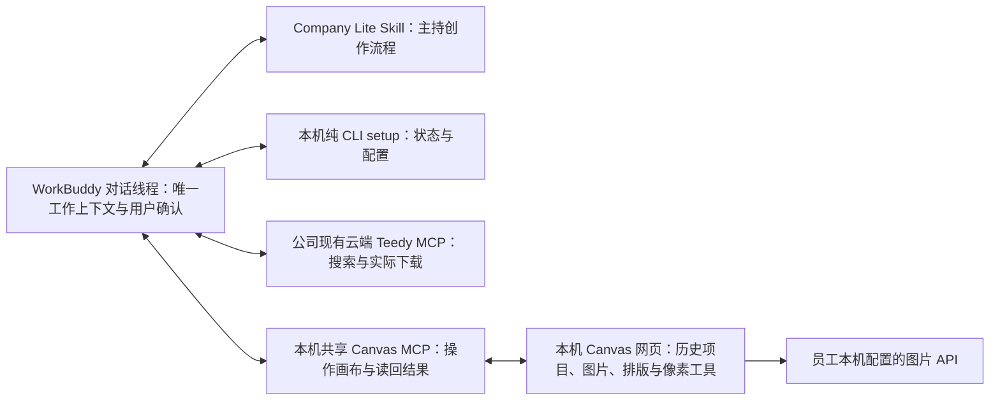

# Creative Agent Studio Company Lite PRD

更新：2026-10-29。本文定义 `codex/company-lite` 当前产品边界。旧版 P0—P5 文档只作为对应版本的历史证据，不代表当前 WorkBuddy 设备验收。

## 1. 产品定义

Company Lite 是运行在员工本机的 WorkBuddy 创作能力包。WorkBuddy 对话线程是每项工作的唯一上下文边界，负责需求、文案、制作单、用户确认、实际读图和最终批准。Company Lite 提供安装状态 CLI、本机共享 Canvas/MCP 绘图服务和导出能力，不另建任务/审批账本。

本机 Canvas 是跨 WorkBuddy 线程共享的持续工作空间，保留历史项目、生成图片、排版编辑状态和绘图连接。员工可以查找并继续旧作品；Canvas 项目和工具本身不代表某个 WorkBuddy 线程的需求或审批。

## 2. 产品结构

WorkBuddy 是唯一对话、推理和代理调度宿主。Canvas 负责绘图、生成和像素操作，不建立独立聊天，不运行第二个 Agent。Teedy 继续使用公司现有只读云端 MCP；不修改其内容、标签或 ACL。

## 3. 工作边界

- 一个 WorkBuddy 对话线程承载一项创作工作。文案、素材用途、制作单版本、确认、审核和批准均由该线程与 Skill 处理。
- Canvas 是通用本机工具，跨线程共用图片 API 配置、绘图连接和项目历史。不存在强制 task ID 绑定的 Canvas、任务 ledger 或独立确认 API。
- 新工作可按用户意图新建 Canvas 项目，也可在用户指定时继续某个历史项目。不能自动继承旧作品的文案、参考来源、批准或对另一线程的判断。
- 同一 Canvas 服务与历史可跨线程访问；WorkBuddy 当前线程仍是唯一工作边界。任何项目的既有状态都不能代替当前线程的用户授权。
- Company Lite 不包含独立 Web 聊天、设置网页、DSH、基础对话 API、全局素材库、全局 DNA 或多宿主兼容层。

## 4. WorkBuddy 安装与配置

员工包提供 `Studio.command`／`Studio.cmd` 与 `Start.command`／`Start.cmd` 包装入口，使用包内 Node 和生产依赖；`Start status` 只返回 setup 状态，不打开浏览器。预构建 Canvas 是唯一浏览器界面。员工不安装 Git、npm、Python、Office 或编译器。员工包与设备体验仍待验证。

WorkBuddy 主界面负责安装、配置和创作。员工包使用 `Start status`，源码开发可运行 `node scripts/setup.mjs status`。Agent 只在安装、配置或故障修复时简洁展示五项真实状态；日常创作不重复展示安装清单：

1. 能力包就绪。
2. Canvas 组件就绪，且 WorkBuddy 实际调用共享 Canvas MCP 的 `canvas_status` 成功。
3. WorkBuddy 使用现有只读 Teedy MCP 完成实际探测并记录工具名；该状态来自宿主报告，不是安装包独立验证。
4. 共用图片 API 地址、模型和密钥已配置，并通过非生图连接检查。
5. 整体就绪状态和当前待处理操作。

Agent 自动推进已有可运行的检查；只在需要本人登录、通过 WorkBuddy UI 添加 Canvas MCP、员工复制图片 API Key 或宿主审批时等待，不要求逐步确认。Canvas MCP 未配置时，`Studio mcp-config` 输出无密钥的 stdio 配置，员工通过 WorkBuddy 官方 MCP 页面添加，再由 Agent 实际调用 `canvas_status`。实际调用自动写入不含密钥的状态记录。Teedy 探测后由 Agent 用 `Start report-workbuddy connected <工具名>` 或 `failed [工具名]` 记录。

图片 API Key 优先走本机剪贴板输入：员工在服务页面复制 Key 并于 WorkBuddy 明确说“已复制”后，Agent 运行 `Start configure-image @image-config.json --key-from-clipboard`。该参数文件只含 `expectedRevision`、`image.baseUrl` 和 `image.model`；命令读取一次剪贴板并保存 Key，不回显。Windows 剪贴板实现仍待设备验证。管理员已有私有配置可使用 `configure-image @私有JSON文件`。不得让员工把 Key 粘贴到对话、命令参数、仓库或日志。随后运行 `Start check-image`；这只做 API 连通检查，不发出生成请求。配置在本机共享 Canvas 中跨线程复用。

## 5. 创作流程

1. 在当前 WorkBuddy 线程收集目标、受众、文案边界、尺寸、品牌要求和输出规格。关键缺口由 WorkBuddy 直接向用户询问。
2. 通过公司现有 Teedy MCP 搜索材料，展示候选并由用户选择。作为参考使用的远端材料必须实际下载；搜索摘要或 URL 不能冒充本地原件。把来源、用途和事实边界保留在当前 WorkBuddy 线程。
3. WorkBuddy 在当前线程整理文案和制作单，让用户确认准确的当前版本。修改后需要再次确认；不写入独立的任务管理或审批系统。
4. 用户确认制作单并明确授权后，调用 `canvas_open` 按用户意图选择 `recent`、`new`、`choose` 或一个既有 Canvas 项目。Teedy 原件必须实际下载后，才调用 `canvas_import_file` 导入。
5. 图片生成调用 `canvas_run_generation` 并快速返回 `{submitted, nodeId}`；生成在 Canvas 继续异步运行，WorkBuddy 随后用 `generation_get_status` 查询状态。状态未知时先查状态，不重复提交收费请求。调用 `canvas_read_image` 读取并核对实际图片内容；局部修改后重新读图。用户实际查看并明确批准后，才调用 `canvas_save_image` 导出。

每项收费出图、失败重试和最终导出都需要用户在当前 WorkBuddy 线程中直接表达对应授权。Canvas 状态或生成结果未知时先读取现有状态，不盲目重提收费请求。一次本地 Canvas MCP 真实图片生成已成功：上游 API 返回 HTTP 200，单次请求耗时 20.198 秒，本地完整保存耗时 25.892 秒，准备画布耗时 1.051 秒；主代理已实际打开检查验收图，图像内容正确且没有生成文字。该单次样本不构成约 20 秒普遍时延承诺，也不证明 WorkBuddy 员工设备流程已验收。

## 6. Canvas 能力与数据

Canvas 保留历史项目、生成图片和排版编辑状态，并支持查找、打开和继续旧作品。既有本地工具包括导入图片、拼贴、横纵拼接、组合、裁切、分割、像素重采样、移动和缩放；这些能力已有实现，不作为本轮新发明功能。

Canvas 网页与 MCP 使用同一个本机工作空间和图片 API 配置。画布中的项目历史可以跨 WorkBuddy 线程访问；需求、制作单、人工确认、读图审核和批准留在对应 WorkBuddy 线程。CompanyLite 本机数据目录承载 Canvas 历史、共享配置和运行状态，不迁移旧版任务或历史 Canvas 数据。

Canvas 通过本机服务直接使用已配置的图片 API。已有一次上游耗时约 20 秒的样本，但不足以承诺其他请求时延。生成故障、MCP 断连或状态未知时，不切换到其他部署 Canvas 或 WorkBuddy 自带生图，也不盲目重提付费请求。

## 7. 验收边界

当前 setup/Studio CLI 接口已在源码实现；WorkBuddy 真实 MCP 配置、员工账号、Teedy 公司权限、Windows 剪贴板、员工包及目标设备上的 Canvas MCP 持续连接仍待验证。单次本地 Canvas MCP 图片生成已通过，不代表其他模型、规格或员工设备都已验证。

模拟 API、源码检查、构建成功、Canvas 项目存在或服务连接成功，都不能证明真实图片生成、人工读图或完整 WorkBuddy 流程已通过。已成功生成的旧项目不能证明当前线程的文案、来源或批准有效。

## 8. WorkBuddy 项目与 Skill 入口

WorkBuddy 本地任务中先选择 Company Lite 根目录，再显式读取 README、AGENTS、代理宿主使用说明和创作 Skill。官方[本地任务说明](https://intl.cloud.tencent.com/zh/document/product/1316/84504)将工作目录与已安装 Skill 分列；官方[技能说明](https://intl.cloud.tencent.com/zh/document/product/1316/84503)支持从 Skills 页面导入本地 Skill，但没有公开项目 Skill 目录的精确路径。

本分支不假设 WorkBuddy 自动发现 `.agents/skills`，也不复制到未证实的 `.workbuddy/skills` 或 `.codebuddy/skills`。无论是否从 Skills 页面导入，所有 CLI 命令均从当前 WorkBuddy 本地任务明确选择的 Company Lite 根目录运行。实际宿主读取与执行行为仍待目标设备验证。
