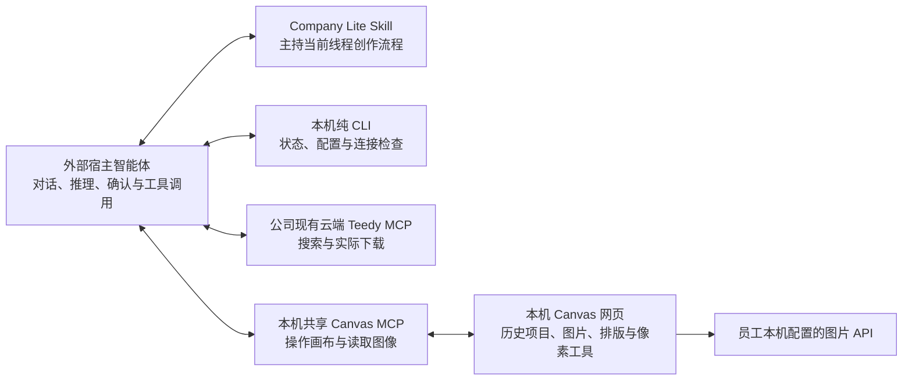

# Creative Agent Studio Company Lite PRD

更新：2026-10-29。本文定义 `codex/company-lite` 当前产品边界。旧版 P0—P5 文档只作为对应版本的历史证据，不代表当前宿主或员工设备验收。

## 1. 产品定义

Company Lite 是给外部宿主智能体使用的本地创作能力包。宿主当前对话线程是每项工作的唯一上下文边界，负责需求、文案、制作单、用户确认、实际读图和最终批准。Company Lite 提供安装状态 CLI、本机共享 Canvas/MCP 绘图服务和导出能力，不另建任务或审批账本。

本机 Canvas 是跨宿主对话线程共享的持续工作空间，保留历史项目、生成图片、排版编辑状态和绘图连接。员工可以查找并继续旧作品；Canvas 项目和工具本身不代表任何对话线程的需求或审批。

## 2. 产品结构

宿主智能体负责对话、推理和用户确认。Canvas 负责绘图、生成和像素操作；本包不内置或启动任何代理推理平台，也不运行第二个 Agent。符合能力要求的外部宿主可运行本包。Teedy 继续使用公司现有云端只读 MCP；不修改其内容、标签或 ACL。

## 3. 工作边界与宿主要求

- 一条宿主对话线程承载一项创作工作。文案、素材用途、制作单版本、确认、审核和批准均由该线程与 Skill 处理。
- Canvas 是通用本机工具，跨线程共用图片 API 配置、绘图连接和项目历史。没有强制 task ID 绑定的 Canvas、任务 ledger 或独立确认 API。
- 新工作可按当前用户意图新建 Canvas 项目，也可继续指定历史项目；不得自动继承旧作品文案、参考来源、批准或其他线程的判断。
- Company Lite 不包含独立 Web 聊天、设置网页、任务／审批系统、全局素材库或全局 DNA。宿主外部运行，本包不绑定某一厂商的 Skill 发现机制或 MCP 配置格式。
- 能运行本流程的宿主必须能读取用户选定的 Company Lite 工作目录、运行其中的本地命令、连接本地 stdio MCP，并把 MCP 返回的图片内容交给智能体实际查看。还须在当前线程处理用户确认、凭据输入和必要审批。没有这些能力时应报告缺项，不得宣称兼容或降级冒充完成。

## 4. 源码准备、状态和配置

Company Lite 从 Git 仓库源码目录运行。执行任何 Node 脚本前，宿主先检查 Git、Node.js 22.19+（22.x）或 24+ 和 npm。缺少任一项时说明缺口，并按当前系统官方说明协助用户安装；不改系统策略、权限或 PATH。无需 Python、Office 或系统编译器。

确认 Git、Node.js 和 npm 可用后，在仓库根运行 `node scripts/prepare.mjs`，自动安装锁文件锁定的依赖并构建 Canvas；`npm run prepare:dev` 是等价开发别名。随后可用 `node scripts/setup.mjs status` 读取当前五项进度：

1. 克隆源码、Git／Node.js／npm 和运行依赖是否就绪。
2. Canvas 组件构建状态和当前宿主实际调用 `canvas_status` 后的连接结果。
3. 本人公司 Teedy 账号、服务提供的 MCP URL／登录地址和只读工具实际调用报告。
4. 图片 API 地址、模型、Key 及非生图连接检查。
5. 当前总体就绪状态和下一步。

仅在首次安装、配置或故障修复时简洁展示这五项；日常创作不重复清单。宿主自动检查依赖并运行 `node scripts/prepare.mjs`，自动完成已有可执行步骤，只在本人登录、复制 Key 或必要宿主审批时等待，不逐项确认。缺少服务地址或登录信息时，setup 状态会标出缺口，宿主再向管理员索取。

使用 Teedy 时，宿主依据 setup 状态中的实际 MCP URL／登录地址及公司、服务方说明，在当前宿主支持的安全配置入口设置本人账号、只读权限和服务要求的 Key。不能猜测传输方式、字段或权限，也不将凭据粘贴到普通对话、仓库或日志。连接完成后由当前宿主实际调用只读工具，再从源码根运行 `node scripts/setup.mjs report-host connected <工具名>`；失败时用 `failed [工具名]`。该记录是宿主报告，不是 CLI 独立连接验证。新宿主或首次进入新会话时，重新确认并调用当前 Canvas MCP 的 `canvas_status`；旧报告只代表上次实际调用，不表示新宿主已接通。

若 Canvas MCP 尚未添加，从源码根运行 `node scripts/studio.mjs mcp-config`。根据输出中的 `command`／`args` 按当前宿主实际支持的 stdio 配置入口和格式操作。外层 `mcpServers` JSON 只是交换示例，不是通用客户端配置文件。本机 MCP SDK stdio 已通过测试，不代表所有宿主客户端均已验证。配置后调用 `canvas_status`。

图片 API 地址、模型、Key 和 `expectedRevision` 由宿主读取当前 `setup status` 后生成参数载荷；员工不需创建或理解 JSON。员工复制 Key 并在当前对话明确说“已复制”后，宿主才运行 `node scripts/setup.mjs configure-image @JSON文件 --key-from-clipboard`。命令仅读取一次本机剪贴板，把 Key 写入本机私有配置，不回显、不写日志。若当前系统没有可用剪贴板入口，宿主可在仓库外生成仅当前用户可访问的私有 JSON 模板，员工在本机编辑器中填写 Key 后由 CLI 导入，并在成功后删除临时文件；文件内容不可进入对话、普通参数或日志。随后运行 `node scripts/setup.mjs check-image`；它只检查 API 连接，不发出生成请求。图片 API 配置在共享 Canvas 中跨线程复用。

日常从源码根按需运行 `node scripts/setup.mjs status`、`report-host`、`configure-image`、`check-image`；Canvas 服务通过 `node scripts/studio.mjs status`、`open @JSON`、`mcp-config` 或宿主的 Canvas MCP 使用。Studio CLI 管理共享 Canvas 服务，不创建任务记录。

## 5. 创作流程

1. 在当前宿主对话线程收集目标、受众、文案边界、尺寸、品牌要求和输出规格。关键缺口由智能体直接向用户询问。
2. 通过公司现有 Teedy MCP 搜索材料，展示候选并由用户选择。作为参考使用的远端材料必须实际下载；搜索摘要或 URL 不能冒充本地原件。把来源、用途和事实边界保留在当前对话线程。
3. 智能体在当前线程整理文案和制作单，让用户确认准确的当前版本。修改后需要再次确认；不写入独立的任务管理或审批系统。
4. 用户确认制作单并明确授权后，调用 `canvas_open` 按用户意图选择 `recent`、`new`、`choose` 或一个既有 Canvas 项目。Teedy 原件必须实际下载后，才调用 `canvas_import_file` 导入。
5. 图片生成调用 `canvas_run_generation` 并快速返回 `{submitted, nodeId}`；生成在 Canvas 继续异步运行，宿主随后用 `generation_get_status` 查询状态。状态未知时先查状态，不重复提交收费请求。
6. 调用 `canvas_read_image` 读取实际图片内容并检查；宿主必须具备实际查看图片的能力，不能将文本说明、生成状态或缩略图冒充读图。局部修改后重新读图。用户实际查看并明确批准后，才调用 `canvas_save_image` 导出。

收费出图和最终导出需要当前宿主对话线程中相应的用户授权。请求明确失败且仍在原授权和费用范围内时，可按原授权继续处理；超出范围或授权不明时先询问。状态未知时先读取现有状态，不盲目重提收费请求。

## 6. Canvas 能力与数据

Canvas 保留历史项目、生成图片和排版编辑状态，并支持查找、打开和继续旧作品。既有本地工具包括导入图片、拼贴、横纵拼接、组合、裁切、分割、像素重采样、移动和缩放；这些能力已有实现，不作为本轮新发明功能。

Canvas 网页与 MCP 使用同一本机工作空间和图片 API 配置。画布中的项目历史可以跨宿主线程访问；需求、制作单、人工确认、读图审核和批准留在对应宿主对话线程。CompanyLite 本机数据目录承载 Canvas 历史、共享配置和运行状态，不迁移旧版任务或历史 Canvas 数据。

一次本地 Canvas MCP 真实图片生成已成功：上游 API HTTP 200，单次请求耗时 20.198 秒，本地完整保存耗时 25.892 秒，准备画布耗时 1.051 秒；主代理已实际打开检查验收图，图像正确且没有生成文字。该单次样本不构成约 20 秒普遍时延承诺，也不证明所有宿主或员工设备流程已验收。

## 7. 验收边界

源码根回归 38/38、Canvas bridge 23/23 通过，0 失败、0 跳过；Canvas web typecheck/build 通过（Vite 有既有导入与大 chunk 警告）。Mac 本机全新浅克隆初始没有 `node_modules` 和构建产物；`node scripts/prepare.mjs` 完成三组依赖安装及 Canvas Agent/Web 构建，退出码为 0。克隆目录中的共享 Canvas 集成 1/1 通过（4.6 秒），覆盖多项目、裁切拼接、历史重启恢复与 MCP stdio 图片读写，未发起生图。

隔离临时配置下的图片服务 `GET /v1/models` 实测 HTTP 200 并返回配置模型；未生图，源配置未改，临时 Key 目录已删除。另有一次真实 Canvas MCP 图片生成样本：上游 API HTTP 200、耗时 20.198 秒，本机完整保存 25.892 秒、准备画布 1.051 秒；主代理已实际打开检查验收图。单次结果不保证普遍时延或所有宿主均通过。Windows/Linux 源码 CI 已定义但未运行，未形成跨系统验收结论。

源码准备与宿主实际工具仍需分开验收：根目录测试、Canvas web 构建和本机真实 MCP 请求不能证明任意宿主的本地命令、MCP 图像读取、Teedy 员工账号与只读权限已通过。

模拟 API、源码检查、构建成功、Canvas 项目存在、服务连接成功或单次生成都不能证明每个宿主的完整创作流程已通过。

## 8. 工作目录与 Skill 入口

宿主中打开克隆后的 Company Lite 仓库根目录，并要求智能体从该目录读取 README、AGENTS、宿主使用说明和 Skill。本仓库不假设 `.agents/skills` 会被自动发现；首次提示明确从打开的源码目录读取。所有命令都从当前仓库根目录运行，不从 Skill 文件位置反推项目根目录。MCP JSON 也需按当前宿主实际支持的格式配置。
