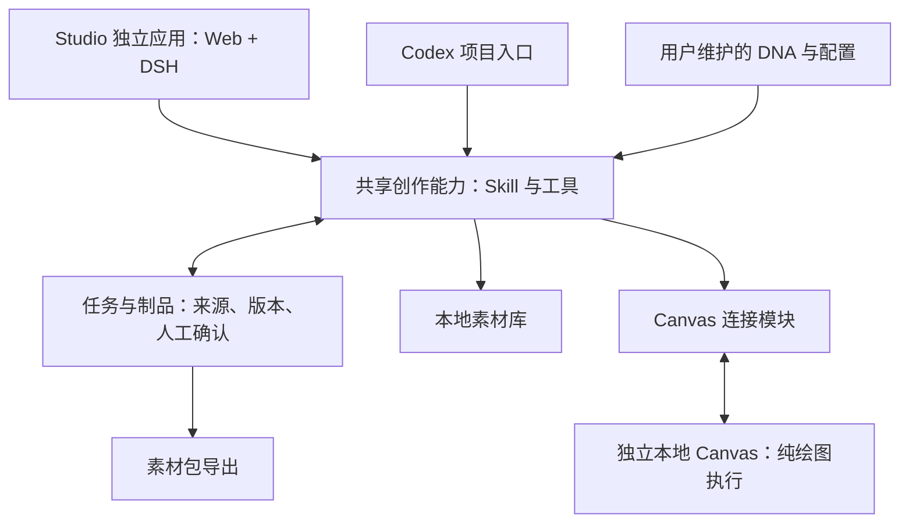

# Creative Agent Studio PRD（产品需求文档）

## 公司版分支（2026-10-16 授权施工）

公司版分支为 `codex/company-edition`，从干净公开历史建立。员工在本机运行新版工作台，连接既有远端 Teedy 和 Canvas；不建设集中多用户工作台。下文 P0—P4 的本地 Canvas 描述是通用版已验收范围，公司版差异以本节及 [公司版接入](docs/公司版接入.md) 为准。

- 保留 Web／DSH 与 Codex 双入口、共享任务、制作单、审核、恢复及导出；公司版使用独立数据目录及默认端口 4311。
- 公司 Teedy 继续为素材权威库，使用员工个人账号；检索端只读，不迁移整库、不重写标签和 ACL、不覆盖既有全局 MCP。候选待人工选择，保留后下载本次原件并保存来源、顺序及哈希。
- 本机素材与公司素材在界面及工具中明确区分。无权限或未配置公司库时如实提示，不自动用本机结果代替。
- 用户补充指定公司 Canvas 按新版协议实现，旧远端由用户更新，不做旧协议适配。公司 Canvas 仅通过明确目标的工具连接使用更新后的远端网页，不启动旧 Agent 或改写远端模型配置。旧桥接协议与新版任务合同不等价，诊断缺失能力时不得绕过目标检查或谎报接通。
- 公司配置、凭据、任务及成品不提交源码；服务器部署变更和员工实机验收分别记录，隔离测试不代表现网通过。


**2026-10-16 P4 最终独立复验通过：跨平台本地 Web 源码交付、macOS 隔离运行和 Windows Actions 按授权范围通过。** 两项首轮必修已关闭，229/229 测试、真实浏览器及用户数据完整性核对通过；普通设备双击体验与既有上游限制单独记录。最新结论见 [P4最终独立复验](docs/P4最终独立复验.md)。

P3 于 2026-10-16 按已授权源码及本机集成范围独立复验通过。主审重跑 206 项测试、审核恢复与归档案例，隔离点验 Web 操作并核对在线构建；完整范围、证据及限制见 [P3最终独立复验](docs/P3最终独立复验.md)。历史远端 AI 改图效果与 WorkBuddy 实际能力不作为已通过项。用户已于 2026-10-16 授权启动 P4；P4 已按跨平台本地 Web 交付范围独立复验通过，两项首轮必修已关闭。交付目标为 GitHub 仓库内的跨平台本地 Web 产品，不要求 macOS 原生 App、DMG 或 PKG。


更新：2026-10-16。产品范围以本文为准；施工顺序与验收见 [开发与施工计划](开发与施工计划.md)。

## 2026-10-15 用户试用交互要求

首次完整创作保留制作单确认；已有成品的局部修改走对话执行。用户明确指定修改意见与页面即可授权本次修改，不重走完整需求、素材或制作单确认。只修改指定页面，传实际原图及必要的风格参考图，保留其他页和历史版本；仅撤销受影响页复审与整套最终批准。支持失败保留旧图和单页恢复。上传已有图片进行轻量修改也使用该能力，不伪造完整创作确认。实现合同见 [对话局部改图](docs/P3对话局部改图.md)。

对话应按用户意图选工具：裁切、行列分割、像素重采样、节点移动与显示缩放，以及本轮补齐的附件导入、横纵拼接、多层贴图与区域覆盖，不一律 AI 重绘。模型可读取画布图片真实预览，并调用通用区域检测取得文字、二维码和矩形的像素框用于定位与复核；区域不明确时只追问目标位置。拼合与替换图片元素使用原始图片字节。像素结果保留原图，以可预览、下载的任务附件回传；节点布局变化不冒充图片像素合成，也不自动覆盖制作单或最终批准。全功能核对与接入取舍见 [Canvas 工具接入清单](docs/P3Canvas工具接入清单.md)。

制作单每页展示实际要发送的参考图／Logo，可从本任务已保留的图片中选择。图片引用和来源索引一同保存到制作单版本；完整制作单改选后重新确认，对话局部改图采用上述受限修改授权；执行时传真实图片字节，不把纯文字描述当作已经传图。Logo 只使用用户提供且确认保留的文件。

图片服务配置保存后同步到已打开的任务 Canvas；下一次生成前读取当前配置。Canvas 经本机同源图片转发访问已配置服务，避免供应商跨域限制导致浏览器秒失败。失败页提供明确重试入口；未知或仍在运行的请求只查询，不自动重复付费。

素材选择后提供“确认素材并继续”：用户确认本轮需求、保留清单及排除其余未选项后，自动发起制作单整理，不要求回到聊天手动输入继续；已确认时提供继续／重试入口。制作单出现后自动展示，仍需人工审核确认才可绘图。

新建创作直接使用聊天描述与可选参考图，不强制填写名称、单张／多页类型或页数。标题由首条需求生成，任务创建时不预设 format/pageCount；Agent 结合文字与参考图整理形式、张数，信息不足用点选追问。共享制作单支持 1—5 张，包括两张海报；不凭上传动作自动确认来源或事实。角色外观允许使用已核对来源的立绘与状态素材，不局限头像。

Web 对话的需求追问优先提供点选选项，保留自由补充。消息发送后立即显示；任务运行时可编辑下一条本地草稿及附件，只禁止提交，完成和轮询不清空新草稿；对话与工作对象分别滚动，支持收起侧栏。图片和 PDF 可直接拖入输入区，在同条消息说明用途，不要求另填附件用途与事实边界表单。素材库支持父文件夹按子目录分篇批量导入和提取。人工确认通过明确动作按钮记录，不要求填写确认人或说明，也不再弹同义确认；存在未选参考将被排除等额外副作用时仅说明一次，收费重试仍提示新请求。Agent 不代替用户作最终确认。检索结果必须进入可见的待选参考区，供人工保留或排除。实现与验证见 [P3 交互修复](docs/P3交互修复.md)。

## 1. 项目定位

### 产品名称（暂定）

Creative Agent Studio；Web 助手展示名：大肥鱼绘图助手。

### 一句话定位

> 告诉我你的想法，我帮你把它变成现实。

### 核心理念

本项目不是一个传统自动化工具，也不是一个固定流程 SaaS。

它是一个面向内容生产人员的垂直 Agent 产品：

> 将高级用户使用 AI Agent  
> 的工作方式，封装成普通运营人员也能使用的创作入口。

核心价值不是替代业务人员，而是降低 AI 使用门槛：

- 用户需要懂自己的业务；
- 用户不需要懂 Prompt Engineering；
- 用户不需要懂 MCP、Workflow、Agent 配置；
- Agent 负责理解需求、补足信息、调用工具、执行生产。

---

# 2. 产品背景

当前已有版本：

- 由宿主 Codex 入口承接高级用户创作；基础模型来源可选 WorkBuddy；
- 通过 Agent Skill + MCP + Canvas Agent 完成内容生产；
- 已有工作方式覆盖以下链路；历史代码与验收记录证明其中的阶段性能力，完整新产品仍需独立验收：

需求输入 → 需求澄清 → 素材检索 → 人工筛选 → 制作单 → 画布执行 → 成品检查  
→ 输出素材包。

当前问题：

1. 依赖工程环境配置；
2. 非技术用户无法部署；
3. 产品形态不像独立应用；
4. Agent能力存在，但入口不够友好；
5. 需要包装成可展示、可传播、可安装的产品。

---

# 3. 产品目标

## 主要目标

打造一个：

"打开即可使用的 AI 创作工作台"。

本次交付目标是相对完整的首版产品，不再交付一套轻量 MVP。现有 RAG-Yuki 与图文工作台作为原型基础；本次补齐完整界面、双入口、本地素材管理、本地 Canvas、安装配置、成品回收、故障恢复与素材包交付。开发可以分阶段推进，内部技术验证和局部可用版本不作为最终交付。

首版同时支持单张海报与多页图文。P4 交付为 GitHub 仓库内的本地 Web 产品：macOS 使用 `.command`、Windows 使用 `.cmd` 两个薄入口，共享同一启动逻辑；不以原生 App、DMG 或 PKG 为交付前提。Windows 支持范围由真实 Windows runner CI 和后续用户试用分别记录，CI 不能替代普通用户双击体验验证。

目标用户：

- 新媒体运营；
- 小红书运营；
- 内容创作者；
- 需要制作营销物料的个人用户。

---

## 非目标

初期不做：

- 企业权限系统；
- 投放数据闭环；
- 自动发布平台；
- 通用 Agent 平台；
- 行业专家知识库。

---

# 4. 核心产品哲学

## 4.1 Agent 优先，而非 Workflow 优先

产品不是要求用户填写复杂表单。

用户可以：

"我想做一个 KET 考试科普。"

Agent 负责：

- 判断信息是否足够；
- 主动追问；
- 补足上下文；
- 形成制作方案。

---

## 4.2 不强行注入业务经验

避免：

"AI告诉用户什么是好的淘宝图。"

因为用户本身拥有业务经验。

产品应该：

帮助用户表达、整理和执行自己的想法。

---

## 4.3 人机协作

关键节点保留人工微调并确认：

- 需求确认；
- 素材选择；
- 制作单确认；
- 最终成品审核。

Agent负责执行，人负责判断。

---

# 5. 核心使用流程

## Step 1：提出想法

用户自然语言输入：

例如：

"帮我做一个英国留学招生海报。"

---

## Step 2：Agent需求澄清

Agent判断信息是否足够。

必要时询问：

- 面向谁；
- 内容目标；
- 风格方向；
- 业务背景。

---

## Step 3：素材检索

从素材库寻找：

- 历史案例；
- 参考图片；
- 内容资料。

结果展示给用户。

用户：

- 保留；
- 排除；
- 补充外部参考。

---

## Step 4：生成制作单

Agent根据：

- 用户需求；
- 参考素材；
- 用户反馈；

生成可执行制作方案。

---

## Step 5：执行生产

调用：

- Canvas Agent；
- 图片生成能力；
- 文件能力。

完成：

- 排版；
- 生图；
- 页面生成。

---

## Step 6：质量检查

Agent读取成品：

检查：

- 错字；
- 多余元素；
- 文案一致性。

必要时重新生成。

---

# 6. 产品架构方向

产品采用两个入口，共用创作能力：



- 独立应用由 DeepSeek Harness 运行 Agent；Codex 模式由 Codex 运行 Agent，不启动 DSH。
- 共享创作、任务、素材、Canvas 与导出代码不依赖某一个 Harness 的推理循环。
- 产品启动时带起独立本地 Canvas。Canvas 接受指令、执行绘图并返回状态和成品，不启动或召唤任何 Agent。
- 不采用 Canvas 网页右侧召唤 Codex 的聊天功能；裁剪范围包含对应服务启动路径，不能只隐藏按钮。
- 指挥权单向，状态和成品传输仍保留双向。
- 用户可以在 Canvas 人工编辑、选图，当前 Agent 对实际成品进行审核。
- 任务文件与制品可跨入口接续；聊天历史不承诺自动互通；同一任务同时由一个入口推进。
- 新项目在当前目录开发；原 RAG-Yuki、旧 Canvas 和现有服务保持原状。

---

# 7. Web UI设计原则

## 核心原则

不是传统后台。

不是任务管理系统。

而是：

Agent Workspace。

---

## 页面组成

### 1. Chat区域

用户与Agent交流。

---

### 2. Agent过程展示

展示：

- 正在理解需求；
- 正在搜索素材；
- 找到参考；
- 等待确认；
- 正在生成；
- 正在检查。

注意：

展示 Agent Trace。

不要展示模型内部 Chain of Thought。

---

### 3. 配置区域

包含：

- API Key；
- API URL；
- 模型配置；
- 本地服务配置。

目标：

开箱即用。

模型 API 只有两类：基础 API 用于独立 Studio 的 DSH 对话、工具调用、读图以及 Web／CLI 素材清洗；生图 API 由 Canvas 用于图片生成。基础 API 可选 OpenCode、Kilo、WorkBuddy 国内版（buddy）、WorkBuddy 国际版（workbuddy）或用户自定义 API；生图 API 使用用户自定义服务。Codex 推理继续由宿主 Codex 会话完成，不经过 Studio 基础 API。来源插件的上游固定版本、许可与裁剪边界见 [模型来源与裁剪](docs/模型来源与裁剪.md)。

---

### 4. Workspace

展示：

- 任务列表、当前任务和恢复；
- 素材导入、处理状态、人工校正、检索、预览、更新和删除；
- 参考素材选择；
- 制作单编辑与版本确认；
- 成品预览、选取、实际读图审核、复审和导出；
- 首次使用、空状态、等待、错误、取消和重试的完整界面。

---

# 8. 素材库设计

## 初版

不采用企业级 Teedy。

采用：

本地轻量素材库。

结构：

```
Asset Library

raw/
processed/
metadata/
index
```

流程：

用户拖入素材：

↓

用户点击 AI 清洗：

↓

生成自由标签：

↓

人工微调并确认：

↓

入库。

---

2026-10-14 已确认：所有素材放同一总库，按自由标签检索；保留单篇图文的图片顺序与正文，支持基础标签管理和 Agent 查询工具。不沿用旧业务标签表。模型 API 只有基础与生图两类：基础 API 负责独立 Studio 的 DSH 对话、工具调用、读图，以及 Web／CLI 素材清洗；生图 API 负责 Canvas 图片生成。Codex 推理继续使用宿主会话。2026-10-15 确认基础 API 的来源选项包括 OpenCode、Kilo、WorkBuddy 国内版、WorkBuddy 国际版与自定义 API；OpenCode/Kilo 无需用户手贴来源密钥，WorkBuddy 使用用户本人账号登录。原有自用 API 保留。来源适配器使用本机 `127.0.0.1` 动态端口及本机随机 token；平台额度由平台决定，不作额度保证。具体上游和裁剪见 [模型来源与裁剪](docs/模型来源与裁剪.md)。

## 企业模式

未来支持：

外部素材库 / Teedy / MCP连接。

但不是默认。

---

# 9. DNA设计

暂不采用自动 Memory。

原因：

错误记忆会造成严重用户体验问题。

采用：

用户主动维护 DNA：本期为默认关闭的全局提示词，内容默认空白，提供可选填写模板；用户显式保存并启用。

例如：

- 品牌风格；
- 常用要求；
- 禁用元素；
- 设计偏好。

DNA不是AI偷偷学习。

而是用户明确配置。

---

# 10. Codex兼容设计

产品不替代 Codex。

两个入口：

## 普通用户

Web UI。

特点：

低门槛。

---

## 高级用户

Codex。

用户在 Codex 中打开同一个仓库，通过项目 `AGENTS.md`、`.agents/skills/` 和共享 CLI／工具完成创作。首次依赖与 Canvas 准备完成后，无须启动 DSH；Codex 推理仍由当前宿主会话承担。WorkBuddy 是基础 API 的可选模型来源，使用国内或国际服务都需用户本人登录；这不表示 WorkBuddy 是 Studio 的创作 Agent 运行环境。

特点：

自由度更高。

可以：

- 修改 Skill；
- 调整 Agent；
- 二次开发。

---

# 11. 完整首版范围

## 必须完成

- 独立 Web UI；
- Agent聊天；
- Agent过程展示；
- 基础 API 与生图 API 配置；
- 本地素材库；
- Canvas连接；
- 输出素材包；
- 单张海报与多页图文的完整制作与修改；
- 独立本地 Canvas 自动启动、连接与结果回收；
- Codex 无 DSH 运行依赖的创作入口；
- 人工确认与制作单版本绑定；
- DNA 显式编辑与保存；
- 任务恢复、停止、错误处理与重试；
- GitHub 仓库内的跨平台本地 Web 交付：macOS `.command` 与 Windows `.cmd` 薄入口共享启动逻辑，负责首次依赖准备、构建、Canvas 与模型插件服务启动／停止、重复启动处理、首次配置、备份和更新；不要求原生 App、DMG 或 PKG；
- Windows GitHub Actions 真 Windows runner 的安装、构建、启动、浏览器与图片样例回归；CI 结果与普通用户双击体验、Windows 实机试用分别记录，不把 CI 描述为实机体验；设备暂不可用不阻断其他 P4 施工；
- 跨平台文字、条码（含二维码）与矩形区域检测，用于定位及局部替换。只替换依赖 macOS Swift／Vision 的检测部分；现有浏览器裁切、分割、拼贴等跨平台像素工具保留。候选库先以代表性图片样例和负例验证定位精度后再选型，不预先锁定库。二维码验收分别核对定位框、替换时未受影响原像素保留和新码可读；不承诺复杂背景的无痕还原。
- WorkBuddy 可辅助部署与故障诊断；普通用户不需要自行修改源码。

---

## 暂缓

- 自动Memory；
- 插件市场；
- 数据分析；
- 企业权限；
- 自动发布；
- ROI闭环。

---

# 12. 开源/作品定位

项目不是展示：

"AI生成图片"。

而是展示：

> 如何把一个高级用户的 Agent 工作方式，包装成普通用户可以使用的产品。

核心展示：

一次完整任务：

需求 → 追问 → 素材 → 制作单 → 画布执行 → 检查 → 成品。

---

# 13. 后续与 Codex 讨论重点

已执行 P0 框架与工具边界验证，形成独立 Canvas 副本、共享 CLI、固定依赖和真实生图证据。结果及未通过项见 [技术验证](docs/技术验证.md)。这不是完整首版交付，P0 已独立验收；P1 返工后已独立复验通过，按阶段范围验收通过；P2 已按批准范围独立复验通过，原发现及最新结论见 [P2独立验收](docs/P2独立验收.md)。P3 于 2026-10-16 按已授权源码及本机集成范围独立复验通过；此前审查发现和返工历史保留，最终结论及边界见 [P3最终独立复验](docs/P3最终独立复验.md)，实施记录见 [P3实施与验证](docs/P3实施与验证.md)。远端 AI 改图效果与 WorkBuddy 实际能力仍有历史验证限制，不冒充通过。P4 已获授权并进入施工，目标是 GitHub 仓库内的跨平台本地 Web 交付、启动维护入口、跨平台区域检测和 Windows CI；施工及跨平台本地 Web 交付范围独立复验已完成。实际进度见 [工程进度](docs/工程进度.md)，后续施工按 [开发与施工计划](开发与施工计划.md) 推进。P0 的核对范围为：

历史记录（2026-10-15）：模型来源插件与基础／生图 API 配置收敛已完成本机实施自验并重启运行；`npm test` 133/133 通过，浏览器检查及 153 个真实文件哈希核对见 [当时证据](docs/evidence/model-plugin/verification.json)。WorkBuddy 真实账号与实际能力仍待本人登录验证；当前 P3 结论见 [最终独立复验](docs/P3最终独立复验.md)。

1. DeepSeek Harness 项目结构；
2. 当前仓库代码结构；
3. Skill / Plugin / Prompt边界；
4. Agent Runtime改造方案；
5. Web UI施工方案；
6. 本地服务打包方案。

---

# 总结

Creative Agent Studio 的核心不是：

"自动做图"。

而是：

"让不会使用 Agent 的人，也拥有一个会协助完成内容生产的 AI 创作伙伴。"

产品价值：

降低 AI 使用门槛，而不是降低业务专业门槛。
