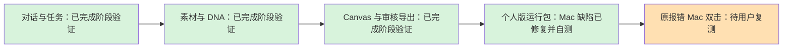

# Mac 运行包隔离启动修复（2026-10-17）

用户实际打开个人版 Mac 包时，启动器报 `AppTranslocation/.../d/.studio-runtime/node/.../bin/node: No such file or directory`。这是交付缺陷：旧 `.app` 只有 AppleScript 启动壳，Node 和程序在相邻目录；系统单独随机化应用路径后，相邻资源不存在。原生 runner 的直接 Node 启动及普通搬移检查没有覆盖这条 Launch Services 路径，不能据此前结果推断普通设备双击可用。

## 修复

- Mac 程序及 Node、Canvas、DSH 和依赖全部移入 `Creative Agent Studio.app/Contents/Resources/studio`。AppleScript 仅从自身 bundle 内定位程序，删除依赖 `.app` 父目录的旧路径；Windows 布局不变。
- 内部 runtime 保持原有相对路径与 manifest 语义，Python、模型、日志、任务和配置仍写入稳定用户数据目录。运行包启动明确传 `STUDIO_RELEASE_BUNDLE=1`，不在只读程序目录创建源码 prepare／servers 状态；源码启动的准备锁及实例保护仍保留。
- 设置稳定的 `CFBundleIdentifier=com.creativeagentstudio.personal`。生成内部 manifest 后，仅重新封装外层 app 的 ad-hoc 资源签名，保留第三方原生程序签名；这不是 Developer ID 签名或公证。
- 解压检查核对 manifest 每个文件的类型、大小和 SHA-256，并核对编译脚本的内部路径及 app 资源完整性。不清除 quarantine、不关闭 Gatekeeper、不从原安装位置绕过隔离执行。

## 已执行验证

- `806dce0` 完整回归 **304/304**，零失败、零跳过；随后 `52736f6` 仅补应用标识，相关真实编译／签名测试15/15通过。
- 定向测试包括 `.app` 单独搬入模拟 AppTranslocation 目录后仍完整、Windows 根路径不变、运行包不写只读源码状态、源码模式仍拒绝活动 prepare 锁。
- 以真实只读磁盘映像挂载完整 `.app`，写入探针实际返回 `EROFS`；从内部 Node 启动独立数据目录／临时端口的 Web，HTTP 入口、launcher 打开复用／状态／检查／停止通过，停止后 app strict 资源校验仍通过。本机该项复用已验证的隔离 Python，不冒充从零安装 Python。
- [原生构建 39012626457](https://github.com/akechi0819-lgtm/creative-Agent-studio/actions/runs/39012626457) 的 Mac job 成功，源码 `806dce0`，覆盖新布局解压后首次 Python/OCR、Office PDF、Web 启停与二次复用。后续应用标识更正由本机真实编译及封包校验覆盖。
- 本机最终包在此前已核验的 Mac payload 上应用上述生产源码，并调用与 CI 共用的组装 helper、manifest 与签名逻辑；同载荷 ZIP 实际解压后，资源校验及包内 Node `v22.23.3` 通过；最终按生产 `ditto --sequesterRsrc` 参数封包的 ZIP 通过 CRC，76,716 份 runtime 文件大小与 SHA 全匹配。

真实只读卷与模拟路径测试不等于已在本机触发系统随机 AppTranslocation。Finder 已启动 applet 进程，但本机自动化未能绑定其 AppleScript 对话框，未完成菜单按钮自动点验，也不把它写作普通设备双击验收。修正版仍需用户在原出现问题的 Mac 上复测。

本轮只改通用版发布与启动代码，使用独立夹具和已有锁定依赖，不修改公司版工作树、用户旧任务或全局安全设置，不调用付费模型。此前独立验收报告保持原文；本修复是用户实际发现的新交付缺陷返修，不冒充已获新的独立验收。

## 修正版交付

- 文件：`Creative-Agent-Studio-Personal-Mac-arm64-fixed.zip`，489,997,295 字节。
- SHA-256：`2732a01dad4d9eb7220358e2d3269b71c35479df47ba6edd438a8c5b7d992a4b`。
- 桌面个人版交付目录已替换 Mac 包并同步使用说明、校验文件；旧 Mac 包移至私有审计目录。Windows 包保持原有已验证内容。

