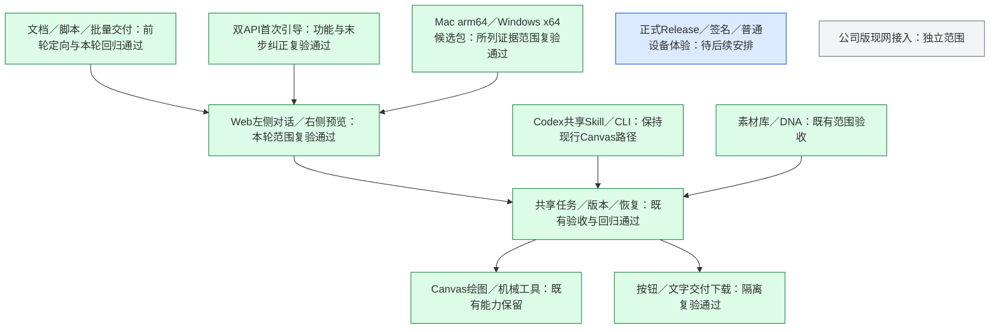

# P5 最终独立复验（2026-10-17）

**结论：按通用版源码、隔离桌面集成、Mac 成品包本机点验及双平台原生 CI 成品验证范围独立复验通过。首轮必修项已关闭。** 不包含公司版现网、普通用户设备双击体验、系统签名或任意上游模型效果。

源码：`8cd572e037dfcf8f9c3f872f6ce129930457ec2a`。交付文档提交：`125fac2598d5b8e821787c801043fa7ee05f676a`，与源码提交之间仅三份文档变更。[PR #1](https://github.com/akechi0819-lgtm/creative-Agent-studio/pull/1) 仍为草稿；本轮未合并、打 tag 或发布正式 Release。首轮 [独立验收](P5独立验收.md) 保留为历史，由本报告更新当前结论。

## 原问题逐项复核

| 原问题 | 本轮独立核验 | 结论 |
| --- | --- | --- |
| SDK sessions 程序目录被误当用户数据 | 复核分发规则及回归；查询同源码两个成功 job、未过期成品 artifact 和实际原生日志；下载最终 Mac ZIP 逐文件校核 | 已关闭 |
| 明确文字确认不能执行／交付 | 独立 Chromium 实际输入“就按当前这版方案开始制作吧”“确认交付并下载”，不调用普通 Agent 判断批准，实际执行并自动下载 | 已关闭返工案例 |
| 文字交付后仍要点按钮／刷新可能重下 | 独立浏览器确认文字交付后确认按钮消失、下载链接出现、刷新不重复下载；HTTP 定向检查同 requestId 复用同一 Job | 通过 |
| 通用版引导误导用户去 Canvas 再配模型 | 独立浏览器走到第五步，核对“本机图片 API 已配置；左侧确认方案即可执行绘图”，旧提示不出现 | 已关闭 |
| 脚本默认超时说明与执行不同 | schema 已统一为实际默认 30 秒，范围 1–30 秒 | 已关闭 |
| 以前启动重复安装 | 全量回归包含分组依赖复用、定向构建、失败续跑；两平台成品原生日志确认第二次启动复用 Python/OCR 状态 | 按所列范围通过 |

自然确认仍绑定当前展示 revision／sheetVersion；交付另核对完整页数、当前执行版本和每页图片 SHA。否定、疑问、含糊表达或追加修改不自动批准。宿主继续检查 Canvas 图片新鲜度及导出前后状态，不给模型批准工具。本轮未新增重复确认关卡。

## 主审实际执行

- 全量测试：`STUDIO_OCR_PYTHON=/tmp/codex-p5-general-workspace-test/venv/bin/python node --test tests/*.test.mjs`，**300/300，零失败、零跳过**。不在真实项目根目录安装或准备环境。
- 隔离 Chromium：独立重跑按钮和文字两条链路；两次执行、两次下载，页面错误为零；1440／1280 桌面、候选原图完整显示、用途与选择状态、预览收起展开、刷新恢复均通过。图片由本地夹具提供，未新增真实生图调用。
- 引导补测：共用地址／密钥保存、跳过可选检查、通用版第五步实际文字均通过。
- 辅审只读定向测试：dialogue 与 web-api **39/39**；核对版本／SHA、同请求幂等、下载 Job ID 绑定和刷新不重复下载，未发现阻断问题。

## 成品包与“解压即可用”的实际含义

[双平台运行包 run 39001846741](https://github.com/akechi0819-lgtm/creative-Agent-studio/actions/runs/39001846741) 的源码 SHA 与上述源码一致，Mac arm64 和 Windows x64 两个 job 均 success，两个 artifact 均存在且查询时未过期。主审重新获取官方运行日志，确认不是引用旧 run。

| 平台 | 成品 ZIP SHA-256 | 独立证据范围 |
| --- | --- | --- |
| [Mac arm64 artifact](https://github.com/akechi0819-lgtm/creative-Agent-studio/actions/runs/39001846741/artifacts/12089706599) | `f85a18f3603f956e1d9f63fbe44f4f4392e0f46a38da59be765ce4a7e5bb2b25` | 主审实际下载最终 ZIP、CRC、清单 SHA、解压及本机隔离点验；另核对原生 runner 首启证据 |
| [Windows x64 artifact](https://github.com/akechi0819-lgtm/creative-Agent-studio/actions/runs/39001846741/artifacts/12089643421) | `157c83865925573fd15f62d95e6f3dc1552ba6d37afc461a9065d05032a17064` | 主审核对实际 runner 日志和 artifact 元数据；没有 Windows 普通设备本机复测 |

两平台构建器实际移动 staging，生成 ZIP，再解压到另一目录后运行。日志确认 Python imports、OCR JSON、原生 Office DOCX→PDF、Web 健康／状态／停止及第二次启动复用通过。Windows 在未缩短 smoke 路径的情况下通过，日志明确启用 LibreOfficeKit 路径修正。主审读过修正代码：只改固定 0.1.5 SDK 的已知路径判断，复用上游现有短路径机制；补丁源码与说明随包保留。

最终 Mac ZIP 主审独立检查：CRC 正常，**76,722 个清单文件 SHA 全部一致**；dialogue、server、launcher、prepare 和 Onboarding 等关键源码与 `git show 8cd572e` 一致。中文文件名在校核工具中按 UTF-8 解码，并用系统 ditto 解压。

解压后的包内 Node `v22.23.3`、sharp 与 LibreOfficeKit 实际导入通过。主审在独立数据目录、临时端口用包内程序启动 Web，新用户引导实际加载、页面无异常；包内 launcher 对该实例的打开复用、状态、检查和停止通过。现有 4310 工作台未停止或占用。该本机点验借用已有隔离 Python，不是第二次从零安装 Python 的验证；从零准备与完整 launcher 两次启动的证据来自上述两个原生 runner，不互相冒充。

交付包已携带 Node、Node 依赖及 Web／Canvas／DSH 构建产物，用户无需手动 npm 安装或编译。**首次启动仍可能联网准备 Python、OCR／Office 依赖和 OCR 模型，并需配置自己的 API。** 这是用户在 P5 线程明确允许的交付方式，不能宣传为完全离线、零准备的独立安装包。

目前下载件是 Actions 候选 artifact，默认保留 14 天，需要有权限访问 GitHub Actions；不是已发布给普通用户的长期 GitHub Release。正式分发、签名／Notarization 和普通设备安全提示体验另行验证，不因本轮通过自动执行。

## 非阻断体验观察

“我确认制作单并开始绘图”“我同意当前方案并执行”等带主语的表达仍未被分类器识别。当前返工指定短语与按钮均已通过；不将自然语言能力写成任意措辞均可。后续可扩大常见明确表达覆盖，不通过给模型无条件批准权限或增加确认步骤解决，也不作为本轮新设门槛。

本轮仅对独立工作树验收文档与忽略证据目录写入；未修改公司版源码、用户旧任务或全局客户端配置，没有重放历史付费任务。旧用户／公司基线含后续活跃施工及任务更新，不复述“历史基线所有文件当前均未变”，也不回滚它们。

## 模块状态

证据位于本机忽略目录 `docs/evidence/p5-reverification/`：tests.log、native.log、browser.json、package-check.json、package-smoke.json 及两张引导截图。下载件与可复查脚本位于 `/tmp/studio-p5-reverification/`。证据不包含实例 token 或用户凭据；本报告不授权下一阶段施工或自动正式发布。
