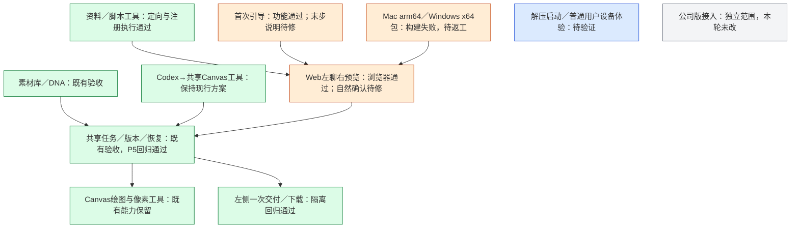

# P5 独立验收（2026-10-17）

验收对象：P5 通用版独立工作树，提交 `d4f9e1f2ee886dc3e05fed8df0dc3b7499ef3fbc`，PR #1。公司版工作区不在本轮修改范围。

**结论：暂不整体通过。源码功能回归通过，但预构建运行包尚未交付，不能宣称“解压即可启动”。**

## 必修项

### 1. 两平台打包均被误判路径阻断（高优先级）

实际查询最新 [Release bundles 38931492816](https://github.com/akechi0819-lgtm/creative-Agent-studio/actions/runs/38931492816)：Apple 芯片 Mac 与 Windows x64 两个构建均失败，upload-artifact 均跳过；该 run 的 artifacts 返回空列表，仓库也未列出 Release。

两边的错误相同：`adapters/dsh/node_modules/@anthropic-ai/sdk/lib/sessions/accumulate.d.mts` 被拒绝进入 Release。`src/launcher/distribution.mjs:61` 对任意层级的 sessions 目录一律拒绝，`:235` 在写清单时触发。主审在临时目录仅创建该 SDK 路径，调用 writeBundleManifest，即可独立复现。

应区分随锁文件安装的第三方程序代码与用户会话数据，保留真实用户数据排除规则，避免简单取消所有检查。修正后两平台都须完成 ZIP、解压、首次 Python 准备、OCR／Office、启动／健康／停止及健康环境复用检查，再提供可审查成品包。

用户已在 P5 线程允许 Python 首次单独检查安装，因此不要求 Python 完整随 ZIP 分发；此调整本身不是缺陷。当前失败发生在包清单阶段，后续启动体验还没有本轮成功的包可供独立验收。

### 2. 自然语言明确确认覆盖不足（中优先级）

`src/web/dialogue.mjs:5-8` 仅识别少量固定句式。独立调用得到：

- “确认制作单 v1 并开始绘图” → sheet。
- “就按当前这版方案开始制作吧” → null。
- “确认交付并下载” → null，解析器没有交付确认类别。

后两种会继续进入普通 Agent 对话，不能作为宿主的人工确认记录；模型本身也没有批准工具。因此左侧按钮路径已简化通过，但“自然表达明确同意即可继续”的目标仅部分完成。应让当前展示对象上的明确同意顺畅完成对应操作，保留否定、疑问、未展示内容及陈旧版本不批准的约束，不通过给模型无条件批准权限解决。

逐项用途的讨论可以先形成可见方案再确认，不要求对未经展示的新方案凭一句话直接执行。

### 3. 通用版首次引导末尾与实际操作不一致（低优先级，发布前修正）

`web/src/Onboarding.jsx:459` 无条件显示“你在 Canvas 选择图片模型并执行绘图”，但通用版在前面已配置图片 API，实际由左侧确认方案启动 Canvas 工具链。相邻说明又说模型已在本机配置，容易让新用户去重复设置。主审实际走到第五步并查看截图，确认该文字存在。

应按通用版与公司版分别描述实际下一步，不给通用版增加手动去 Canvas 再配置、再启动的要求。

## 已独立核对的部分

| 检查项 | 结果与边界 |
| --- | --- |
| 全量测试 | 独立运行 293/293 通过，0 失败、0 跳过；使用已有隔离 Python，不安装依赖 |
| 桌面浏览器 | 独立运行隔离 Chromium，1440 与 1280 视口；无横向溢出或页面异常 |
| 重复确认 | 右侧无重复审批；左侧一次确认执行、一次确认交付下载通过 |
| 参考预览 | 冻结原图完整缩放，编号、待选择／拟保留／已保留及用途更新正确 |
| 引导 | 可重开，共用服务地址／密钥实际保存成功，检查可跳过，完成引导可回工作台；没有发出真实 AI 请求 |
| 通用工具 | 定向 10/10 通过；覆盖合成 Word／Excel／PDF、Python、Office 转换、工作簿、ZIP、文件变化后旧 SHA 下载失效；另通过真实 DSH ToolRegistry 注册工具并执行 XLSX 读取 |
| 重复安装修复 | 分组依赖、无账本健康环境接纳、源码变化定向构建、单组锁变化、缺产物、部分失败续跑、Node patch 变化等测试均通过；未在真实项目根目录重新安装 |
| Codex／Canvas 边界 | 静态核对现行 Codex CLI 仍经共享 Canvas 执行器及图片 API；不启动 DSH，不改为宿主内置生图 |
| Windows 源码 CI | 同提交 Windows CI 38931492591 通过；不等于运行包通过或 Windows 普通用户实机通过 |

实施方另外已有一次真实素材检索、生图、读图和 ZIP 下载记录。主审读取了 real-round.json 与实测记录，本轮没有重放付费任务；这份历史实测不能替代本轮成品包验收。

主审重新核对实施方真实测试前的 1,228 份用户文件基线：1,227 份一致，另一个既有任务的 task.json 已在 `2026-10-17T03:12:43.012Z` 更新，晚于 P5 实测交付记录。本轮验收不修改该文件，也不依据旧基线将它归因于 P5；不复述“当前所有文件均未变”的结论。

## 非阻断整理项

脚本工具 schema 在 `adapters/dsh/workspace-tools.mjs:227` 写默认超时 10 秒，`:235` 实际默认 30 秒。统一说明与实际值即可，不需要新增审批或架构。

## 模块状态

本机证据在忽略目录 `docs/evidence/p5-independent/`，包括独立测试、浏览器检查、失败 CI 日志与用户基线复核。截图及额外引导检查在 `/tmp/studio-p5-independent/`。本报告不批准合并、发版或宣称 P5 整体完成。
