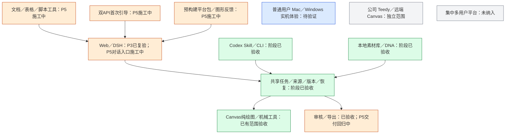

# P5 预构建运行包与启动反馈

## 当前进度

P5 正在把已验收的本地 Web 产品变成不用首次安装依赖的独立运行包。当前实现包括 native runner 构建、干净工作树与 allowlist、预装运行时和离线 OCR／Office 依赖、平台图形入口、许可材料清单与搬移后 smoke；跨平台 zip 尚待 GitHub Actions 实际 runner 构建。

## 用户入口与能力

- macOS 用户双击 `Creative Agent Studio.app`，Windows 用户双击 `Start.vbs`。macOS 使用 AppleScript 原生对话框；Windows 使用隐藏控制台与简短的启动中进度窗口。启动器展示中文结果，进程日志只写进该用户的数据目录。
- 第一次启动不安装依赖、不访问包管理器。Node.js 22.23.3、Python 3.12.15、前端构建产物、Canvas／DSH 产物、Node 与 Python 锁定依赖、RapidOCR ONNX 模型均随 zip 提供。启动时做轻量文件及版本检查，然后启动本机 Web 服务并打开浏览器。
- 启动器可启动／打开、停止、查询状态和检查包。实际启动逻辑由独立 `release/launcher.mjs` 承载，只复用既有运行状态及服务控制合同，不调用源码首次准备菜单。
- Web／DSH、Codex／CLI 和 Canvas 继续使用现有产品路径；分发模块复用共享服务；Web 界面另按 P5 精简目标更新。

## 构建与包边界

`scripts/package-release.mjs` 只允许从无 tracked／untracked 改动的 Git 工作树构建。其后按 `src/launcher/distribution.mjs` 的固定 allowlist 复制普通文件到源码树外 staging；开发 `node_modules` 链接、公司文件、虚拟环境、用户数据和历史任务均不能成为源输入。构建依赖由原生 runner 在隔离 staging 中重新准备，包内链接会先校验目标仍在 staging，再复制成真实文件。

GitHub Actions 为三个目标分别运行对应平台：macOS arm64 使用 `macos-15`，macOS x64 使用 `macos-15-intel`，Windows x64 使用 `windows-2025`。每个 runner 只打自己的平台包，Node 官方归档由 SHA-256 pin 校验。Pull request 和手动运行只生成可审查的 zip 与 checksum；签名、Notarization 与 Windows Authenticode 证书尚未配置，系统可能显示未签名提示。普通用户设备双击体验仍须在对应实机复测。

搬移 smoke 在生成 zip 前先把 staging 整体改名移动到另一个临时目录，再从移动后的目录检查：Node 与私有 Python 导入；OCR 对随包 `adapters/dsh/connection-check.png` 返回合法 JSON；Python 生成临时 DOCX 后由当前平台原生 LibreOfficeKit 转为 PDF；包内 launcher 以 `STUDIO_DATA_DIR` 指向的临时目录启动 Web、调用健康 API、查询状态并停止。该 smoke 不打开系统浏览器、不读取用户资料、不验证 OCR 识别准确率。临时目录清理后才归档。

## 许可证定位与边界

包内 `THIRD-PARTY-LICENSES.json` 记录实际 runtime 目标、Node/Python 许可文件、npm 与 Python 包版本、声明许可证和许可证文件相对路径；`release/NOTICE-third-party.md` 说明重点义务和源代码入口。自动检查缺少关键许可证文件或 sharp-libvips 动态库时阻止正式归档。材料记录的是包和文件证据，不构成法律意见或完整法律审查。

重点项目：

- MPL-2.0：LibreOffice Kit 0.1.5 的 `LICENSE`、`NOTICE`、原生包 `licenses/` 与嵌入式 LibreOffice `Resources/LICENSE`／`NOTICE` 随包保留。本项目不修改这些上游包；若修改其 MPL 覆盖代码，必须一并提供修改源码。
- LGPL-3.0-or-later：sharp-libvips 原生共享库保持为独立、未修改文件，README 与 `versions.json` 给出许可表和各平台组件版本；包内保留 LGPL-3.0 文本与源码入口。打包器会拒绝丢失 README、版本清单或 `.dll`／`.dylib`／`.so` 动态文件的目标包。
- CC-BY-4.0：若最终依赖中含 `caniuse-lite`，保留包内 `LICENSE` 并在 NOTICE 标注数据来源 `Can I Use / caniuse.com`。即使构建后裁剪掉该依赖，记录仍说明构建来源。
- Node.js 与 Python 官方运行时许可证、RapidOCR 包及 ONNX 模型、Tesseract.js 语言模型的定位和上游来源分别见 `THIRD-PARTY-LICENSES.json`、`release/NOTICE-rapidocr-models.md` 与 `release/NOTICE-third-party.md`。Tesseract.js 数据包的 npm 元数据声明 MIT；语言模型来自 Apache-2.0 的 tessdata 上游，包内保留原始元数据和 Apache-2.0 许可文本，不将两种声明混为一谈。

存在未能确认的组件版本或缺失许可材料时，打包器把该目标标为 blocked；构建产物只供审查，tag 发布工作流会在创建 GitHub Release 前拒绝发布。不能以许可证字段清单单独推断再分发已获批准。

## 当前验证边界

本机验证范围是 allowlist／干净树门槛单测、Mac AppleScript 编译检查、脚本语法和平台拒绝路径。Mac arm64 zip 本轮没有本地下载运行时或执行真实准备；Mac x64 与 Windows x64 必须由对应 runner 构建。CI 产物只代表构建与搬移 smoke 通过，不代表签名、Notarization、各版本 Windows/macOS 实机体验或外部 API 服务效果。
