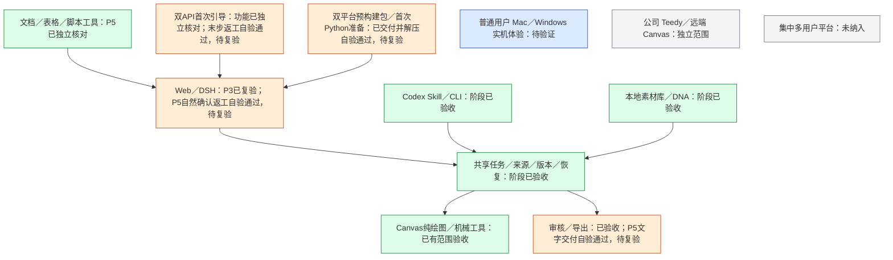

# P5 预构建运行包与启动反馈

## 当前进度

P5 预构建主包已完成返工自验，等待独立复验。2026-10-17 用户补充决定：Python 环境可独立首次检查和安装，主包负责 Node、Web、Canvas／DSH 等依赖与图形启动。源码 `8cd572e` 的 [双平台原生构建 39001846741](https://github.com/akechi0819-lgtm/creative-Agent-studio/actions/runs/39001846741) 已生成两份 ZIP 与 SHA，并通过解压后的首次准备与健康复用检查；文件与精确校验和见 [实施与验证](P5实施与验证.md)。

## 用户入口与能力

- macOS 用户双击 `Creative Agent Studio.app`，Windows 用户双击 `Start.vbs`。macOS 使用 AppleScript 原生对话框；Windows 使用隐藏控制台与简短的启动中进度窗口。启动器展示中文结果，进程日志只写进该用户的数据目录。
- 主包携带 Node.js 22.23.3、前端构建产物、Canvas／DSH 产物与 Node 生产依赖。首次启动单独检查 Python 3.12 与 OCR／Office 锁定依赖；没有兼容环境时可能下载私有 Python、所需库和 OCR 模型，准备在应用数据目录。已有健康环境直接复用，不重新安装，也不改系统默认 Python。准备完成后启动 Web 并打开浏览器。
- 启动器可启动／打开、停止、查询状态和检查包。实际启动逻辑由独立 `release/launcher.mjs` 承载，只复用既有运行状态及服务控制合同，不调用源码首次准备菜单。
- Web／DSH、Codex／CLI 和 Canvas 继续使用现有产品路径；分发模块复用共享服务；Web 界面另按 P5 精简目标更新。

## 构建与包边界

`scripts/package-release.mjs` 只允许从无 tracked／untracked 改动的 Git 工作树构建。其后按 `src/launcher/distribution.mjs` 的固定 allowlist 复制普通文件到源码树外 staging；开发 `node_modules` 链接、公司文件、虚拟环境、用户数据和历史任务均不能成为源输入。构建依赖由原生 runner 在隔离 staging 中重新准备，包内链接会先校验目标仍在 staging，再复制成真实文件。

Python 复用共享准备器，以运行包为只读资源目录、以稳定应用数据目录为输出目录。源码清单、哈希锁和 OCR helper 从包中读取；虚拟环境、私有解释器、uv、模型、状态与备份放在用户数据目录。只认实际版本、依赖和模型检查结果，不以系统存在 `python` 命令作为通过。开发入口不传独立 runtimeRoot 时保持现行行为。

GitHub Actions 只构建两个目标：Apple 芯片 Mac（arm64）使用 `macos-15`，Windows 64 位（x64）使用 `windows-2025`。按用户决定，Intel Mac 不纳入交付。每个 runner 只打自己的平台包，Node 官方归档由 SHA-256 pin 校验。Pull request 和手动运行只生成可审查的 zip 与 checksum；签名、Notarization 与 Windows Authenticode 证书尚未配置，系统可能显示未签名提示。普通用户设备双击体验仍须在对应实机复测。

归档验证先把 staging 整体改名移动到另一个临时目录，再生成 ZIP 并解压到新目录；从解压后的目录检查：Node 导入、首次独立 Python 准备和健康复用；OCR 对随包 `adapters/dsh/connection-check.png` 返回合法 JSON；Python 生成临时 DOCX 后由当前平台原生 LibreOfficeKit 转为 PDF；包内 launcher 以 `STUDIO_DATA_DIR` 指向的临时目录启动 Web、调用健康 API、查询状态并停止。该 smoke 不打开系统浏览器、不读取用户资料、不验证 OCR 识别准确率。检查通过后才生成校验和并允许上传运行包。

## 许可证定位与边界

包内 `THIRD-PARTY-LICENSES.json` 记录实际随主包分发的 Node、npm 及资源版本、声明许可证和许可文件；Python 与 RapidOCR 模型单独标明为首次准备，不冒充已经随包分发；`release/NOTICE-third-party.md` 说明重点义务和源代码入口。自动检查缺少关键许可证文件或 sharp-libvips 动态库时阻止正式归档。材料记录的是包和文件证据，不构成法律意见或完整法律审查。

重点项目：

- MPL-2.0：LibreOffice Kit 0.1.5 的 `LICENSE`、`NOTICE`、原生包 `licenses/` 与嵌入式 LibreOffice `Resources/LICENSE`／`NOTICE` 随包保留。Windows 精确补丁让所有转换使用 SDK 已有的 profile 短路径机制，修正入口路径长度判断遗漏内部资源目录的问题；修改后的 `lib/index.js`、`lib/cli.js` 可读源码保留原路径并随包提供，补丁实现也随项目源码及运行包提供，不改原生引擎二进制。
- LGPL-3.0-or-later：sharp-libvips 原生共享库保持为独立、未修改文件，README 与 `versions.json` 给出许可表和各平台组件版本；包内保留 LGPL-3.0 文本与源码入口。打包器会拒绝丢失 README、版本清单或 `.dll`／`.dylib`／`.so` 动态文件的目标包。
- CC-BY-4.0：若最终依赖中含 `caniuse-lite`，保留包内 `LICENSE` 并在 NOTICE 标注数据来源 `Can I Use / caniuse.com`。即使构建后裁剪掉该依赖，记录仍说明构建来源。
- Node.js 运行时、首次准备的 Python/RapidOCR 包与模型、随主包分发的 Tesseract.js 语言模型的定位和上游来源分别见 `THIRD-PARTY-LICENSES.json`、`release/NOTICE-rapidocr-models.md` 与 `release/NOTICE-third-party.md`。Tesseract.js 数据包的 npm 元数据声明 MIT；语言模型来自 Apache-2.0 的 tessdata 上游，包内保留原始元数据和 Apache-2.0 许可文本，不将两种声明混为一谈。

存在未能确认的组件版本或缺失许可材料时，打包器把该目标标为 blocked；构建产物只供审查，tag 发布工作流会在创建 GitHub Release 前拒绝发布。不能以许可证字段清单单独推断再分发已获批准。

## 当前验证边界

本机完整回归300/300，隔离桌面浏览器与引导检查通过；原生 runner 分别实际构建 Mac arm64／Windows x64 包，并从 ZIP 解压后的目录完成首次 Python 准备、OCR、原生 Office PDF、Web 启停和第二次健康环境复用。Windows 深层目录用例已验证固定 SDK 路径修正。CI 产物不代表签名、Notarization、各版本 Windows/macOS 普通用户实机体验或外部 API 服务效果，也不替代本轮独立复验。
