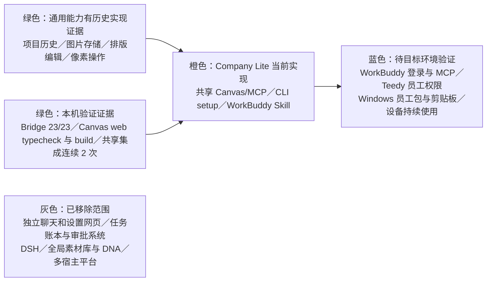

# Company Lite 工程进度

更新：2026-10-29。当前分支 `codex/company-lite`。本页区分代码／本机集成证据和 WorkBuddy、Teedy、员工设备验收；未在目标设备检查的能力不记为通过。

## 当前状态

- 产品主线：WorkBuddy 对话线程承担当前创作需求、制作单、确认、实际读图和批准；本机 Canvas/MCP 是跨线程共享的通用绘图空间，保存历史项目、图片、排版和共享配置；Teedy 继续使用公司现有云端 MCP。
- 不建立任务账本、独立审批系统或一任务一画布；Canvas 可按当前线程用户意图打开新项目、最近项目或历史项目，但不会带入其他线程的需求或批准。
- Canvas `/canvas` 历史页、`/canvas/:id` 编辑页、共享连接和历史恢复已实现。工具操作在返回前将当前项目快照写入本机历史；`canvas_list_projects` 刷新时读取持久项目列表，不替换活动编辑页状态。小图无缩略图时以原图显示。
- 纯 CLI setup、Studio 服务包装和 WorkBuddy Skill 已实现；员工安装、配置及故障修复时显示五项状态。日常创作不重复安装清单。
- 真实图片调用已有一单本机 Canvas MCP 成功证据（下方）。这不是目标员工设备验收，也不构成普遍时延承诺。

## 模块状态

绿色表示图中明确列出的实现证据；橙色表示当前产品代码，不代表所有设备均已验收；蓝色表示真实账号或员工设备仍待检查；灰色不是待续建设项。

## 本机验证证据

- Canvas web：`npm run typecheck` 与 `npm run build` 通过。Vite 报告既有动态／静态导入和大 chunk 警告，但构建退出成功。
- 根目录完整回归：45/45 通过，0 失败、0 跳过，包含 MCP SDK、共享历史恢复、剪贴板 stub、配置与包合同（主代理日志：`/tmp/company-lite-final-tests.log`）。已删除隔离测试数据根下的 Key 配置子目录；Canvas 测试历史保留作只读验收，真实源配置只读未改。
- Canvas bridge：23/23 通过。
- 共享 Canvas 集成连续 2 次通过：两项目中的文字与图片节点在重开及 bridge 重启后恢复；历史页两张卡片都显示图片缩略图；新建和导入按钮在历史刷新完成后恢复启用；旧页面和 MCP `canvas_list_projects` 都返回两个项目；MCP 图片读取及导出保持原始字节一致。
- 一次真实 Canvas MCP 图片生成成功：上游 HTTP 200，请求耗时 20.198 秒；MCP 提交约 63 毫秒、准备画布约 1.051 秒；完整图片本地保存耗时 25.892 秒。请求计数为 1。主代理已实际打开检查验收图，图像内容正确且无生成文字。以上仅是一单样本。

## 安装与凭据边界

WorkBuddy 主界面承担安装、配置和创作。本地 setup CLI 只返回真实状态并处理本机配置，不提供独立设置网页。员工包目标由 `Start.cmd`／`Start.command` 和 `Studio.cmd`／`Studio.command` 包装器调用包内 Node；`Start status` 返回 setup 状态，包装器不启动浏览器。员工无需安装 Git、npm、Python、Office 或编译器；实际分发包与设备体验仍待验证。

只在首次安装、配置或故障修复时展示五项状态：能力包、Canvas 组件及 MCP 实际连通、WorkBuddy 对现有 Teedy MCP 的实际探测报告、图片 API 检查、整体就绪。自动执行已可运行的检查，只在本人登录、WorkBuddy MCP 宿主审批或员工提供凭据时等待，不增加逐步确认。日常创作直接使用现有连接。

若尚未添加 Canvas MCP，`Studio mcp-config` 输出无密钥的 stdio 配置，由员工通过 WorkBuddy 官方 UI“插件 → MCP 服务器 → 配置 MCP”添加；随后 WorkBuddy 实际调用 `canvas_status`。Teedy 状态只在实际调用现有只读工具后通过 `Start report-workbuddy connected <工具名>` 或 `failed [工具名]` 记录。配置图片 Key 优先使用剪贴板：员工复制并明确说“已复制”后才调用 `Start configure-image @JSON --key-from-clipboard`，JSON 不含 Key；Windows 剪贴板仍待验证。任何凭据都不进入对话、普通命令参数、仓库或日志。

## 数据与产品边界

- WorkBuddy 当前对话线程持有本次需求、材料用途、文案、制作单和用户批准。历史 Canvas 可被用户重新选择，不会自动继承上一线程的业务上下文或批准。
- 本机 `CompanyLite` 数据目录独立保存共享 Canvas 历史、图片 API 配置和服务状态；不导入旧版任务或其他版本 Canvas 数据。
- Teedy 内容、标签和 ACL 不因本机改动而变化。实际使用为参考的远端材料须先由用户选定，再经 Teedy MCP 下载原件。
- Canvas 现有手动绘图和像素工具继续可用，包括导入、拼贴、拼接、组合、裁切、分割、重采样、移动和缩放。
- `canvas_run_generation` 返回提交状态和 node ID 后，通过 `generation_get_status` 查询异步结果；未知状态先查，不重复提交收费请求。实际读图使用 `canvas_read_image`；用户在当前 WorkBuddy 线程批准后才能导出。

## 剩余验证

1. 当前仓库完整回归已 45/45 通过；主代理继续 Mac 包构建与最终归档检查。
2. 在目标 WorkBuddy 环境确认项目规则与 Skill 读取、MCP 配置和本机命令调用；官方文档不保证仓库 `.agents/skills` 自动发现，首次提示词需显式读取本地 Skill。
3. 核实员工 Teedy 登录和实际只读权限、Windows 包运行与剪贴板输入、Canvas MCP 持续运行以及目标设备上的恢复体验。
4. 继续检查真实 API 调用状态和图片质量；不要把单次成功样本当作普遍延迟或员工验收。

历史报告、构建结果、mock 和单次图片请求不能替代 WorkBuddy 员工流程及目标设备验收。

## WorkBuddy 项目入口

WorkBuddy 本地任务须显式选择 Company Lite 根目录，并由首次提示词读取 README、AGENTS、宿主使用说明和创作 Skill。官方[本地任务说明](https://intl.cloud.tencent.com/zh/document/product/1316/84504)把工作目录与技能列为不同设置；官方[Skill 说明](https://intl.cloud.tencent.com/zh/document/product/1316/84503)支持本地 Skill 导入，但未公开项目内 Skill 目录的精确名称。本分支不宣称 `.agents/skills` 自动发现，不复制到未经验证的 WorkBuddy 目录。已导入的 Skill 也须从用户选定的能力包根目录执行命令。
