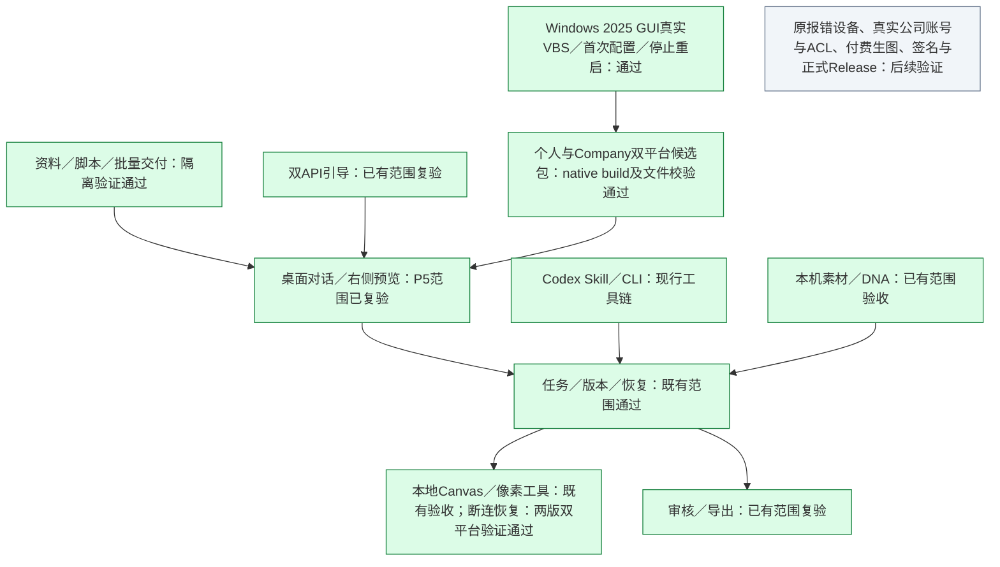

# 整体工程进度

更新：2026-11-11。本文是当前状态入口；实施过程和失败历史留在对应报告中，不把历史“待验收”作为当前状态。

## 真实创作复测与审美对照（2026-11-11 追加）

用户已授权真实调用，并要求后续对话使用 Kilo。官网首屏改图以同一原件、同一图片渠道 `gpt-image-2.6`、auto 质量比较原话直传与正常 Web 短指令转写；用户认为两组审美接近，未发现需要增加固定美学模板的依据。画布强制比例作为小参数问题处理，不与审美混判；首次生成中的部分文字漂移另记为保真限制。连续修改实际走通 Canvas 裁切、正式采用、自然语言纠正边界及再次采用，保持原画面质感且不额外生图。原件、参照与生成文件均留在仓库外私有目录，未最终批准这些样本。

真实 H3 原任务仅提交一次，已播放并从原节点回收：请求六秒、16:9、1080p，实际为约 6.58 秒、1920×1088。刷新后浏览器连接编号变化导致工作台误拒恢复的问题已修复，重新核验原节点／远端任务 ID 后可在同一 Canvas 实例恢复；未改供应商协议或重发生成。上传图编辑同时取消默认 3:4 硬锁，使用既有 auto，并允许本轮明确的文字删除；单次真实复测保持宽幅，模型文字漂移仍单独保留。

最新个人版全仓 **386 通过、1 跳过**，公司版 **420 通过、4 跳过**。极简版源码 92/92、本机 Canvas Agent 28/28、Web Bun 18/18 与构建通过，三版源码均已更新到 GitHub；下文旧测试计数及“无收费调用”仅指首次隔离验证时点。具体范围见[实施记录](标识适配与图视分轨-实施记录.md#后续真实调用与审美对照2026-11-11)。

## 标识适配与图视分轨（源码闭环与本机配置更新）

用户于 2026-11-10 批准[复核定稿](标识适配与图视分轨-复核定稿.md)，要求先图文、再标识与视频，并由 Planner／Worker 分离实施。当前个人版源码为 `codex/media-workflow-upgrade`，本轮完整事实、失败记录及边界见[实施记录](标识适配与图视分轨-实施记录.md)。

质量默认不再强制 low；auto 在原生图片请求省略字段，显式质量按页保留。已有成品改图只使用本次短指令、当前底图和明确风格页，不累加历史提示词。机械结果可正式采用、复审、人工确认、ZIP 导出及后续修改／恢复；透明标识可换色、沿轮廓描边、加圆角底板，派生素材进入现有 staged→清洗→人工确认流程后可跨任务保留、导入并合成。

已增加独立 H3 镜头方案、确认、一次提交、原节点恢复、MP4 回收、实际播放、按 SHA 复审批准与 MP4／manifest 导出；图文状态不被视频覆盖。CLI、Web／DSH 使用同一核心合同，DSH 只编写待确认视频方案，不能代替用户执行或批准。原生 H3 面板使用当前供应商合法参数。当前首版仅文生视频；供应商要求的公网参考素材 URL 尚未接入 Studio，不自动公开本机原件，也不宣称供应商不支持参考图。

个人版最终整仓为 **378 通过、2 项明确跳过**；Canvas Agent 19 项及构建、Canvas Web 类型检查／构建与 Bun 18 项通过。真实 Canvas／模拟图片服务端到端已覆盖两次短改图、标识像素、机械采用、预览及 ZIP；原生视频模拟链路覆盖一次提交、pending 中断恢复、媒体存储与播放、SHA、批准、导出及刷新不重提。无视频字段的旧任务曾因前端空值比较白屏，已修复并加隔离 Chromium 回归；不能用之前仅单元测试通过的结论忽略此失败。

Canvas 已纳入上游 `main@9cd3deacbcc598361807afc16c059a80dd18b6f9` 相对原固定版本的全部差异，仅 README、CHANGELOG 与新增 SVG，无功能代码升级；保留本地纯执行、任务隔离及恢复补丁，不恢复 Canvas 召唤 Agent。

本机正常停止旧实例并完成仓库外私有备份后已更新源码工作台；Octiva `minimax_h3` 现有密钥已通过设置页保存、刷新核对，配置权限 `0600`，原基础／图片配置与密钥未变。备份中 1221 个旧任务文件 SHA 核对未变。没有真实收费生成，没有更新公司服务器、ACL、全局 MCP、旧任务或已发布安装包。

公司版共享源码同步与隔离检查完成：413 通过、4 项平台／环境条件跳过，相关 Canvas／Studio 构建通过，具体范围与跳过原因见实施记录及公司版自检。视频工作台 attempt 12 已通过 13 项浏览器检查：原图片保留、独立方案按钮、实际播放、MP4／manifest、刷新不重发或重复下载；均为模拟接口。真实 H3 的实际时长、分辨率、动作／音轨、质量与扣费尚未验收；本轮模拟接口证据不扩张为这些结论。

## 双入口与现场故障返修（设备复测待完成）

画布故障现场仍运行旧目录；代理宿主直接使用未进入任务工具链。当前修复覆盖运行身份、操作与清理状态分离、任务入口释放重试、代理宿主指令与画布诊断。见[双入口与运行版本修复](双入口与运行版本修复.md)。两版本机完整回归与双平台云端专项、完整 Windows 回归通过，计数和 run 见该报告。原设备调用栈溢出的完整原因尚未确认，不能据此宣称现场问题已解决。

## 源码运行身份与更新核验

启动控制健康／状态现已上报规范化源码目录、可用 Git 提交和源码／构建摘要；同一数据目录发现另一程序目录、不同构建或未上报身份的旧实例时，启动器拒绝复用并给出正常停止步骤，不强杀进程或清理数据。更新前的数据备份、本地修改保护、分支获取、依赖／构建准备及身份核验顺序见[源码更新与运行核验](源码更新与运行核验.md)。当前仅记录源码实施和定向测试；旧实例的在途作业确认、日常快捷方式核验及旧程序清理须在新版本安装启动验收通过后按指南完成。

## Canvas 断连恢复返修（两版 Mac／云端 Windows 验证通过）

共享修复包括状态上报成功后再判定已连接、临时失败自动补报、悬挂状态请求超时取消、SSE 心跳与断流恢复、重连时旧快照及 pending 清理，以及同任务画布标签页复用。恢复只同步状态，不重提绘图请求。两版在云端 Windows 2025 和 macOS 14 各通过 31 项专项测试；完整 Windows CI 为个人版 334 通过、1 跳过，公司版 370 通过、2 跳过。个人本机 Mac 31 项定向测试和 9 项可见浏览器补测通过，完整回归 333 项通过、2 项明确跳过；公司版本机 Mac 另跑 31 项通过。具体源码、run、跳过原因和首轮失败记录见 [Canvas 断连恢复修复](Canvas断连恢复修复.md)。

这次源码修复不改变下文已有候选安装包。原报错员工设备、操作系统真实休眠／唤醒及安全软件干预仍待实机复测，不能从合并错误提示直接归因到后台标签页。

## Windows 首次启动返修（源码、双平台原生构建及 Windows 2025 GUI 用户路径通过）

本轮修复安装进度、防重复启动、缓存续装、进展超时和伴随进程隐藏。个人本机 Node 回归 316 项通过、1 项 Windows 专属测试跳过；个人 Windows 源码 CI run 39567504298 首次 Office recalculation 校验失败后单次重跑成功，最终 316 项通过、1 项跳过，新增用例无失败。保留首轮失败历史。公司本机回归 353 项通过、1 项跳过；公司 Windows 源码 CI run 39565191148 为 352 项通过、2 项跳过。

个人版和公司版的 Mac、Windows 原生构建均通过，候选成品已下载并完成完整性校验。Personal p5-startup.1 下载见 [README](../README.md)；Company company-p5.1.4 下载见公司分支 README。Windows 2025 GUI 真实 VBS 入口、冷启动准备、首次配置与停止重启流程已通过；完整证据、产品 SHA 和历史测试驱动问题见 [修复记录](Windows首次启动修复.md)。本轮未观察到新增可见控制台，但原报错 Mac 与员工 Windows 设备、真实公司账号与 ACL、付费生图、签名和正式 Release 仍未完成验证。

## 当前版本与交付

个人版主线为 main，公司版为 codex/company-edition。P5主体按原报告范围独立复验；Mac隔离启动后续修复已同步两版。当前个人候选为 media-workflow.2，公司候选为 company-media.2；四个原生构建、归档清单与搬移启动检查已通过，下载和 SHA 见两版 README。历史连接修复见 [Canvas 断连恢复修复](Canvas断连恢复修复.md)，旧包 GUI 范围见 [Windows 首次启动修复记录](Windows首次启动修复.md)。正式长期 Release、签名和原报错设备验证仍未完成。

- 个人版：使用本机素材、默认关闭的 DNA、本地 Canvas、左侧对话与确认、右侧预览、通用文件／脚本工具、审核导出及双 API 引导。
- 公司版：使用独立 Company 数据目录与 4311、Teedy 本人账号只读检索、保留后冻结来源、本地 Canvas 和本机双模型配置；员工真实账号／ACL 与付费生图仍待验证。
- 运行包：Mac Apple 芯片为自包含 app；Windows x64 保留完整目录。Node、生产依赖和构建产物随包；Python／OCR／Office 首次启动可能联网准备，健康环境会复用。
- 个人版 media-workflow.2 与公司版 company-media.2 均通过双平台 native build、归档解压清单和搬移 smoke。README 提供 CI 产物、产品 ZIP SHA-256 与 2026-11-25 到期时间；本轮核验依据为 CI 打包日志和 artifact 元数据，不冒充本机已下载复核。
- Windows 2025 GUI真实用户路径已按VBS入口通过冷启动准备、分别保存两类API设置、刷新后不重复引导、打开本地Canvas及停止重启。未调用图片生成或真实Teedy；本轮未观察到新增可见控制台。原报错 Mac 与员工设备、真实账号与ACL、付费图片、签名及正式Release仍待验证。
- Codex 继续使用宿主对话、项目 Skill／共享 CLI 与 Canvas 图片 API，不启动 DSH，不切换到宿主内置生图。

## 整体模块

绿色覆盖已注明的源码、native build、候选包完整性和 Windows 2025 GUI 用户路径证据。原报错设备、真实公司账号与ACL、付费图片、签名和正式Release仍待验证；本轮未观察到新增可见控制台不代表所有环境都无闪窗。

## 阶段证据索引

| 阶段 | 当前结论 | 报告 |
| --- | --- | --- |
| P0 技术基础 | 按阶段范围通过 | [P0验收](P0验收.md) |
| P1 创作核心 | 返工后独立复验通过 | [P1独立验收](P1独立验收.md) |
| P2 素材与DNA | 按批准范围独立复验通过 | [P2独立验收](P2独立验收.md) |
| P3 Web界面及集成 | 按授权源码与本机集成范围通过 | [P3最终独立复验](P3最终独立复验.md) |
| P4 跨平台源码交付 | Mac隔离运行及Windows Actions范围通过 | [P4最终独立复验](P4最终独立复验.md) |
| P5 微迭代 | 主体按报告范围独立复验通过 | [P5最终独立复验](P5最终独立复验.md) |
| Mac后续缺陷 | 两版修复已同步；原设备复测未完成 | [个人版修复](Mac运行包隔离启动修复.md)；公司分支见公司版自检 |

[启动准备复用修正](启动准备复用修正.md)、[模型来源与裁剪](模型来源与裁剪.md)和各阶段实施记录保留具体过程。OpenCode第三方对话限制、WorkBuddy本人账号能力和远端改图质量按实际证据解释，阶段通过不扩张这些结论。

## 后续工作

本次收尾整合共享修复、分支／工作树和文档入口，不自动部署公网服务、更新公司服务器、改变标签ACL或进行付费重测。正式Release、签名与普通设备反馈需要按后续实际安排记录；不将候选下载链接当永久分发地址。
