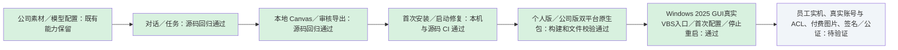
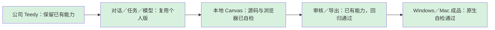
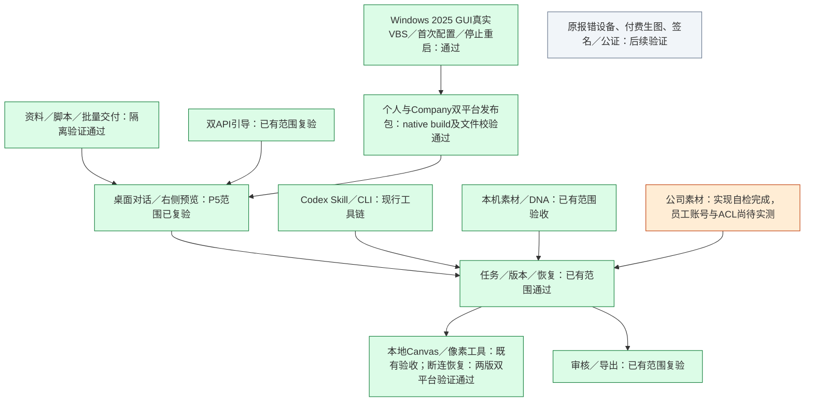

# 整体工程进度

更新：2026-11-11。本文是当前状态入口；实施过程和失败历史留在对应报告中，不把历史“待验收”作为当前状态。

## 图文、标识与独立视频更新（2026-11-11）

公司版已同步共享质量参数、短指令改图、机械成品采用、透明标识与独立 H3 视频源码，保留 Company 数据目录／4311、员工本人 Teedy 凭据及只读素材差异。上传图编辑不再默认锁定 3:4，使用既有 auto；本轮明确删除／替换文字不会与额外的全保留句冲突。刷新 Canvas 后，在同一实例核验原节点和已保存的远端任务 ID 可恢复视频，不重复提交生成。

最新公司版全仓 **420 通过、4 项条件跳过**，Web 构建通过；个人版真实官网改图对照中用户认为审美接近，真实 H3 已从原节点回收并播放。这些个人本机真实调用不代替公司员工实机、公司账号或公司渠道的收费验收，范围和模型文字保真限制见[实施记录](标识适配与图视分轨-实施记录.md)。

公司打包已移除过期 P5 artifact／overlay 依赖，改用当前干净源码按 Company profile 在原生 runner 构建，保留外部服务注入、独立 app 与搬移 smoke。定向合同检查 33 项通过；company-media.2 的双平台原生构建、解压清单与搬移启动检查已通过，长期下载见[公司版 Release](https://github.com/akechi0819-lgtm/creative-Agent-studio/releases/tag/company-media.2)。公司 Windows 源码 CI 最新 run 42960432670 通过，包含已更新的机械导入和三类模型设置浏览器专项。旧包设备记录仍按旧版本范围解释。

## 双入口与现场故障返修（设备复测待完成）

画布故障现场仍运行旧目录；代理宿主直接使用未进入任务工具链。当前修复覆盖运行身份、操作与清理状态分离、任务入口释放重试、代理宿主指令与画布诊断。见[双入口与运行版本修复](双入口与运行版本修复.md)。两版本机完整回归与双平台云端专项、完整 Windows 回归通过，计数和 run 见该报告。原设备调用栈溢出的完整原因尚未确认，不能据此宣称现场问题已解决。

## 源码运行身份与更新核验

启动控制健康／状态现已上报规范化源码目录、可用 Git 提交和源码／构建摘要；同一数据目录发现另一程序目录、不同构建或未上报身份的旧实例时，启动器拒绝复用并给出正常停止步骤，不强杀进程或清理数据。更新前的数据备份、本地修改保护、分支获取、依赖／构建准备及身份核验顺序见[源码更新与运行核验](源码更新与运行核验.md)。当前仅记录源码实施和定向测试；旧实例的在途作业确认、日常快捷方式核验及旧程序清理须在新版本安装启动验收通过后按指南完成。

## Canvas 断连恢复返修（两版 Mac／云端 Windows 验证通过）

共享修复包括状态上报成功后再判定已连接、临时失败自动补报、悬挂状态请求超时取消、SSE 心跳与断流恢复、重连时旧快照及 pending 清理，以及同任务画布标签页复用。恢复只同步状态，不重提绘图请求。两版在云端 Windows 2025 和 macOS 14 各通过 31 项专项测试；完整 Windows CI 为个人版 334 通过、1 跳过，公司版 370 通过、2 跳过。个人本机 Mac 31 项定向测试和 9 项可见浏览器补测通过，完整回归 333 项通过、2 项明确跳过；公司版本机 Mac 另跑 31 项通过。具体源码、run、跳过原因和首轮失败记录见 [Canvas 断连恢复修复](Canvas断连恢复修复.md)。

这次源码修复当时不改变已有候选安装包。原报错员工设备、操作系统真实休眠／唤醒及安全软件干预仍待实机复测，不能从合并错误提示直接归因到后台标签页。

## 公司 Windows 原包返修（源码、原生构建及 Windows 2025 GUI 用户路径通过）

本轮同步修复首次安装进度、防重复启动、缓存续装、进展超时修正与伴随进程隐藏。公司本机 Node 回归 353 项通过、1 项 Windows 专属测试跳过；公司 Windows 源码 CI run 39565191148 为 352 项通过、2 项跳过。个人本机回归 316 项通过、1 项跳过；个人 Windows 源码 CI run 39567504298 首次 Office recalculation 校验失败后单次重跑成功，最终 316 项通过、1 项跳过，新增用例无失败；保留首次失败记录。

个人版和公司版的 Mac、Windows 原生构建均通过，产品包已下载并完成文件完整性校验。Windows 2025 GUI 真实 VBS 入口、冷启动准备、首次配置与停止重启流程已通过；完整证据、产品 SHA 和历史测试驱动问题见 [修复记录](Windows首次启动修复.md)。本轮未观察到新增可见控制台，但原报错 Mac 与员工 Windows 设备、真实 Teedy 账号与 ACL、付费生图以及签名／公证仍未完成验证。

## 公司画布本地化（2026-10-17 施工自检完成）

公司版直接复用个人版本地 Canvas，移除远端适配、任务桥接、远端专用前端及诊断入口。Teedy 预置地址、员工账号与只读素材流程保留；公司数据目录和4311不变。模型配置继续原样复用个人版。旧远端服务不改动，旧浏览器画布不自动迁移。

## 公司模型配置缺陷修复（2026-10-17 施工自检完成）

用户反馈选择 Kilo 后被图片共享凭据校验阻止保存。按用户要求直接复用个人版 main@2dd9036 的模型设置页，不新增企业专属设计。个人版现有实现分别保存两路配置，保存 Kilo 不需要用户 API key，不覆盖已保存生图配置；用真实 DSH 与隔离上游验证无图片 API 的基础对话。现有共享任务／公司素材／Canvas 边界不变，348/348 本机 Node 回归、Windows 源码 CI 与双平台 `company-p5.1.2` 原生打包通过；原报错设备待用户复测。

## 当前公司版

本工作树为公司交付版。当前版本为 company-media.2，使用本地 Canvas；双平台原生构建、归档清单和搬移启动检查通过，长期下载见[公司版 Release](https://github.com/akechi0819-lgtm/creative-Agent-studio/releases/tag/company-media.2)。最新本机源码回归为 420 通过、4 项条件跳过，Windows 源码 CI 42960432670 通过。员工设备、真实 Teedy 账号／ACL 与签名仍待验证，历史 GUI 结果按原报告的版本范围解释。

### 公司版媒体工作流源码同步（2026-11-11，非发行包）

公司 topic 在 `96e3683` 基线上同步了机械成品采用、透明 Logo 像素适配及素材草稿保存、独立 H3 视频方案与交付流程；同步提交为 `4c1c4f8`、`bf220a0`。保留 Company 数据目录与 4311、Teedy 只读检索、风险检查、公司素材预览及既有本地图片代理。Logo 派生结果进入本机素材库待清洗和人工确认，不写回 Teedy。该首次同步时点尚未重建成品，后续 company-media.2 原生构建结论见本文开头。

首次同步时的源码检查：根仓库 Node 测试 **413 通过、4 跳过、0 失败**；Canvas Agent 测试 **19/19** 与 TypeScript build 通过；Canvas Web Bun 测试 **18/18**、typecheck 和 Vite build 通过；Studio Web build 通过。Canvas Web build 有静态／动态导入混用及较大 bundle 提示，但构建成功。未执行真实 Teedy 账号／ACL、真实图片或视频付费请求、员工设备浏览器验收或原生包构建；这些不由隔离源码测试代替。详细记录见[公司版源码与隔离自检](公司版自检.md)。

共享主工作台视频浏览器回归 attempt 12 在个人版隔离环境通过 13 项；脚本已同步到公司源树，但该次浏览器运行未使用公司任务数据、Teedy或员工配置。模拟接口通过不代表真实 H3 质量、扣费或员工设备验收。

Company 原生包脚本已从固定 P5 artifact overlay 改为当前源码 allowlist 的原生 source build；保留 Company profile、服务预配注入、manifest 与搬移后 smoke。定向发行测试和脚本语法检查通过；随后 company-media.2 的 Mac／Windows 原生构建及归档检查已完成，入口见 README。

## 当前版本与交付

个人版主线为 `main`，公司版为 `codex/company-edition`。P5主体已按源码、隔离桌面、Mac本机及双平台原生CI范围独立复验；后来用户发现Mac隔离启动缺陷，现已在两版同步自包含app与只读启动修复。修复自测与原生构建已通过，原报错Mac双击仍待用户复测，不能复述旧Mac包“开箱已验收”。

- 个人版：本机素材库、默认关闭的DNA、本地Canvas、左侧对话与确认、右侧预览、通用文件／脚本工具、审核导出、双API引导。
- 公司版：继承P5能力，使用独立Company数据目录／4311、Teedy本人账号只读检索、保留后冻结来源、本地Canvas和本机双模型配置；公司新增范围有实施自检，尚不宣称真实员工账号／ACL、付费生图与员工灰测均通过。
- 运行包：Mac Apple芯片为自包含app；Windows x64保留完整目录。Node、生产依赖和构建产物随包，Python／OCR／Office首次可能联网准备，健康环境复用。
- 当前公司版下载为 company-media.2 GitHub Release。旧 Actions artifact 仅保留构建记录且有期限，不作为当前下载入口；旧 Mac 包不作为推荐入口。
- Codex继续使用宿主对话、项目Skill／共享CLI与Canvas图片API，不启动DSH，不切换到宿主内置生图。

## 整体模块

绿色只覆盖节点所列的源码、原生构建、包完整性和 Windows 2025 GUI 实测范围。原报错设备、真实账号与 ACL、付费生图、签名／公证仍待验证；本轮未观察到新增可见控制台不等于所有环境均无闪窗。

## 阶段证据索引

| 阶段 | 当前结论 | 报告 |
| --- | --- | --- |
| P0 技术基础 | 按阶段范围通过 | [P0验收](P0验收.md) |
| P1 创作核心 | 返工后独立复验通过 | [P1独立验收](P1独立验收.md) |
| P2 素材与DNA | 按批准范围独立复验通过 | [P2独立验收](P2独立验收.md) |
| P3 Web界面及集成 | 按授权源码与本机集成范围通过 | [P3最终独立复验](P3最终独立复验.md) |
| P4 跨平台源码交付 | Mac隔离运行及Windows Actions范围通过 | [P4最终独立复验](P4最终独立复验.md) |
| P5 微迭代 | 主体按报告范围独立复验通过 | [P5最终独立复验](P5最终独立复验.md) |
| Mac后续缺陷 | 两版修复已同步；原设备复测未完成 | [个人版修复](Mac运行包隔离启动修复.md)；公司分支见公司版自检 |

[启动准备复用修正](启动准备复用修正.md)、[模型来源与裁剪](模型来源与裁剪.md)和各阶段实施记录保留具体过程。OpenCode第三方对话限制、WorkBuddy本人账号能力和远端改图质量按实际证据解释，阶段通过不扩张这些结论。

## 后续工作

本次收尾整合共享修复、分支／工作树和文档入口，不自动部署公网服务、更新公司服务器、改变标签 ACL 或进行付费重测。当前公司版下载入口见上方版本说明及 [company-media.2 Release](https://github.com/akechi0819-lgtm/creative-Agent-studio/releases/tag/company-media.2)；签名／公证与普通设备反馈继续按实际验证范围记录。
