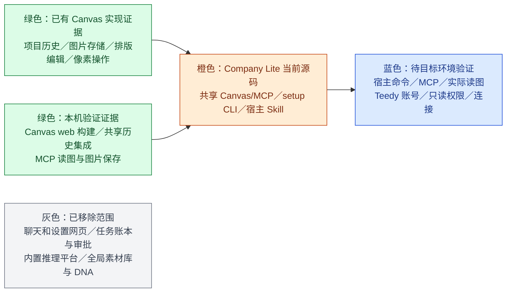

# Company Lite 工程进度

更新：2026-10-30。当前分支 `codex/company-lite`，按 Git 源码目录运行。本页区分本机源码与集成证据、真实 MCP 请求和具体宿主／Teedy 账号验证；没有在目标环境实测的能力不记为通过。

## 当前状态

- 产品主线：宿主当前对话线程承担创作需求、制作单、确认、实际读图和批准；本机 Canvas/MCP 跨线程共享历史项目、图片、排版和绘图配置；Teedy 使用公司现有云端只读 MCP。
- 不建立任务账本、独立审批系统或一任务一画布。用户可从当前线程按意图打开新项目、最近项目或历史作品，但不会带入其他线程需求或批准。
- Canvas `/canvas` 历史页、`/canvas/:id` 编辑页、共享连接和历史恢复已实现。MCP 工具成功返回前会把当前项目快照写入历史；`canvas_list_projects` 从持久数据读取最新项目，不替换活动编辑页状态。小图未生成缩略图时，历史卡片使用原图。
- 源码准备与纯 CLI setup 已实现：执行 Node 脚本前检查 Git、Node.js 22.19+（22.x）或 24+、npm；从源码根运行 `node scripts/prepare.mjs` 安装固定依赖并构建 Canvas（`npm run prepare:dev` 为等价别名）；状态和配置命令由 `node scripts/setup.mjs` 提供。PowerShell 中如 `npm` 被策略阻止，可用 `npm.cmd --version` 检查，不要求更改执行策略。无需 Python、Office 或系统编译器。
- 日常使用从 `node scripts/studio.mjs` 或宿主 Canvas MCP 开始；没有宿主特定的工作目录或 Skill 自动发现承诺。宿主应显式读取当前源码根规则和 Skill。

## 模块状态

绿色表示图中所列已有实现证据；橙色是当前源码，不代表所有环境均验收；蓝色需用真实宿主和账号验证；灰色不是后续开发范围。不同宿主不自动兼容，不建立注册、迁移或适配系统。

## 安装和配置进度

首次准备、配置或故障修复时，先从源码根运行 `node scripts/setup.mjs status`，按真实探测结果简洁展示五项；然后自动运行耗时的 `node scripts/prepare.mjs`，完成后重新读取状态。初始状态展示前不要先启动构建。自动推进可执行步骤，当前阻塞时只说明员工需要完成的下一步；日常创作不重复清单。

1. 环境与依赖：执行 Node 脚本前确认 Git、Node.js 22.19+（22.x）或 24+、npm 可用；运行 `node scripts/prepare.mjs`，按锁文件准备依赖并构建 Canvas。`npm run prepare:dev` 是等价开发别名。PowerShell 中如 `npm` 被策略阻止，可用 `npm.cmd --version` 检查，不要求更改执行策略。缺少基础工具时按当前系统官方说明协助安装，不擅自改策略、权限或 PATH；无需 Python、Office 或系统编译器。
2. 本地 Canvas/MCP：Canvas 构建组件状态，加上当前宿主实际调用 `canvas_status` 的结果。新宿主或首次进入新会话必须重新检查；旧探测记录仅代表上次调用。
3. 素材库 Teedy MCP：根据当前 setup 状态提供的 MCP URL／登录地址和服务说明，由员工本人配置公司账号、只读权限及所需 Key。宿主实际调用当前只读工具后，使用 `node scripts/setup.mjs report-host connected <工具名>` 或 `failed [工具名]` 留存宿主报告。报告不是 CLI 独立验证。
4. 图片 API：由宿主读取状态并生成地址、模型、Key 和 revision 参数。员工明确说已复制 Key 后，宿主才可用 `node scripts/setup.mjs configure-image @JSON --key-from-clipboard` 仅读一次剪贴板并保存到本机私有配置；之后执行 `node scripts/setup.mjs check-image` 检查连接，不发起生图。
5. 完成：按以上实际状态显示整体就绪或当前唯一阻塞项。

Teedy URL、登录入口或账号信息缺失时，setup 状态会列出缺口；宿主不猜测 URL、传输、认证字段或权限，需要时向管理员索取。密钥不进入对话、仓库、普通参数或日志。MCP 需按当前宿主实际接受的格式配置：`node scripts/studio.mjs mcp-config` 的 `command`／`args` 可供配置，`mcpServers` 外层 JSON 不是通用宿主格式。本机 MCP SDK stdio 测试不等于各宿主客户端兼容性已验收。

## 本机验证证据

- 源码根回归 38/38、Canvas bridge 23/23 通过，0 失败、0 跳过；覆盖 MCP SDK、共享历史恢复、剪贴板与配置。
- Canvas web `npm run typecheck` 和 `npm run build` 通过。Vite 有既有导入及大 chunk 警告，但构建退出成功。
- Mac 本机全新浅克隆起始没有 `node_modules` 或 Canvas 构建产物；setup 能读取缺依赖状态。运行 `node scripts/prepare.mjs` 后，三个依赖组安装完成，Canvas Agent 与 Web 均构建成功，退出码为 0；随后 setup 报告本地源码与 Canvas 就绪、等待当前宿主 MCP，`mcp-config` 路径指向当前系统 Node 和该克隆。
- 在该克隆中共享 Canvas 集成 1/1 通过（4.6 秒）：多项目、裁切拼接、历史重启恢复及 MCP stdio 图片读写均通过，没有生图请求。此前共享历史集成也连续两次通过：两个项目中的文字和图片节点在重开及 bridge 重启后恢复；两张历史卡片均显示缩略图；历史页及 MCP `canvas_list_projects` 都返回两个项目；MCP 读图和导出与源图片字节一致。
- 隔离临时配置下图片服务 `GET /v1/models` 返回 HTTP 200 并列出配置模型；未发起生图，源配置未改，临时 Key 目录已删除。
- 一次真实 Canvas MCP 图片请求成功：上游 HTTP 200，用时 20.198 秒；MCP 提交约 63 毫秒，准备画布 1.051 秒，本机完整保存 25.892 秒。请求计数为 1。主代理已实际打开检查验收图，图像正确且无生成文字。这是单次样本，不是普遍时延或所有宿主验收承诺。

## 待验证范围

1. 在目标宿主实测源码目录读取、Skill 显式读取、本地命令、stdio MCP 和图片内容传递；一种宿主的证据不推广到其他宿主。
2. 实测 Teedy 员工账号、MCP URL／Key 配置、只读权限和当前宿主安全凭据入口。
3. 源码提交 `5fbf1bd` 的 Windows/macOS/Linux GitHub Actions 已全部通过；Mac 本机浅克隆构建通过不等于跨系统验收。仍需在目标系统验证 Git、Node.js、npm 准备、本地 Canvas 持续连接和工作区恢复体验。

历史报告、构建结果、mock 和单次图片请求不等于具体宿主与员工账号验收。数据保存在独立 `CompanyLite` 本机目录，不迁移旧版任务或其他版本 Canvas 数据。

## Windows CI 与黑窗检查（2026-10-30）

[GitHub Actions 40984731467](https://github.com/akechi0819-lgtm/creative-Agent-studio/actions/runs/40984731467) 验证源码提交 `5fbf1bd`：Windows、macOS、Linux 全部通过。Windows 完成依赖安装、Canvas 构建、浏览器集成与源码回归；38 项中 37 项通过、0 失败、1 项 Mac 专用剪贴板测试跳过。共享 Canvas 集成验证重复启动复用同一服务、多项目历史重启恢复及 MCP stdio 图片读写。

黑窗静态审阅覆盖 Canvas 服务、bridge、系统浏览器调用、PowerShell 剪贴板、Node/npm 准备与依赖探测，所有生产子进程入口都设置 `windowsHide`；后台服务输出写日志，不创建交互终端。未发现需要新增启动器的缺陷。首次 CI 因 job 级环境变量引用 runner context 无效而没有启动；移到测试 step 后通过。

GitHub Windows runner 属于非交互环境，以上不能证明员工桌面绝不闪窗；尤其宿主拉起顶层 MCP/CLI 进程的方式由宿主决定，仍需在实际宿主桌面确认。此次未新增付费生图请求。
