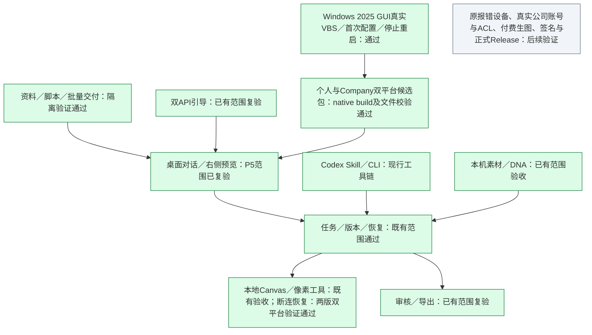

# 整体工程进度

更新：2026-10-23。本文是当前状态入口；实施过程和失败历史留在对应报告中，不把历史“待验收”作为当前状态。

## 双入口与现场故障返修（设备复测待完成）

画布故障现场仍运行旧目录；代理宿主直接使用未进入任务工具链。当前修复覆盖运行身份、操作与清理状态分离、任务入口释放重试、代理宿主指令与画布诊断。见[双入口与运行版本修复](双入口与运行版本修复.md)。原设备调用栈溢出的完整原因尚未确认，不能沿用下方历史 CI 结论宣称现场问题已解决。

## 源码运行身份与更新核验

启动控制健康／状态现已上报规范化源码目录、可用 Git 提交和源码／构建摘要；同一数据目录发现另一程序目录、不同构建或未上报身份的旧实例时，启动器拒绝复用并给出正常停止步骤，不强杀进程或清理数据。更新前的数据备份、本地修改保护、分支获取、依赖／构建准备及身份核验顺序见[源码更新与运行核验](源码更新与运行核验.md)。当前仅记录源码实施和定向测试；旧实例的在途作业确认、日常快捷方式核验及旧程序清理须在新版本安装启动验收通过后按指南完成。

## Canvas 断连恢复返修（两版 Mac／云端 Windows 验证通过）

共享修复包括状态上报成功后再判定已连接、临时失败自动补报、悬挂状态请求超时取消、SSE 心跳与断流恢复、重连时旧快照及 pending 清理，以及同任务画布标签页复用。恢复只同步状态，不重提绘图请求。两版在云端 Windows 2025 和 macOS 14 各通过 31 项专项测试；完整 Windows CI 为个人版 334 通过、1 跳过，公司版 370 通过、2 跳过。个人本机 Mac 31 项定向测试和 9 项可见浏览器补测通过，完整回归 333 项通过、2 项明确跳过；公司版本机 Mac 另跑 31 项通过。具体源码、run、跳过原因和首轮失败记录见 [Canvas 断连恢复修复](Canvas断连恢复修复.md)。

这次源码修复不改变下文已有候选安装包。原报错员工设备、操作系统真实休眠／唤醒及安全软件干预仍待实机复测，不能从合并错误提示直接归因到后台标签页。

## Windows 首次启动返修（源码、双平台原生构建及 Windows 2025 GUI 用户路径通过）

本轮修复安装进度、防重复启动、缓存续装、进展超时和伴随进程隐藏。个人本机 Node 回归 316 项通过、1 项 Windows 专属测试跳过；个人 Windows 源码 CI run 39567504298 首次 Office recalculation 校验失败后单次重跑成功，最终 316 项通过、1 项跳过，新增用例无失败。保留首轮失败历史。公司本机回归 353 项通过、1 项跳过；公司 Windows 源码 CI run 39565191148 为 352 项通过、2 项跳过。

个人版和公司版的 Mac、Windows 原生构建均通过，候选成品已下载并完成完整性校验。Personal p5-startup.1 下载见 [README](../README.md)；Company company-p5.1.4 下载见公司分支 README。Windows 2025 GUI 真实 VBS 入口、冷启动准备、首次配置与停止重启流程已通过；完整证据、产品 SHA 和历史测试驱动问题见 [修复记录](Windows首次启动修复.md)。本轮未观察到新增可见控制台，但原报错 Mac 与员工 Windows 设备、真实公司账号与 ACL、付费生图、签名和正式 Release 仍未完成验证。

## 当前版本与交付

个人版主线为 main，公司版为 codex/company-edition。P5主体按原报告范围独立复验；Mac隔离启动后续修复已同步两版。最新连接源码验证见 [Canvas 断连恢复修复](Canvas断连恢复修复.md)，已有 Mac、Windows 候选包构建结果见 [Windows 首次启动修复记录](Windows首次启动修复.md)。正式长期 Release、签名和原报错设备验证仍未完成。

- 个人版：使用本机素材、默认关闭的 DNA、本地 Canvas、左侧对话与确认、右侧预览、通用文件／脚本工具、审核导出及双 API 引导。
- 公司版：使用独立 Company 数据目录与 4311、Teedy 本人账号只读检索、保留后冻结来源、本地 Canvas 和本机双模型配置；员工真实账号／ACL 与付费生图仍待验证。
- 运行包：Mac Apple 芯片为自包含 app；Windows x64 保留完整目录。Node、生产依赖和构建产物随包；Python／OCR／Office 首次启动可能联网准备，健康环境会复用。
- 个人版 p5-startup.1 与公司版 company-p5.1.4 均已通过双平台 native build 并完成 artifact、ZIP、sidecar 和 manifest 校验。当前是有期限的 Actions 候选 artifact，具体链接、SHA 和到期时间见两版 README，不是长期 Release。
- Windows 2025 GUI真实用户路径已按VBS入口通过冷启动准备、分别保存两类API设置、刷新后不重复引导、打开本地Canvas及停止重启。未调用图片生成或真实Teedy；本轮未观察到新增可见控制台。原报错 Mac 与员工设备、真实账号与ACL、付费图片、签名及正式Release仍待验证。
- Codex 继续使用宿主对话、项目 Skill／共享 CLI 与 Canvas 图片 API，不启动 DSH，不切换到宿主内置生图。

## 整体模块

绿色覆盖已注明的源码、native build、候选包完整性和 Windows 2025 GUI 用户路径证据。原报错设备、真实公司账号与ACL、付费图片、签名和正式Release仍待验证；本轮未观察到新增可见控制台不代表所有环境都无闪窗。

## 阶段证据索引

| 阶段 | 当前结论 | 报告 |
| --- | --- | --- |
| P0 技术基础 | 按阶段范围通过 | [P0验收](P0验收.md) |
| P1 创作核心 | 返工后独立复验通过 | [P1独立验收](P1独立验收.md) |
| P2 素材与DNA | 按批准范围独立复验通过 | [P2独立验收](P2独立验收.md) |
| P3 Web界面及集成 | 按授权源码与本机集成范围通过 | [P3最终独立复验](P3最终独立复验.md) |
| P4 跨平台源码交付 | Mac隔离运行及Windows Actions范围通过 | [P4最终独立复验](P4最终独立复验.md) |
| P5 微迭代 | 主体按报告范围独立复验通过 | [P5最终独立复验](P5最终独立复验.md) |
| Mac后续缺陷 | 两版修复已同步；原设备复测未完成 | [个人版修复](Mac运行包隔离启动修复.md)；公司分支见公司版自检 |

[启动准备复用修正](启动准备复用修正.md)、[模型来源与裁剪](模型来源与裁剪.md)和各阶段实施记录保留具体过程。OpenCode第三方对话限制、WorkBuddy本人账号能力和远端改图质量按实际证据解释，阶段通过不扩张这些结论。

## 后续工作

本次收尾整合共享修复、分支／工作树和文档入口，不自动部署公网服务、更新公司服务器、改变标签ACL或进行付费重测。正式Release、签名与普通设备反馈需要按后续实际安排记录；不将候选下载链接当永久分发地址。
