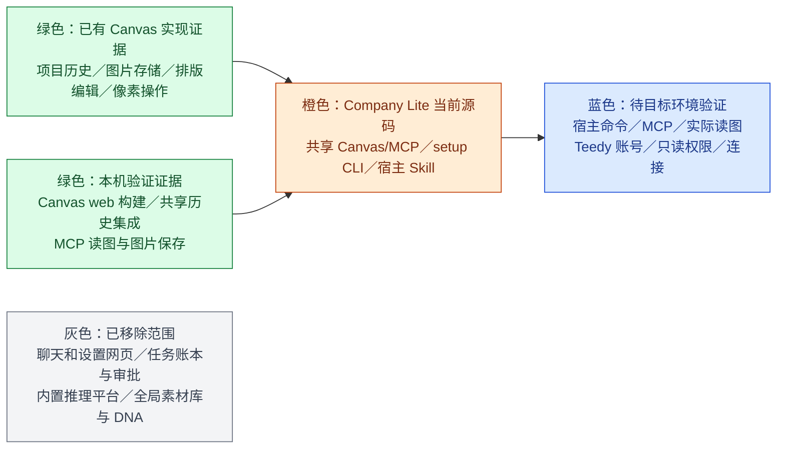

# Company Lite 工程进度

更新：2026-10-30。当前分支 `codex/company-lite`，按 Git 源码目录运行。本页区分本机源码与集成证据、真实 MCP 请求和具体宿主／Teedy 账号验证；没有在目标环境实测的能力不记为通过。

## 当前状态

- 产品主线：宿主当前对话线程承担创作需求、制作单、确认、实际读图和批准；本机 Canvas/MCP 跨线程共享历史项目、图片、排版和绘图配置；本机只读素材 MCP 连接公司现有远端 Teedy。
- 不建立任务账本、独立审批系统或一任务一画布。用户可从当前线程按意图打开新项目、最近项目或历史作品，但不会带入其他线程需求或批准。
- Canvas `/canvas` 历史页、`/canvas/:id` 编辑页、共享连接和历史恢复已实现。MCP 工具成功返回前会把当前项目快照写入历史；`canvas_list_projects` 从持久数据读取最新项目，不替换活动编辑页状态。小图未生成缩略图时，历史卡片使用原图。
- 源码准备与纯 CLI setup 已实现：执行 Node 脚本前检查 Git、Node.js 22.19+（22.x）或 24+、npm；从源码根运行 `node scripts/prepare.mjs` 安装固定依赖并构建 Canvas（`npm run prepare:dev` 为等价别名）；状态和配置命令由 `node scripts/setup.mjs` 提供。PowerShell 中如 `npm` 被策略阻止，可用 `npm.cmd --version` 检查，不要求更改执行策略。无需 Python、Office 或系统编译器。
- 日常使用从 `node scripts/studio.mjs` 或宿主 Canvas MCP 开始；没有宿主特定的工作目录或 Skill 自动发现承诺。宿主应显式读取当前源码根规则和 Skill。

## 模块状态

绿色表示图中所列已有实现证据；橙色是当前源码，不代表所有环境均验收；蓝色需用真实宿主和账号验证；灰色不是后续开发范围。不同宿主不自动兼容，不建立注册、迁移或适配系统。

## 安装和配置进度

首次准备、配置或故障修复时，先从源码根运行 `node scripts/setup.mjs status`，按真实探测结果简洁展示五项；然后自动运行耗时的 `node scripts/prepare.mjs`，完成后重新读取状态。初始状态展示前不要先启动构建。自动推进可执行步骤，当前阻塞时只说明员工需要完成的下一步；日常创作不重复清单。

1. 环境与依赖：执行 Node 脚本前确认 Git、Node.js 22.19+（22.x）或 24+、npm 可用；运行 `node scripts/prepare.mjs`，按锁文件准备依赖并构建 Canvas。`npm run prepare:dev` 是等价开发别名。PowerShell 中如 `npm` 被策略阻止，可用 `npm.cmd --version` 检查，不要求更改执行策略。缺少基础工具时按当前系统官方说明协助安装，不擅自改策略、权限或 PATH；无需 Python、Office 或系统编译器。
2. 本地 Canvas/MCP：Canvas 构建组件状态，加上当前宿主实际调用 `canvas_status` 的结果。新宿主或首次进入新会话必须重新检查；旧探测记录仅代表上次调用。
3. 素材库 Teedy MCP：宿主打开一次性本机登录表单，员工填写账号密码，程序自动验证登录、查询和原件下载；接入本机 Node stdio MCP 后宿主再真实查询、下载，并记录两项工具结果。公司只需提供远端 HTTPS 根地址 `materials.baseUrl`，员工不操作终端。
4. 图片 API：由宿主读取状态并生成地址、模型、Key 和 revision 参数。员工明确说已复制 Key 后，宿主才可用 `node scripts/setup.mjs configure-image @JSON --key-from-clipboard` 仅读一次剪贴板并保存到本机私有配置；之后执行 `node scripts/setup.mjs check-image` 检查连接，不发起生图。
5. 完成：按以上实际状态显示整体就绪或当前唯一阻塞项。

Teedy 根地址或账号信息缺失时，setup 状态会列出缺口；宿主不猜测 URL、传输、认证字段或权限，需要时向管理员索取。密钥不进入对话、仓库、普通参数或日志。MCP 需按当前宿主实际接受的格式配置：`node scripts/studio.mjs mcp-config` 的 `command`／`args` 可供配置，`mcpServers` 外层 JSON 不是通用宿主格式。本机 MCP SDK stdio 测试不等于各宿主客户端兼容性已验收。

## 本机验证证据

- 首轮源码根回归 38/38、Canvas bridge 23/23 通过，0 失败、0 跳过；覆盖 MCP SDK、共享历史恢复、剪贴板与配置。后续审阅修复及验证见下文。
- Canvas web `npm run typecheck` 和 `npm run build` 通过。Vite 有既有导入及大 chunk 警告，但构建退出成功。
- Mac 本机全新浅克隆起始没有 `node_modules` 或 Canvas 构建产物；setup 能读取缺依赖状态。运行 `node scripts/prepare.mjs` 后，三个依赖组安装完成，Canvas Agent 与 Web 均构建成功，退出码为 0；随后 setup 报告本地源码与 Canvas 就绪、等待当前宿主 MCP，`mcp-config` 路径指向当前系统 Node 和该克隆。
- 在该克隆中共享 Canvas 集成 1/1 通过（4.6 秒）：多项目、裁切拼接、历史重启恢复及 MCP stdio 图片读写均通过，没有生图请求。此前共享历史集成也连续两次通过：两个项目中的文字和图片节点在重开及 bridge 重启后恢复；两张历史卡片均显示缩略图；历史页及 MCP `canvas_list_projects` 都返回两个项目；MCP 读图和导出与源图片字节一致。
- 隔离临时配置下图片服务 `GET /v1/models` 返回 HTTP 200 并列出配置模型；未发起生图，源配置未改，临时 Key 目录已删除。
- 一次真实 Canvas MCP 图片请求成功：上游 HTTP 200，用时 20.198 秒；MCP 提交约 63 毫秒，准备画布 1.051 秒，本机完整保存 25.892 秒。请求计数为 1。主代理已实际打开检查验收图，图像正确且无生成文字。这是单次样本，不是普遍时延或所有宿主验收承诺。

## 待验证范围

1. 在目标宿主实测源码目录读取、Skill 显式读取、本地命令、stdio MCP 和图片内容传递；一种宿主的证据不推广到其他宿主。
2. 实测 Teedy 员工账号、MCP URL／Key 配置、只读权限和当前宿主安全凭据入口。
3. 源码提交 `5fbf1bd` 的 Windows/macOS/Linux GitHub Actions 已全部通过；Mac 本机浅克隆构建通过不等于跨系统验收。仍需在目标系统验证 Git、Node.js、npm 准备、本地 Canvas 持续连接和工作区恢复体验。

历史报告、构建结果、mock 和单次图片请求不等于具体宿主与员工账号验收。数据保存在独立 `CompanyLite` 本机目录，不迁移旧版任务或其他版本 Canvas 数据。

## Windows CI 与黑窗检查（2026-10-30）

[GitHub Actions 40984731467](https://github.com/akechi0819-lgtm/creative-Agent-studio/actions/runs/40984731467) 验证源码提交 `5fbf1bd`：Windows、macOS、Linux 全部通过。Windows 完成依赖安装、Canvas 构建、浏览器集成与源码回归；38 项中 37 项通过、0 失败、1 项 Mac 专用剪贴板测试跳过。共享 Canvas 集成验证重复启动复用同一服务、多项目历史重启恢复及 MCP stdio 图片读写。

黑窗静态审阅覆盖 Canvas 服务、bridge、系统浏览器调用、PowerShell 剪贴板、Node/npm 准备与依赖探测，所有生产子进程入口都设置 `windowsHide`；后台服务输出写日志，不创建交互终端。未发现需要新增启动器的缺陷。首次 CI 因 job 级环境变量引用 runner context 无效而没有启动；移到测试 step 后通过。

GitHub Windows runner 属于非交互环境，以上不能证明员工桌面绝不闪窗；尤其宿主拉起顶层 MCP/CLI 进程的方式由宿主决定，仍需在实际宿主桌面确认。此次未新增付费生图请求。

## 源码审阅修复（2026-10-30）

- setup 读取准备状态与活动锁：安装中、安装失败或中断时不再因旧构建产物误报就绪；图片 API 检查与实际生图使用一致的 `/v1` 地址规则。
- 画布仅提供图片生成；保留可编辑的文本提示词节点，移除视频、音频、文本生成与依赖文本模型的反推入口。配置和凭据继续由宿主对话引导 CLI 完成。
- MCP 生图提交返回 `{submitted, nodeId}`，该 ID 指提交源节点；完成后从画布状态定位对应图片节点并实际读图。同一节点仍在生成时拒绝重复请求，不取消原请求；完成后允许再次生成。
- 缺少图片配置和节点忙碌的错误可直接反馈宿主；其他服务端错误仍不回传敏感内容。参考图读取失败会释放生成状态，允许修复后重试。
- 本机源码回归 55/55、bridge 24/24 通过，Canvas web 类型检查与构建通过；新增图片入口浏览器回归 1/1 通过：仅生图、文本可编辑保存、无视频或音频入口、零生图请求。独立真实 stdio MCP + 浏览器 + 本机模拟上游验证：提交立即返回、在途重复调用只有一笔请求、完成后再次生成、实际 MCP 读到图片、缺配置时零请求均通过。裁切、缩放、拼图像素及原图保留复验通过。上述审阅测试没有新增付费生图。
- 宿主说明补齐公司非秘密默认地址、文案检查、多页局部修改与原图保留、文案及图片交付、可选 ZIP；不增加另一套任务或审批系统。

本轮源码提交 `d8ae34f` 已由 [GitHub Actions 40988571113](https://github.com/akechi0819-lgtm/creative-Agent-studio/actions/runs/40988571113) 完成三平台验证：Windows 55/56 通过、Linux 55/56 通过（各跳过 1 项 Mac 专用剪贴板测试），macOS 56/56 通过，全部零失败。各平台均从源码安装依赖并构建 Canvas，运行浏览器与 stdio MCP 回归。此结果仍不等于真实 Windows 桌面无闪窗、具体宿主或员工 Teedy 账号验收。

## Teedy 首次登录闭环（2026-10-30）

认证调查确认此前客户端是本地 Python stdio MCP，使用用户名密码登录远端 Teedy 并持有 Cookie；不是远端 OAuth MCP。旧安装器使用终端输入账号密码，Teedy 网页登录不能直接授权该 MCP。现已使用项目已有 Node 运行时复用只读素材逻辑，并新增一次性本机登录表单；自动查询和原件下载验证、宿主双项报告均通过后才标记素材步骤完成。重新登录清除旧检查与报告，新记录关联当前凭据版本；旧单工具报告不参与就绪判断。图片 Key 继续采用复制后回复“已复制”。

线上只读调查：现有安装的 MCP 完成账号登录、素材查询和原件下载，下载 301,339 字节 JPEG，与远端附件清单大小一致；仓库外临时原件已清理。现有测试账号为 ADMIN，工具只读不等于账号权限只读；员工应由公司分配 Reader 账号。本次未修改远端账号、内容或 ACL，不能把该管理员样本写作员工只读账号验收。

新 Node 实现线上验证：登录、查询和原件字节读取通过（725,079 字节）；真实 stdio MCP 调用 search_materials → get_material → download_file 通过，原件 301,339 字节，本地 SHA-256 与工具结果一致。临时凭据与原件目录均已清理，未改动已有宿主凭据配置。测试使用既有管理员账号，不作为员工 Reader 账号权限验收。

本轮本机回归 65/65 通过、零失败，包含表单成功/失败、来源检查、旧就绪失效、无终端输入的 CLI 启动和素材 MCP SDK 测试。空表单已在浏览器实际渲染并检查。未新增付费图片请求。源码提交 `86e3921` 的 [GitHub Actions 40991050078](https://github.com/akechi0819-lgtm/creative-Agent-studio/actions/runs/40991050078) 已全部通过：macOS 65/65，Windows 和 Linux 各 64/65（各跳过 1 项 Mac 专用剪贴板测试），均零失败。该结果不替代真实员工桌面和本人 Reader 账号验收。

## 新员工流程实测（2026-10-30）

从 GitHub `codex/company-lite` 的 `854093e` 全新浅克隆开始，未借用现有依赖和构建产物。Mac 已安装 Git、Node.js 和 npm；源码准备成功。实测发现真实浏览器原生表单提交因 `Referrer-Policy: no-referrer` 产生空来源而被严格来源校验拒绝；改为 `strict-origin` 后通过，仍拒绝不匹配的 Origin，Referer 不携带一次性令牌路径。新增 Chromium 原生表单提交回归，避免手工设置 Origin 的 fetch 测试掩盖此问题。该修复复制到测试克隆后继续验证，因此不能把原始提交记为全程通过。

- 真实本机表单登录完成，自动查询与原件下载成功；另经标准 stdio MCP 查询、读取详情、下载 301,339 字节原件，验证文件随后删除。使用既有 ADMIN 测试账号，不代表员工 Reader 权限验收。
- 用户明确回复已复制后，由配置程序读取一次剪贴板并保存图片 Key，图片连接检查通过。没有让员工操作终端或把 Key 发进对话。
- Canvas MCP 已提交一笔真实生图请求，测试进程中断后仅保留生成中节点，没有最终图片或失败回执；结果未知，没有自动重发。此次不能记为出图通过，也不能用此前成功样本替代。
- 当前对话没有原生挂载新 MCP，以上使用标准 SDK stdio 客户端。未伪造宿主接入报告，整体就绪仍不能通过。
- 本机相关回归 66/66 通过，零失败、零跳过；同时补充本地参考图导入的字节一致与源文件保留断言。

仍有明确安装障碍：仓库默认分支是 `main`，需分享极简版分支链接；公开源码不含公司 Teedy 地址及图片服务默认参数，需管理员通过私有渠道提供；MCP 注册和刷新依赖实际宿主能力，输出配置示例不等于自动接通；Linux 剪贴板当前不支持，回退到私有 JSON 编辑仍要求用户手动配置。Mac 已具备基础工具的模拟也不能替代干净员工电脑的工具安装、Windows 桌面闪窗检查。当前不能宣称只发一个 GitHub 链接即可无配置完成整个流程。

## 公司默认值与员工安装入口（2026-10-30）

用户明确将支持范围收敛到 Windows、macOS，不再适配或验收 Linux；源码 CI 移除 Linux job，历史三平台结果仍按原样保留。此前新员工实测中“需另行提供公司地址”和“Linux 私有 JSON 回退”的事项分别由本次内置默认值和支持范围调整处理，不再列为当前待补功能。

新增 `docs/员工安装提示词.md`，固定克隆 `codex/company-lite`，由宿主执行依赖准备、打开本机登录表单、接入 MCP 和连接检查。根目录 `company-defaults.json` 按用户授权公开公司 Teedy 根地址、图片 API 请求地址与模型；不包含个人账号、密码、Key 或 Cookie。员工无需另贴服务 URL，仍需本人填写素材账号密码、复制 Key 后回复“已复制”，以及处理宿主要求的必要审批。图片 API 请求地址不等同于获取或管理 Key 的页面，不猜测后者路径。

隔离空数据目录验证：无外部默认值环境变量时，setup 自动得到预置素材地址与图片地址/模型。此改动复用现有默认值加载逻辑，不新增配置平台；当前宿主实际 MCP 接入与此前中断的生图验收仍保持待验证，不能由安装提示词替代。

## 安装引导与宿主能力解耦（2026-10-30）

按用户反馈调整安装提示词：只规定源码准备、Canvas 接入、素材库登录验证、图片 API 配置验证和完成状态，由当前宿主选择具体执行及凭据输入方式。剪贴板与“已复制”不再是所有宿主的安装前提；仅在选择剪贴板方案时要求明确确认本次读取。现有 CLI 方法保留为实现参考，不新增凭据页面、不宣称任何宿主都有专用秘密输入能力。员工不操作终端或编辑技术配置；缺少一种入口先选择其他实际可用方式，仅确无可用方式时报告障碍。此轮仅修改文档，未再次登录或发起生图。

同轮追加要求：安装验收包含一张真实测试图，不以 Key 保存或连接 HTTP 200 代替。宿主在配置后自动完成生成、状态查询、本机图片保存、实际读图和历史重开；只有全链路通过才报告完成。`check-image` 仍是连接检查命令，真实生成由 Canvas MCP 执行。此处记录验收标准变更，不代表本轮已经完成新的实图测试。

## 服务地址可更换（2026-10-30）

公司默认值仅作预填。安装展示当前图片服务地址与模型，询问沿用或更换；员工可在对话提供非秘密 URL 和模型，本机已保存图片配置不被默认值覆盖。更换服务使用新 Key，或明确确认原 Key 对新地址有效，再完成连接与单张实图验收。Teedy 也可选择其他 HTTPS 地址，宿主显式传给登录命令。此轮更新文档，未改运行代码。隔离临时配置验证了自定义图片 URL/模型覆盖仓库默认值，以及显式素材地址被接受；使用虚构 Key、无网络请求，测试目录已删除。这不代表新中转站已完成真实出图。
