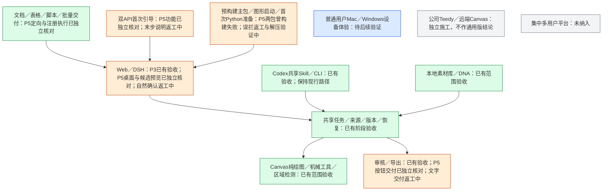
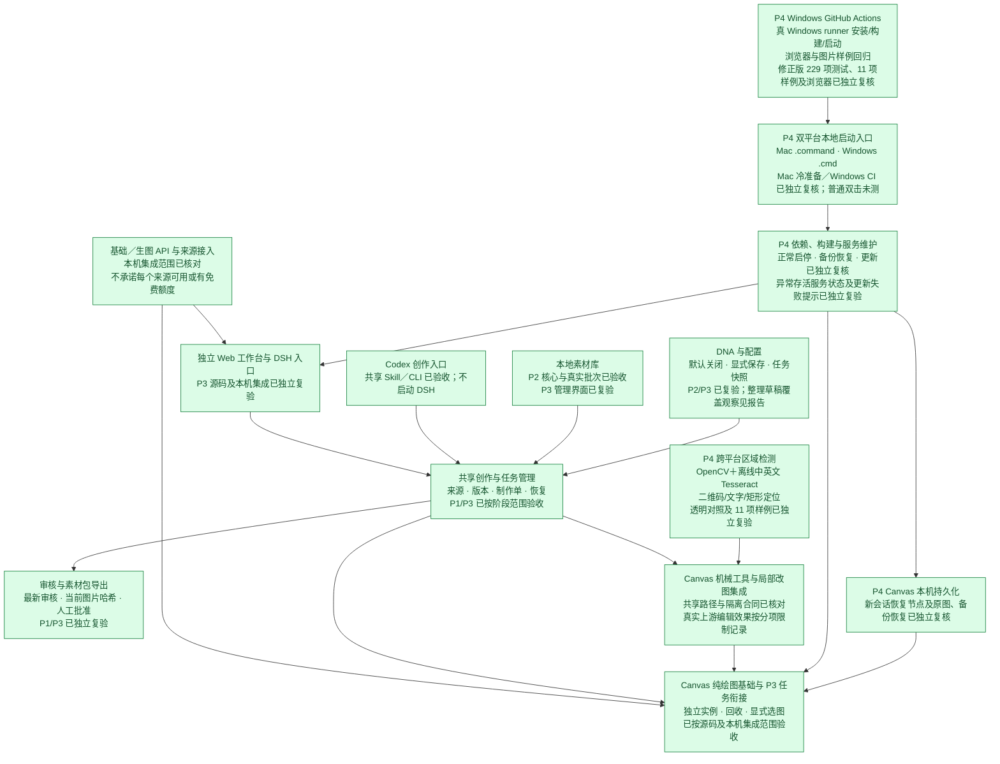
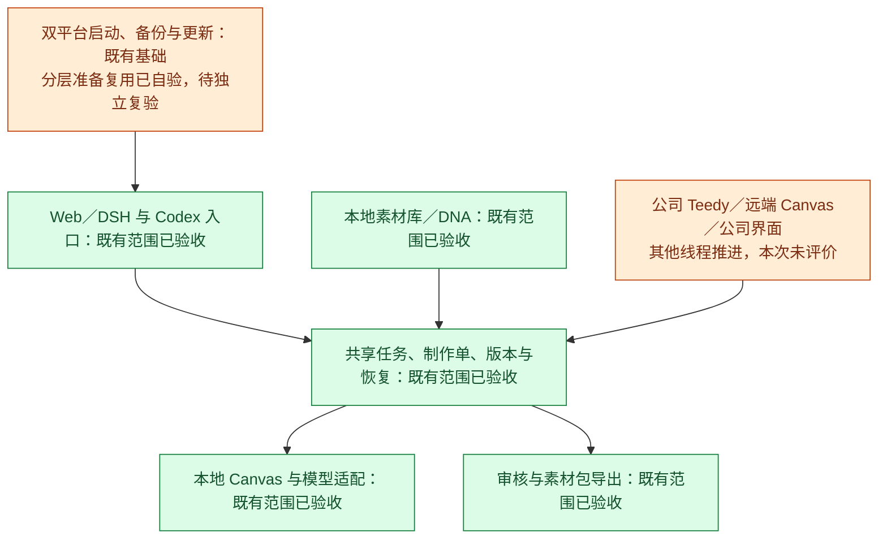

# 整体工程进度

## P5 通用版微迭代（施工中）

用户已明确授权本批范围，并确认以通用版交付为准、保留公司版差异。本轮使用独立工作树，复用 `391b955` 准备器修复；不在公司版脏树上构建发布。独立验收基线 d4f9e1f 暂不整体通过，当前仅返工报告中的必修项，报告见 [P5独立验收](P5独立验收.md)。

2026-10-17 用户补充：Python 环境单独检查和准备，其余依赖随预构建主包交付；不再要求 Python 虚拟环境随 ZIP 搬移。素材检索阶段右侧只读展示编号、缩略图、摘要／用途及拟选或已确认状态，左侧自然语言讨论；生成后成品优先、参考可折叠。桌面窗口为验证目标，手机适配已从本批范围删除。源码 Windows CI 在 `d732bd6` 通过；新主包布局仍须重新跑平台构建，不能沿用该结果宣称运行包已通过。详见 [P5实施与验证](P5实施与验证.md)。

**2026-10-16 P4 最终独立复验通过：跨平台本地 Web 源码交付、macOS 隔离运行和 Windows Actions 按授权范围通过。** 两项首轮必修已关闭，229/229 测试、真实浏览器及用户数据完整性核对通过；普通设备双击体验与既有上游限制单独记录。最新结论见 [P4最终独立复验](P4最终独立复验.md)。

更新日期：2026-10-16。**P0 至 P4 均已按各自授权范围独立验收或复验通过。** P3 的通过范围是源码及当前本机集成，不代表完整首版交付。用户已授权启动 P4；P4 已按跨平台本地 Web 交付范围独立复验通过，两项首轮必修已关闭；普通用户实机和双击体验未验证。

## 当前整个项目具备什么

独立 Web 工作台通过 DSH 调用共享核心，Codex 通过项目 Skill 与 CLI 使用同一任务和工具，不启动 DSH。已有需求与参考确认、可编辑制作单、绘图与失败恢复、实际读图审核、人工批准和素材包导出。本地素材与 DNA 的共享核心及 Web 管理入口已接通；Canvas 独立保留，只执行绘图和机械操作，不召唤 Agent。

本轮 P3 独立复验：206 项测试通过；原两种审核顺序和后续输入归档案例正确；CUA 隔离点验关闭版 DNA 应用、普通草稿一次保存、参考已明确时一次继续、运行中可写本地草稿但不能重复提交。在线 JS 349,851 字节及 SHA 与验证构建一致。361 项基线中359项未变，两项变化为聊天与操作日志；其时间与已完成聊天吻合，但未保存旧日志全文，不能逐条证明只追加。85份旧源、9张历史图、现存Codex ZIP本体及24个成员CRC和23个记录文件哈希已核对，不回滚用户日志。

当前素材库保留用户新增后的14篇、87份附件。历次审核与返工问题保留在独立验收报告中，不再作为当前待修状态。最新完整结论见 [P3最终独立复验](P3最终独立复验.md)及[本轮独立摘要](evidence/p3-independent/final-verification.json)。

P4 目标是 GitHub 仓库内的跨平台本地 Web 产品，不要求 macOS 原生 App、DMG 或 PKG。macOS `.command` 和 Windows `.cmd` 为共享逻辑的薄入口；施工范围包括首次依赖准备与构建、Canvas／插件启停、首次配置、重复启动、备份更新、区域检测跨平台替换，以及 Windows Actions 真 runner 回归。P4 前 Git 基线和回滚边界见 [Git 版本与回滚](Git版本与回滚.md)。

## 产品模块进度图

绿色＝按节点所注明范围已有验收证据；橙色＝当前获授权推进、尚未验收；蓝色＝下一阶段计划、未授权；灰色＝更后续范围。未验证的上游能力不因模块涂绿而宣称通过。P4 的 Windows 实机试用与 GitHub Actions CI 也分别记录；暂缺 Windows 实机不阻断其他 P4 工作。

## 阶段状态与证据

| 阶段 | 当前状态 | 主要证据 |
| --- | --- | --- |
| P0 技术基础 | 已独立验收 | [P0验收](P0验收.md)、[技术验证](技术验证.md) |
| P1 创作核心 | 返工后独立复验通过 | [P1独立验收](P1独立验收.md) |
| P2 素材与 DNA | 返工后独立复验通过 | [P2独立验收](P2独立验收.md) |
| P3 独立工作台 | 源码及本机集成按授权范围独立复验通过 | [P3最终独立复验](P3最终独立复验.md)、[206项独立测试](evidence/p3-independent/final-contract-tests.log) |
| P4 GitHub 本地 Web 交付 | 按源码交付、Mac 隔离运行及 Windows CI 范围独立复验通过 | [最终独立复验](P4最终独立复验.md)、 [首轮独立验收](P4独立验收.md)、[返工与自验证](P4返工与自验证.md)；修正版 Windows [run 38872663995](https://github.com/akechi0819-lgtm/creative-Agent-studio/actions/runs/38872663995) 全部通过（229/229、11/11、真实浏览器） |

## 保留的边界和历史

- 远端局部 AI 改图曾超时、上传图 AI 改图和部分新增真实场景未覆盖，不能把协议集成通过说成所有上游视觉效果通过。WorkBuddy 真实账号与能力仍需本人验证；OpenCode 已记录不可用，不宣传为可用免费额度。
- 历史一／三／五页9张图可核对；当时三份开发测试ZIP本体未保留，本轮没有重新验证它们。现存Codex真实ZIP独立核验通过。
- DNA 整理完成可能覆盖同期未保存编辑，是非阻断的后续体验观察；不为此扩展本轮范围或新增审批。
- 原实施与实测、界面设计、用户新增需求及局部改图／机械工具的详细过程保留在 [P3实施与验证](P3实施与验证.md)、[P3独立验收历史](P3独立验收.md)、[护栏复核历史](P3护栏与返工复核.md)、[小范围修正](P3小范围修正与护栏精简.md)和 [Codex真实回归](evidence/codex-real-regression-20261015/README.md)。

每个新阶段线程先读 PRD、施工计划、本文及上一阶段验收，用自然语言说明工作与完成后能力，展示模块进度图。下一阶段计划不等于施工授权；当前 P4 已于 2026-10-16 按授权范围独立复验通过，后续可进行普通用户设备试用。

本轮用户已补充授权：创建公开源码仓库 `creative-Agent-studio`，经源码与历史检查后上传并运行 Windows Actions；云端运行以真实 run 结果为准，普通用户实机与双击体验单独记录，不部署公网服务。

## P4 首轮独立验收历史

主审从 Git 归档冷准备，220/220 测试及真实浏览器、二维码合成、重开恢复、正常停机通过；Windows 实际 CI 与代码对应关系已独立核对。正常更新、备份恢复通过，检查期间 813 个用户文件哈希不变。透明 PNG 二维码漏检与不健康存活服务状态误报为本轮两项必修；更新失败时恢复点提示和取消窄窗为非阻断观察。最小修正和复验范围见 [P4独立验收](P4独立验收.md)。不增加普通用户自行改源码、额外确认或强杀进程要求。

## P4 小范围返工自验证历史

首轮两项必修已按最小范围修正，更新失败恢复点提示与取消检查一并小修。本机隔离全量 229/229、图片 11/11、真实浏览器通过；修正版 Windows 真 runner 全部通过。主体链路既有独立证据保留，新增修正仍待主审复验；不把自验当作独立通过。源码提交、公开对应关系和精确证据见 [返工报告](P4返工与自验证.md)。

## P4 最终独立复验

主审从修正版 Git 归档重新准备并构建，229/229 零跳过，真实浏览器与原两项缺陷复现均通过。Windows run 38872663995 及公开源码对应关系已独立核对；更新失败恢复点提示验证通过；公开历史扫描零发现；本轮 813 个用户文件哈希全相同。两项首轮必修关闭，无新增阻断。普通用户双击体验、各模型来源和复杂图片检测能力继续按证据范围记录，见 [最终报告](P4最终独立复验.md)。

## 启动准备复用修正（2026-10-16）

已有目录无 ready 账本导致全量重装的问题已修正。四组依赖、五个构建和 OCR 运行时／包／模型分别验证与记录；源码变化只重建相关产物，不重装健康依赖。隔离全量 259/259、针对性 30/30 通过，真实 Node 22.22.3→22.23.3 切换后仍免安装。OCR 已用本机 Python 3.12.0 与既有缓存离线补回，原三模型 SHA 不变，第二次跳过，扫描 PDF 等10项回归通过；原旧 venv 无备份，不能称恢复原件。

本轮一次验证命令误在真实根目录执行，已停止并清理新增临时环境／状态；没有 npm ci，但两套前端被重建、无旧快照未回滚。该错误及缓存边界如实保留在 [启动准备复用修正](启动准备复用修正.md)。本轮不评价或提交公司版其他施工，不上传工作树，Windows 新回归未执行；等待主审复验。

