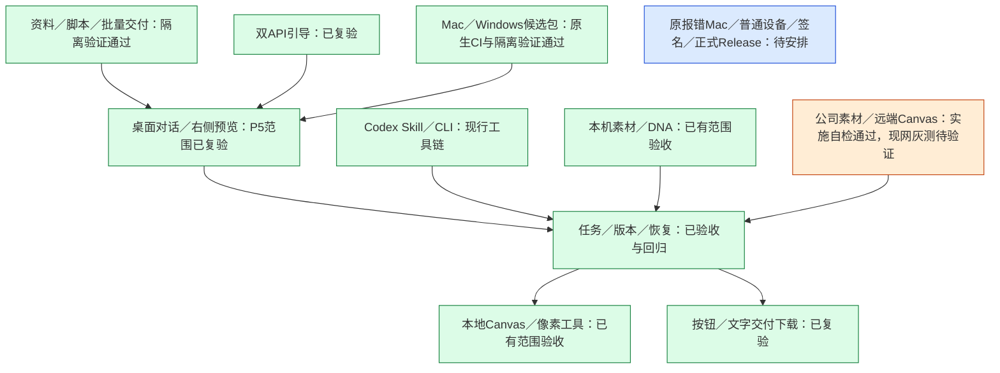

# 整体工程进度

更新：2026-10-17。本文是当前状态入口；实施过程和失败历史留在对应报告中，不把历史“待验收”作为当前状态。

## Windows 首次启动返修（2026-10-21 施工中）

按用户要求同步个人版和公司版：实时安装进度、防重复启动、缓存续装、进展超时修正与隐藏伴随进程。个人版源码回归317项中316通过，1项Windows专属测试待runner。个人版候选 `p5-startup.1`，公司版 `company-p5.1.4`；[修复记录](Windows首次启动修复.md)。真实Windows用户路径（解压、VBS启动、首次安装、首次配置、停止重启）正在单独验证，尚不标通过。

## 当前版本与交付

个人版主线为 `main`，公司版为 `codex/company-edition`。P5主体已按源码、隔离桌面、Mac本机及双平台原生CI范围独立复验；后来用户发现Mac隔离启动缺陷，现已在两版同步自包含app与只读启动修复。修复自测与原生构建已通过，原报错Mac双击仍待用户复测，不能复述旧Mac包“开箱已验收”。

- 个人版：本机素材库、默认关闭的DNA、本地Canvas、左侧对话与确认、右侧预览、通用文件／脚本工具、审核导出、双API引导。
- 公司版：继承P5能力，使用独立Company数据目录／4311、Teedy本人账号只读检索、保留后冻结来源、远端Canvas和本机双模型配置；公司新增范围有实施自检，尚不宣称真实员工账号／ACL、付费生图与员工灰测均通过。
- 运行包：Mac Apple芯片为自包含app；Windows x64保留完整目录。Node、生产依赖和构建产物随包，Python／OCR／Office首次可能联网准备，健康环境复用。
- 当前下载是Actions候选artifact，可能需要GitHub登录且有保留期；尚未建立正式长期Release。当前下载链接以各分支README为准，旧Mac包不作为推荐入口。
- Codex继续使用宿主对话、项目Skill／共享CLI与Canvas图片API，不启动DSH，不切换到宿主内置生图。

## 整体模块

绿色只覆盖节点注明的证据范围，尤其候选包构建通过不等于所有设备双击体验通过。公司模块橙色表示仍有现网与员工体验待核对，不代表重新授权未讨论的开发。

## 阶段证据索引

| 阶段 | 当前结论 | 报告 |
| --- | --- | --- |
| P0 技术基础 | 按阶段范围通过 | [P0验收](P0验收.md) |
| P1 创作核心 | 返工后独立复验通过 | [P1独立验收](P1独立验收.md) |
| P2 素材与DNA | 按批准范围独立复验通过 | [P2独立验收](P2独立验收.md) |
| P3 Web界面及集成 | 按授权源码与本机集成范围通过 | [P3最终独立复验](P3最终独立复验.md) |
| P4 跨平台源码交付 | Mac隔离运行及Windows Actions范围通过 | [P4最终独立复验](P4最终独立复验.md) |
| P5 微迭代 | 主体按报告范围独立复验通过 | [P5最终独立复验](P5最终独立复验.md) |
| Mac后续缺陷 | 两版修复已同步；原设备复测未完成 | [个人版修复](Mac运行包隔离启动修复.md)；公司分支见公司版自检 |

[启动准备复用修正](启动准备复用修正.md)、[模型来源与裁剪](模型来源与裁剪.md)和各阶段实施记录保留具体过程。OpenCode第三方对话限制、WorkBuddy本人账号能力和远端改图质量按实际证据解释，阶段通过不扩张这些结论。

## 后续工作

本次收尾整合共享修复、分支／工作树和文档入口，不自动部署公网服务、更新公司服务器、改变标签ACL或进行付费重测。正式Release、签名与普通设备反馈需要按后续实际安排记录；不将候选下载链接当永久分发地址。
