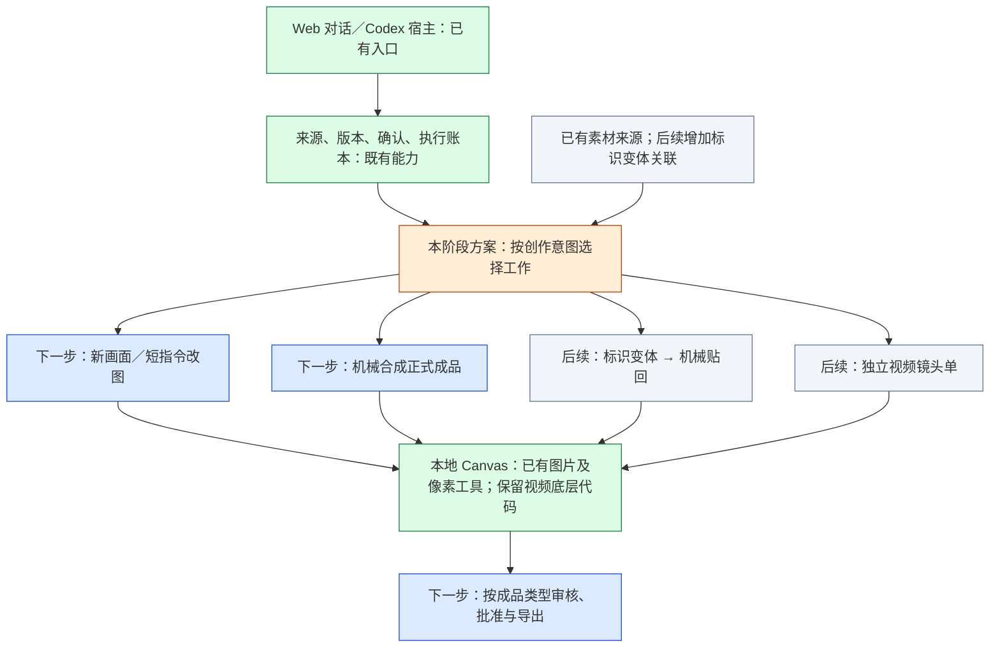

# 标识适配与图视分轨：复核定稿

日期：2026-11-10。复核基线：个人版 `main@b28e8e1d190374adeb3606e9db045706d500763d`。

本文是对外部《标识适配与图视分轨-架构复核与施工计划》的施工方案定稿建议，不表示功能已经实施或验收。此次只读核查代码、项目文档与上游公开资料，没有重放用户任务或调用付费模型。公司版尚未逐项核对，实施共享修复时必须在适用分支同步验证。

## 一、复核结论

保留外部方案的主方向：新创作、已有图修改、机械合成、标识适配分别处理；短视频使用独立镜头单。保留现有来源、版本、SHA、人工确认和防重复提交合同。采用逐段扩展现有实现，不先造通用工作流引擎，不整体替换 Canvas。

用户关于上游的记忆成立：原项目是 [basketikun/infinite-canvas](https://github.com/basketikun/infinite-canvas)，同时支持图片和视频，并提供 [Canvas Agent／Codex MCP](https://github.com/basketikun/infinite-canvas/blob/main/canvas-agent/README.md)。本地内置副本注明基线为 `3a6b64b602ad062b29fac66902ed18a7ef5fd9dc`。当前上游 `main` 文档不等同于这一基线；选取新增实现前需固定提交并核对依赖，不能整包覆盖。

更准确的判断是：**视频底层大部分仍在，Studio 尚未形成受控的视频产品链路。MCP 可以提供调用入口，但不能单独补齐配置、任务、回收、审核和导出。**

## 二、需要修正的原方案表述

| 原判断或建议 | 当前代码证据 | 定稿处理 |
| --- | --- | --- |
| 正式出图写死 low，需核实是否生效 | `src/creative/executor.mjs:215` 写 low；`canvas-generation-helpers.ts:88` 优先取节点质量；`services/api/image.ts:744–754` 将合法 quality 写入 OpenAI 图片请求，编辑路径也传该参数 | 已确认该请求路径会传 low。先移除执行器强制低质量，采用明确的任务质量或当前默认 auto；不能直接把默认改成 high，也不把 low 当唯一劣化原因 |
| 局部改图始终追加历史 prompt | `page-edits.mjs:413` 的页修改确实追加；但同文件 `315–317` 已有短 instruction、底图及 preserve-source-text 的图片修改路径 | 复用已有短指令实现来改页修改入口，保留版本追溯；不再开发第二套同类执行器 |
| 执行器不再把 copy 送入 Image | 新海报当前靠 executor `132–134` 将准确文案传入图片模型 | 区分用途：新海报仍传需要绘制的准确文案；已有图修改只传本次指令、必要的新文案与当前底图；机械合成不传生图。拆字段不代表模型接口能分别理解两个结构字段 |
| 加意图路由器 | `src/web/dialogue.mjs` 主要识别用户确认语句，关联展示版本 | 保留确认判定器；另在现有对话工具选择处加入工作类型，避免把创作分类与人工授权合在一起，也不以关键词自动触发付费执行 |
| 没有视频能力 | `schemas.ts`、`operations.ts` 保留视频工具；`services/api/video.ts`、`project.tsx` 保留实际生成、查询和存储 | 恢复 Studio 配置和任务接入；无需从零重写视频供应商适配 |
| 审核只验文案；加审美字段即可避免稳但丑 | 现有 AI 复审已读取实际图片并核对 SHA，以版本、页码、SHA 关联记录；不能说完全没有视觉审核。结构字段也不能证明审美判断可靠或独立 | 增加实际看图依据、参考对比与待改项；结果仍需用户整套确认，不能称为独立审美验收 |
| 25项任务／211条提示词／235次修订等统计 | 本轮未读取原证据包或重新统计生产任务 | 保留为外部审计所述，不写成此次独立验证事实；审美因果仍需对照实验 |

## 三、产品模块与实施边界

绿色指已有实现或既有验收范围，不代表视频在 Studio 已可用；橙色是本次方案复核；蓝色是建议先施工部分；灰色是后续部分。共享工作类型、素材身份和结果追溯即可，不要求五种工作各有完整独立状态机。

## 四、Canvas 原生接入的最终取舍

### 1. 复用什么

- 原有图片／视频节点、引用连线、生成配置与 UI。
- `canvas_generate_video`、`canvas_run_generation` 与 `generation_get_status` 的现有桥接能力，仍绑定任务专属 project／instance／client。
- `web/src/services/api/video.ts` 已有的 OpenAI 风格 `/videos` 提交、状态查询、结果下载，以及 Gemini 分支。首尾帧、全能参考、声音等按实际供应商支持开放。
- `project.tsx:313–380` 的远端任务 ID 保存和刷新续查。继续贯彻未知状态只查原任务，不自动重新付费提交。
- 现有本地媒体存储、视频预览与截帧实现；补的是 Studio 受控读取／下载与成品登记，不能把浏览器 blob URL 当可交付文件。

### 2. Codex MCP 怎么用

上游提供 MCP 与 Codex app 插件，插件配置确实以 `@basketikun/canvas-agent ... mcp` 启动。[上游插件配置](https://github.com/basketikun/infinite-canvas/blob/main/plugins/infinite-canvas/.mcp.json)与 [OpenAI MCP 文档](https://learn.chatgpt.com/docs/extend/mcp?surface=cli)支持这一连接方式。

但上游有两个不同方向：宿主 Codex 通过 MCP 操作画布；画布侧栏启动 Codex app-server。Studio 只需要前者的工具连接能力，继续由当前宿主会话推理，不恢复画布召唤另一个 Agent 的侧栏。

**施工优先级：先沿已工作的 Studio CLI／HTTP-SSE 桥接接通视频；若要给 Codex 原生工具体验，再复用上游 MCP 协议层，接到同一套 Studio 受控操作。** 不把安装全局 MCP 作为视频前置条件，也不因省接入工作而让原始工具绕过任务确认、隔离或账本。先检验上游 MCP 的项目选择与服务发现是否适配多任务实例，再决定能原样复用的范围。

上游当前插件示例使用 latest 和线上画布；项目实际集成应使用固定版本与本机任务 Canvas，沿用现有安装和数据目录边界。此次不安装插件、不改全局配置。

### 3. 还缺什么

- Studio 独立视频模型设置：地址、协议、模型、凭据可复用已有渠道，但视频能力和参数单独表达。已有双 API 配置不足以自动推导视频模型。
- `src/web/canvas.mjs` 当前只注册 image，且 `videoModel` 为空；需增加视频渠道和同步，并保证图片配置刷新不会覆写视频选择。
- 独立镜头单、受控执行入口、状态恢复、媒体文件回收、审核批准和导出。它们不能经图文 `execute` 或强制套图文 1–5 页。
- 首版只做单镜头短片；时长、分辨率与参考模式按用户实际模型合同取交集。UI 可选值不是供应商支持证明，6秒默认也不是产品能力上限。
- 第一版验证用户一个真实视频模型即可，不同时建设音频制作、剪辑时间线、自动拼接、配乐或通用供应商插件平台。

## 五、施工顺序与验收条件

### 第零步：修正质量参数

移除 executor 强制 low。记录每次新执行采用的质量；已提交作业不因默认变化重放，已批准成品不被重生成。用隔离替身接口核对文生图、图生图实际请求参数及节点优先级；不需要付费证明参数传递。

验收：默认路径不再强制 low；明确选择的合法质量被保留；恢复只查原结果；文案及引用图合同仍成立。

### 第一阶段：先修图文闭环

1. 复用短指令改图路径，页修改使用本次指令与当前成品。版本可继续存在，但不把历史创作指令层层追加后再次执行。只有用户指定的风格参考进入本次请求；无关旧参考不自动携带。
2. 新创作分开表达画面语言与准确文案，仍将必要文字送入模型；禁止把平面、纯色或禁止渐变当通用默认。艺术指导先放进现有编写规范，不急于新建独立 skill。
3. 为机械结果增加“采用为本页／本次成品”的正式动作。核验任务来源、源图 SHA、操作结果与输出文件后产生新成品版本；该结果进入既有读图、审核、用户批准和导出。不能把辅助附件直接标已批准，也不能手填 succeeded 伪造图片执行成功。
4. 复审补充构图、字体与层级、色彩质感、参考贴合、品牌表现及可见缺陷，提供具体看图说明。只对新结果绑定审核；替换页的旧审核／批准失效，未改页按其真实哈希复用。保留现有用户明确确认当前整套展示图后由宿主登记逐页通过、批准并导出的路径（`src/web/server.mjs:876–889`），不把新增审美项变成强制重复确认。

验收：连续改两次不会累加历史 prompt；新海报仍有准确文案；机械成品可正式下载；原图保留；陈旧确认拒绝；重复请求不重复生成。机械操作的框外像素可逐像素核验；生成式改图即使指令短或带遮罩，也不得承诺框外像素必定不变。

### 第二阶段：标识适配

先做最小可复用标识变体：关联原件 SHA、透明背景、前景色、描边色／宽度及底牌参数，保存为派生素材，不覆盖原件。复用现有 Canvas 2D 与像素处理依赖。只同步必要元信息到既有素材体系，不新建另一套总库；公司 Teedy 保持只读，变体留在本地任务／派生素材目录。

对于透明底且边缘明确的原件，可确定性换前景色、按 alpha 轮廓描边、增加圆角底牌。白底扁平图不一定能安全抠出白字或细边；先看原图，只在确实可分离时机械处理，否则要求透明／矢量原件或在用户已授权范围内做标识局部生成并复核字形。不能默认把所有白色像素清空。

雅思案例必须区分两件事：从干净标识做绿色填充细白描边，可以机械完成；从已烘焙的海报里删白矩形并恢复被遮背景，需干净底图／可分离图层，否则属于背景局部修复。不能把后者宣称纯像素操作可还原。

验收：雅思细白线紧贴轮廓而非外接矩形；新托福白字绿底牌先生成标识变体再合成；原件不变，标识字形和比例可对照，变体可复用，最终海报走第一阶段的正式成品链路。

### 第三阶段：视频独立闭环

按“镜头单 → 展示并确认 → 提交一次 → 保存远端 ID → 查询 → 保存媒体 → 审核 → 人工批准 → 导出”接通单镜头视频。镜头单写本次动作、镜头、时长、比例和输入帧，不调用图文提示词规范化器。

允许引用已确认可用的图文成品帧，记录其版本和 SHA；视频创建后不改变原图文任务、文案、审核或批准。先支持视频文件下载和必要元信息，不把图文 PNG／ZIP 导出器强行当视频导出器。

先用替身视频服务跑提交、pending、成功、失败、超时、断连和恢复，确认媒体实际落盘可播放。浏览器刷新／进程重启后继续查同一远端 ID；若任务是否提交未知，不自动重提。异常不得伪装为完成。

真实模型验收前明确型号、供应商协议、费用与用户授权；随后做一条短片，核对参考帧、播放、时长、分辨率、音轨（若支持）和下载。抽帧仅用于画面检查，不能冒充已检查动作连续性和声音；后两项需实际播放验收。没有真实付费测试时只标“替身链路通过”。

### 后续独立事项

DNA 按品牌／系列限定作用域值得做，但不是视频前置依赖，不打包进视频首版。保持默认关闭和显式应用。页数放宽也不属于本次必要施工。

“用户原话直出”与“工作台转写后出图”的审美对照另行安排：同模型、同参考、同质量／尺寸／文案，保留实际请求和成图；涉及新增真实付费生成时单独明确次数与费用。现有返工次数不足以证明单一因果。

## 六、落地接点与停止条件

图文主要接点：`src/creative/executor.mjs`、`page-edits.mjs`、`tasks.mjs`、`reviews.mjs`、`canvas-operations.mjs`，以及 Web／CLI／DSH 的同类工具入口与成品预览。

视频主要接点：Studio 模型设置与 `src/web/canvas.mjs`，Canvas `canvas-agent/src/canvas/{schemas,operations,session}.ts`、`web/src/services/api/video.ts`、`web/src/pages/canvas/project.tsx`，新增最小视频任务执行与成品回收入口。遮罩参数是否接通取决于本阶段模型合同；不把 UI 有按钮当接口已经接通。

实施时在现有 PRD、施工计划、工程进度和相关接入清单中更新真正被本次改变的条目；更新代理宿主 skill 和 Web 工具描述，保证两入口采用同一语义。测试用隔离目录和夹具，按修改范围运行现有检查并增加必要回归。共享修改在个人／公司版各自验证，保留各版素材和配置边界。

每段完成且相关检查通过即停止扩建。本文不授权新增付费试跑、部署、发布安装包或修改公司服务；这些行为也不是方案复核的完成条件。
