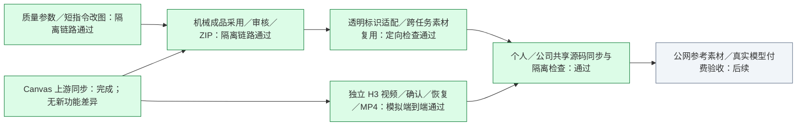

# 标识适配与图视分轨：实施记录

日期：2026-11-11。施工依据为[复核定稿](标识适配与图视分轨-复核定稿.md)，当前结论以[工程进度](工程进度.md)为准。Planner 负责接口、审查、集成和验证；Luna Worker 分别实施图文核心、机械／宿主入口和 Canvas／视频配置。首次实施验证使用隔离目录与模拟模型接口，没有重放旧任务或进行收费生成；后续获授权的真实调用另见文末，不扩写首次验收范围。

## 已落地行为

- 质量参数不再强制 low。默认 auto 在原生图片请求省略 quality，明确指定的合法质量按页传递；不重放已提交作业。
- 对已有成品的修改只使用本次指令、当前底图与明确选择的风格页。省略 copy 时保留原图文字及导出文案记录，不把原文和旧提示词重新累加给模型；新创作仍携带准确文案。
- 机械结果通过操作账本、任务身份、实际字节与 SHA 核验后采用为新页成品。原件和未改页保留，受影响审核与最终批准失效；支持后续局部修改、恢复、预览和原有 ZIP 导出。无制作单任务可采用为单页机械成品，不伪造 AI 执行和整套创作确认。
- 透明标识可确定性换前景色、沿 alpha 轮廓描边、加圆角底板；操作拒绝不透明或空标识。派生素材保留原件 SHA、参数和输出 SHA，进入现有素材库 staged 草稿，清洗及人工确认后才是正式素材。不覆盖原图，不向公司 Teedy 写入。
- 独立视频核心使用 `task.video`，不覆盖图文制作单、执行、复审和批准。镜头方案版本、人工确认、一次提交意图、原 Canvas 节点／远端 ID、媒体文件 SHA、复审、批准和 MP4／manifest 导出形成独立链路。提交不明时只查询原节点；明确失败后必须新建并确认方案。

代理宿主入口的具体 payload 与人工确认要求见[项目 Skill](../.agents/skills/creative-studio/SKILL.md)。本轮保留既有受控 CLI／HTTP-SSE 连接，没有安装全局 MCP，也没有恢复画布召唤 Agent。

## 首次隔离验证模块状态

绿色只表示标注范围的隔离源码验证；灰色为后续输入接入及真实模型验收，不代表模型质量已验证。

## 上游核对

原项目为 [basketikun/infinite-canvas](https://github.com/basketikun/infinite-canvas)。内置基线为 `3a6b64b602ad062b29fac66902ed18a7ef5fd9dc`，已纳入截至核查时上游 `main@9cd3deacbcc598361807afc16c059a80dd18b6f9` 的全部差异。仅两个 README／CHANGELOG／资源提交，零功能源码及依赖变更。因此升级本身没有解决 Studio 视频配置、确认和交付问题；这些由本轮集成补齐。原本的任务隔离、纯执行和断连恢复补丁保留。

## H3 当前渠道合同

按用户指定旧线程恢复既有模型选择：Octiva `https://api.osodm.com`、`minimax_h3`。以当前[供应商模型文档](https://api.osodm.com/docs/model/minimax_h3)为准，旧试跑使用的 duration 等字段不再沿用。请求使用 `version:'video.v1'`、`operation:'text_to_video'`、`duration_seconds`、`resolution`、`aspect_ratio`。时长为 4—15 秒整数；分辨率字符串为 768、1080p、2K、4K；比例为 21:9、16:9、4:3、1:1、3:4、9:16。没有发送供应商未列出的音频／水印控制参数。

供应商参考素材要求公网 HTTP(S) URL。Studio 本轮首版只开放文生视频，尚未接入公网素材 URL，不把本机文件／data URL 直接发送，也不自动把用户原件上传图床。不能把这一边界描述成供应商不支持参考图。原图文成品帧转视频仍属于后续输入接入工作。

核查时模型页面的 768 规格标价为每秒 $0.16，4 秒名义 $0.64；实际费用以供应商计费为准。首次隔离验证没有调用真实付费模型，因此当时不证明实际时长、分辨率、动作连续性、声音、供应商质量或最终扣费。后续真实调用见文末。模拟 MP4 可播放只证明 Studio 媒体链路。当前回收单个 MP4 的大小上限为 64 MiB，超限明确停止，不自动转码或降清晰度。

## 首次隔离验证记录

个人版最终整仓回归为 378 通过、2 项明确跳过（380 项）；其中包含本轮补齐的旧任务真实浏览器回归。宿主接口／CLI／DSH 定向检查 40 项通过，Web 构建通过。Canvas Agent 19 项测试及构建、Canvas Web 类型检查与构建、Bun 18 项检查已通过；H3 HTTP 合同采用本地假接口验证。

`scripts/verify-media-workflows.mjs` 使用真实任务 Canvas 与本地假图片服务，检查默认 auto 省略字段／明确 high、连续两次短指令互不累加、透明标识轮廓／底板像素、机械合成采用、新鲜度、主工作台预览、人工交付确认、ZIP 字节及刷新不重复下载。证据为 `docs/evidence/media-workflows/verification.json`。其中 staged 变体的直接读字节再导入并不能单独证明正式素材跨任务复用，后者需独立覆盖。

旧 `scripts/verify-web-page-edits.mjs` 因已淘汰的“制作单”标签选择器在请求前停止，未将其记为通过；新端到端脚本覆盖本轮实际主界面路径。auto 首次检查曾错误要求请求显式携带 auto，按原生 API 合同改为验证省略字段后通过；没有为检查而改变产品合同。

`scripts/verify-video-workflow.mjs` 第 6 轮原生链路通过 10 项检查：真实 Canvas、严格 H3 参数、一次创建、pending 后中断／原节点恢复、媒体持久化回收、SHA／尺寸／时长、Chromium 播放、人工复审批准、MP4／manifest、图文状态不变及刷新不重提。当前恢复时长 4000ms，与浏览器 3999ms 差 1ms。第 1—5 轮失败原因保留在 `docs/evidence/video-workflow/verification.json`；包括错误的测试假设（浏览器必须持有密钥、精确原文而非原生引用展开、macOS realpath 前缀），以及真实修复的 MP4 呈现时长问题。恢复器改为读取有效 mvhd 呈现时长，缺失／无效时明确失败，不再用媒体轨采样时长或方案秒数代替。真实合成 MediaRecorder fixture 纳入回归。主工作台视频按钮与下载由 attempt 12 接续验证通过。

本机更新前检查确认无活动作业、任务入口或核心锁，并正常 stop 旧实例。现有备份器将 DSH 的零字节 `session.lock` 错当 JSON 所有者文件而失败；该锁按上游合同为 POSIX flock，不应删除或忽略。现已复用既有 native addon 做非阻塞试锁，持有者存在则拒绝备份；两项隔离回归及 launcher 18 项检查通过。本机重跑备份成功，1832 个文件在仓库外私有目录保留，包含配置／Canvas 媒体，不包含浏览器资料；未删除或改写 DSH 锁。异常 Git 引用名称 `main 2` 等已在 `.git/codex-backups` 备份后移出引用区，修复 fetch 与分支创建；对应提交未删除。

本机视频配置已通过设置页保存，刷新后仍显示已配置；配置文件权限 0600，原基础／图片配置及密钥与更新前备份逐项相同，已跟踪源码中未发现这些密钥。1221 个原任务文件与备份 SHA 一致。源码第一次启动曾暴露无 video 状态的旧任务白屏：前端把 undefined===undefined 误当有效视频版本，已修复有效版本／执行／SHA 判断，隔离 Chromium 回归和本机页面复测通过。

公司版已在 `codex/media-workflow-upgrade-company` 合入共享源码及旧任务修复，保留 Company 数据目录／4311、Teedy 检索／冻结、公司文案提示及原图片代理。公司整仓为 413 通过、4 项条件跳过（417 项）；跳过为私有 OCR／RapidOCR 环境、Windows GUI 条件与 Office Python 环境不足，未掩盖为通过。Canvas Agent 19 项及构建、Canvas Web Bun 18 项／类型检查／构建、Studio Web 构建均通过。首轮全仓与构建并行时遇到 Canvas 尚未构建，随后构建完成串行重跑通过，失败历史保留在公司自检。没有更改 company-p5.1.4 已发布候选包的状态，也没有把个人密钥复制到公司数据。

最终视频工作台 attempt 12 已通过 13 项隔离浏览器检查：先生成并保留原图片，再展示／确认独立 v2 镜头方案，使用真实任务 Canvas 提交本地替身请求、实际播放、按 SHA 批准、下载 MP4 与读取 manifest；Web／Canvas 刷新不重发或再次下载，原图文 graph 深相等。两次视频创建对应两个已确认方案，每个方案仅一次；供应商直连 0、付费请求 0。截图见 `docs/evidence/video-workflow/attempt-12-workbench-video-exported.png`，完整历史在 verification.json。后续轮次修正了测试脚本的未授权连接探测、首次引导与图片代理断言，并未放宽产品授权；图片既有本机代理可能携带内存中的密钥，新 H3 代理浏览器请求不携带密钥，两者证据分开记录。没有更新公司服务、ACL、全局 MCP 或已发布安装包。

## 后续真实调用与审美对照（2026-11-11）

以下真实调用发生在个人本机工作台，不代替公司员工实机、公司账号或极简版的真实收费验收。

用户授权按正常使用流程进行真实图文和约六秒视频调用，随后明确本轮重点是审美，而非接口是否返回成功。WorkBuddy 当前渠道返回受控失败；依照用户要求，后续对话统一使用 Kilo，不绕过原渠道限制。基础对话与图片／视频渠道仍独立保存。

最初的简单图文只证明调用链路，不能作为审美验收。辅助阅读封面样本的原话组和转写组均已实际读图，并做不知道条件来源的复核；单次无固定种子的差异不能外推为所有提示词转写都会降低审美。

主场景改用用户提供的真实官网首屏编辑，两组使用相同原件、相同渠道 `gpt-image-2.6` 和默认 auto 质量，分别直传用户短指令与经正常 Web／Kilo 理解后的短指令。网页版现成结果只作为外部审美参照：网页未暴露可核实的底层图片模型，不能宣称与 API 严格同模型。用户认为本场景审美接近；两组建筑、玻璃、柔光及半透明底的方向接近，没有依据再增加固定美学模板。画布强制比例另作参数问题，不据此判定审美退化。

连续修改中，正常 Web 选择 Canvas 像素裁切并正式采用为新版本，保留首轮画面而不再次生图；首次裁切漏掉聊天框底部，经一次正常反馈后从完整图片重新裁出，保留输入框与发送按钮，并去掉编辑工具栏和产品中心。直传组第二轮采用生成式编辑，因此第二轮记录为真实流程分岔，不冒充同模型提示词配对。

原图中的个别说明、标签及聊天名称在首次生成时发生漂移；它属于文字保真限制，与审美结论分开，未据此伪造最终批准。用户原件、网页参照和实际生成文件只留在下载目录／私有任务目录，不进入仓库、公开证据或分发包。

随后只补齐参数与文字保护的最小修正：上传图不再默认锁成 3:4，而使用 Canvas 已有 auto；两类短编辑均接受用户明确指定的 size，已有成品省略时沿用原尺寸。文字保护允许本轮明确要求的删除／替换，不与用户本次指令冲突。单次真实上传图复测输出为 1839×855，原图为 1903×887，未再强制竖版；这不保证所有渠道的 auto 都严格等比例，也没有解决模型本身的文字漂移。

真实 H3 按六秒、16:9、1080p 的方案仅提交一次。原 Canvas 已实际播放完成，镜头从前景叶片转向玻璃大楼，没有字幕或 Logo；实际文件为 1920×1088、约 6.58 秒、6,745,808 字节，不将请求规格冒充输出的精确规格。首次等待未及时显示结果，用户刷新后 Canvas 出现视频；工作台随后拒绝恢复。确定原因是刷新改变浏览器 clientId，而 project、Canvas instance 和模型渠道均未改变，视频核心却把 clientId 当成不可变化的实例身份。

修复只允许已提交且已保存远端任务 ID 的同实例恢复；重新核验固定文案／配置节点和唯一关联视频的原任务 ID 后才更新浏览器绑定，跨项目／实例／渠道、歧义目标和任务 ID 不符仍拒绝。使用共享 CLI 从原节点回收真实文件成功，原远端任务 ID、提交意图和实例均未改变，没有第二次生成。该修复没有修改供应商返回格式，也不把最初的显示延迟全部归因于这个恢复错误。

此后个人版全仓 **386 通过、1 跳过**，公司版 **420 通过、4 跳过**；新增回归覆盖刷新后原任务恢复、不重复生成与跨目标拒绝。样本审美结论、模型文字保真、参数修正、视频恢复和设备／打包验证分别记录，不能相互代替。

正常对话复测还发现模型任务投影遗漏独立视频状态，导致右侧已可播放时助手仍误说未启动。现为初始上下文和 `studio_read_task` 同时加入白名单视频状态，区分方案请求值与实际输出宽高／时长／字节及审核状态，不传内部任务 ID、存储键、路径、访问 URL 或密钥。本机加载后同一 Kilo 对话已准确读回 succeeded、1920×1088、6584ms 和未最终批准状态；没有发起新生成。

## 三版源码与候选包收尾（2026-11-11）

个人 Windows 源码 [CI 42958996366](https://github.com/akechi0819-lgtm/creative-Agent-studio/actions/runs/42958996366)、公司 Windows 源码 [CI 42960432670](https://github.com/akechi0819-lgtm/creative-Agent-studio/actions/runs/42960432670) 通过；极简版 [CI 42960857404](https://github.com/akechi0819-lgtm/creative-Agent-studio/actions/runs/42960857404) 在 macOS 15 和 Windows 2025 均通过。极简版保持共享 Canvas／宿主线程架构，以独立 H3 配置、原生视频节点和本机 MP4 保存闭合流程，不引入完整版任务账本。其完整隔离验证从 MCP 提交经真实 Canvas、fake H3 请求、关联视频子节点到保存核 SHA；不是预置视频节点的单独读取测试，也不替代真实付费成品审美。

个人 [native run 42958998296](https://github.com/akechi0819-lgtm/creative-Agent-studio/actions/runs/42958998296) 与公司 [native run 42958996532](https://github.com/akechi0819-lgtm/creative-Agent-studio/actions/runs/42958996532) 均成功，分别生成 media-workflow.2 和 company-media.2 的 Mac arm64／Windows x64 候选包。CI 已对归档解压、manifest 哈希、独立 app／启动入口和搬移后启动进行核验；产品 SHA 与 artifact 元数据来自 CI，本轮没有声称完成本机大包下载复核。入口已更新到 README，均于 2026-11-25 到期；未创建正式 Release 或签名／公证。

公司两次 Windows CI 失败分别暴露旧专项夹具缺少 import sourceKind、以及旧设置页全局密码框计数未包含视频卡片，均修正下游验证合同而未放宽产品校验。对应完整本机专项为 Canvas 24 个断言调用、公司浏览器 30 处断言，最新云端全部通过。早先 .1 native 候选构建为纳入后续视频状态修复而主动取消，发布入口只指向最终 .2。
