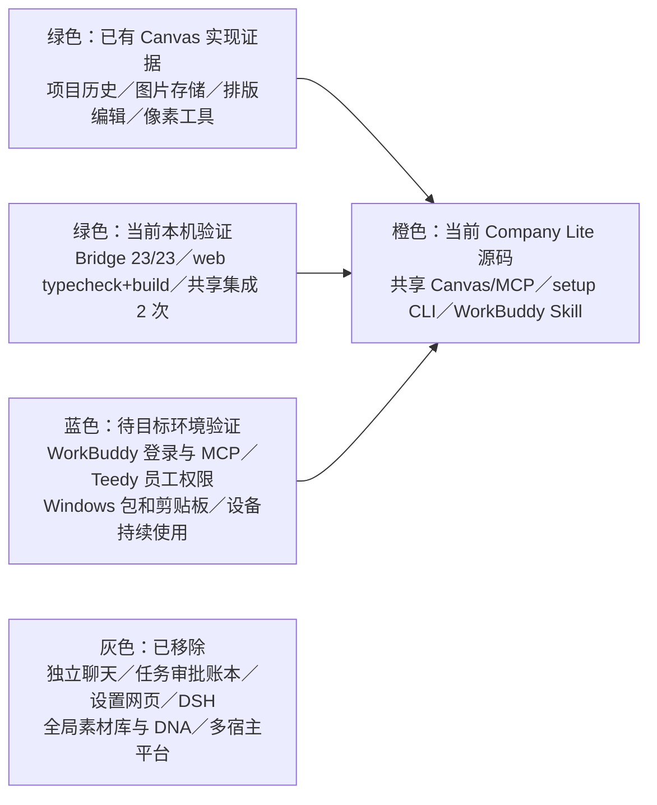

# Creative Agent Studio Company Lite 开发与施工计划

更新：2026-10-29。适用于 `codex/company-lite`。WorkBuddy 对话线程主持当前创作；本机共享 Canvas/MCP 和公司现有云端 Teedy MCP 提供工具能力。旧 P0—P5 文档只作为对应版本的历史证据。

## 产品目标

- WorkBuddy 是唯一对话、推理、制作单确认和工具调度宿主；本次需求、素材用途、文案、批准和复审留在当前线程。
- 本机 Canvas 是跨线程的持续通用工作空间，保存历史项目、生成图片和排版状态，并共用绘图连接与图片 API 配置。员工可查找、重开和继续作品；Canvas 不代表任何 WorkBuddy 线程的需求或批准。
- 使用公司现有云端 Teedy MCP 搜索并实际下载用户选定材料，不修改 Teedy 内容、标签或 ACL。
- 不新增任务 ledger、任务 ID 绑定、一任务一画布、独立确认接口、聊天网页、设置网页、DSH、全局素材库／DNA 或多宿主适配。
- Canvas 继续提供既有手动绘图和像素工具；已有拼贴、拼接、组合、裁切、分割、重采样、移动与缩放不写作新发明。

## 模块图与状态

绿色是明确证据，不代表任意环境均可用；橙色表示当前实现；蓝色需在真实账号和员工设备中验证；灰色不是后续开发目标。

## 当前已实现

### WorkBuddy 创作与远程资料

- Skill 在当前 WorkBuddy 对话中整理需求、来源、文案和制作单，取得当前用户的确认；当前线程保留实际读图与批准。
- 用户选择 Teedy 结果后，WorkBuddy 通过现有只读 MCP 实际下载原件。只有下载的本地原件才能导入 Canvas；URL 或摘要不视为原件。
- API Key 优先经本机剪贴板配置。员工复制 Key 并明确说“已复制”后，Agent 才执行一次 `Start configure-image @JSON --key-from-clipboard`；JSON 只含 `expectedRevision`、`image.baseUrl`、`image.model`，Key 不回显。Windows 剪贴板未实测；管理员可用已有本机私有配置。

### 共享 Canvas/MCP

- `/canvas` 展示跨线程共享的历史项目，`/canvas/:id` 编辑指定项目。页面保留项目历史、图片缩略图、节点和排版；没有独立聊天、设置或公司全局素材库。
- 项目和图片存在独立 `CompanyLite` 本机数据目录。MCP 支持打开历史／新建／选择项目、查看列表／状态、读图和导出；同时保留手动 Canvas 操作。
- MCP 工具操作在报告成功前同步更新项目历史并 flush 持久状态；`canvas_list_projects` 在旧页面调用时 flush 后只读最新持久列表，不重载活动编辑页状态。无缩略图（例如无需缩小的小图）时，历史卡片使用原图。
- `canvas_run_generation` 快速返回 `{submitted, nodeId}`，后续状态由 `generation_get_status` 查询。结果未知时先查状态，不自动重复收费请求；通过 `canvas_read_image` 读实际图像，用户在当前 WorkBuddy 线程批准后用 `canvas_save_image` 导出。

### 安装与配置

- `Start.cmd`／`Start.command` 提供 setup 状态和图片配置；`Studio.cmd`／`Studio.command` 管理本机 Canvas 服务与生成 MCP 配置。员工包使用包内 Node 和生产依赖；Start 不启动浏览器。
- WorkBuddy 主界面是安装、配置和创作入口，Canvas 是唯一浏览器界面。员工不需要 Git、npm、Python、Office 或编译器（员工包实际分发仍待目标设备验收）。
- 只在首次安装、配置或故障修复时显示五项状态：包、Canvas/MCP、Teedy MCP 实际探测报告、图片 API 检查、整体就绪。Agent 自动推进已可执行步骤，只在本人登录、MCP 宿主审批或本人输入凭据时等待；日常创作不重复安装清单。
- Canvas MCP 不可用时，`Studio mcp-config` 输出不含密钥的 stdio 配置，员工在 WorkBuddy 官方 MCP UI 添加，再实际调用 `canvas_status`。Teedy 状态在实际调用现有只读工具后用 `Start report-workbuddy connected <工具名>`／`failed [工具名]` 记录。配置连接检查不调用生图。

## 已取得的本机与真实 API 证据

- 根目录测试 45/45 通过，0 失败、0 跳过（含 MCP SDK、共享历史恢复、剪贴板 stub、配置与包合同）。Canvas web `npm run typecheck`、`npm run build` 通过；有既有 import/chunk 警告，不影响构建成功。Bridge 23/23 通过。
- 共享历史集成连续 2 次通过：A/B 两项目文字与图片节点在重开和 bridge 重启后恢复；两张卡片显示 PNG 缩略图；两个连接目标的 `canvas_list_projects` 都返回两项目；MCP 读图／导出字节与原图相同。
- 一次真实 Canvas MCP 图片请求成功：提交耗时约 63ms，准备画布 1.051 秒，上游 API HTTP 200 且请求耗时 20.198 秒，本机完整保存耗时 25.892 秒；仅请求一次。主代理已实际打开检查验收图，图像正确且没有生成文字。此单样本不保证普遍 20 秒时延，不代表 WorkBuddy 员工流程或设备验收。

## 后续施工与验证

1. 当前完整回归已通过；主代理继续 Mac 包构建与最终员工包归档检查。未完成前不声称包发布。
2. 在真实 WorkBuddy 任务确认项目目录读取、Skill 首次提示、MCP 配置和本机命令调用；文档不假设 WorkBuddy 自动发现 `.agents/skills`。
3. 验证 Teedy 员工账号和只读权限、Windows 包运行／剪贴板输入、Canvas 长期连接及员工设备恢复体验。
4. 若需继续真实 API 检查，先确认当前生成状态并取得当前 WorkBuddy 用户授权；不重放或重复发起旧请求。

## WorkBuddy 工作目录与 Skill 加载

WorkBuddy 本地任务显式选择 Company Lite 根目录，并在首次提示词中要求读取 README、AGENTS、代理宿主说明和创作 Skill。官方[本地任务说明](https://intl.cloud.tencent.com/zh/document/product/1316/84504)将工作目录和 Skill 设为不同项目；官方[Skill 说明](https://intl.cloud.tencent.com/zh/document/product/1316/84503)支持本地导入，但没有公开项目 Skill 目录的精确路径。分发流程不宣称 `.agents/skills` 自动发现，也不复制到未经证实的 WorkBuddy 路径。通过 Skills 页面导入的 Skill 也要从用户当前选定的 Company Lite 根目录执行命令，不能用 Skill 安装路径反推包根目录。
