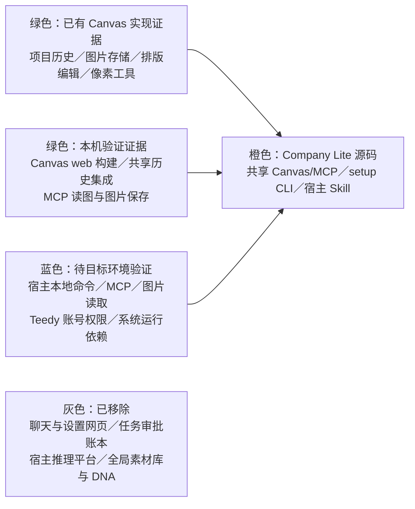

# Creative Agent Studio Company Lite 开发与施工计划

更新：2026-10-29。适用于 `codex/company-lite` 源码分支。宿主智能体主持当前创作；本机共享 Canvas/MCP 和本机只读素材 MCP 连接公司远端 Teedy 提供工具能力。旧版 P0—P5 文档仅作对应版本的历史证据。

## 产品目标

- 当前宿主对话线程负责需求、材料用途、文案、制作单、用户确认、实际读图和批准；Company Lite 不另建任务或审批账本。
- 本机 Canvas 是跨线程共享的持续工作空间，保存历史项目、生成图片与排版状态，并共用绘图连接和图片 API 配置。用户可查找并继续作品；项目不承载任何线程的需求或批准。
- 通过本机只读素材 MCP 连接公司远端 Teedy 搜索并实际下载用户选定材料，不修改 Teedy 内容、标签或 ACL。
- 从 Git 仓库源码运行。Git、Node.js 和 npm 是本地准备前提；无需 Python、Office 或系统编译器。
- 不新增任务 ledger、任务 ID 绑定、一任务一画布、独立确认接口、聊天网页、设置网页、全局素材库或全局 DNA；不内置宿主推理平台。符合能力要求的外部宿主可运行本产品，但需逐个按证据验证。
- Canvas 保留既有手动绘图和像素工具；拼贴、拼接、组合、裁切、分割、重采样、移动与缩放不写作新发明。

## 模块图与状态

绿色是明确实现证据，不代表任意环境均可用；橙色表示当前源码；蓝色需在真实宿主、账号和目标系统中验证；灰色不是后续开发目标。不建立宿主注册、迁移或适配系统。

## 当前实现

### 源码准备与 setup

当前支持 Windows 和 macOS，不做 Linux 适配或验收。仓库附带 [员工安装提示词](docs/员工安装提示词.md)，固定极简分支；根目录 `company-defaults.json` 预填获授权的公司 Teedy 地址、图片 API 请求地址和模型，可按员工选择更换。安装时展示图片 API 当前本机设置（若有）或默认值，询问沿用或更换；图片 API 本机设置优先于默认值。员工可在对话提供非秘密 URL 和模型。账号密码与图片 Key 的输入由宿主选择实际可用方式，员工不操作终端。

- 执行 Node 脚本前检查 Git、Node.js 22.19+（22.x）或 24+ 和 npm。从仓库根运行 `node scripts/prepare.mjs`，按锁文件安装或复用固定依赖并编译 Canvas；`npm run prepare:dev` 是等价开发别名。
- PowerShell 中如 `npm` 命令被策略阻止，可用 `npm.cmd --version` 检查，不要求更改执行策略。缺少基础工具时说明缺项，按用户当前系统官方安装说明协助；不改系统策略、权限或 PATH。无需 Python、Office 或系统编译器。
- 通过 `node scripts/setup.mjs status` 读取安装进度、连接检查、Teedy 地址／登录信息缺项和后续动作；只在首次准备、配置或故障修复时简洁展示五步，日常创作不重复。
- 五步顺序：环境与依赖 → 本地 Canvas/MCP → 素材库 Teedy MCP → 图片 API → 完成。状态来自实际检查；当前阻塞时只说明员工需完成的下一步。宿主自动推进可执行步骤，不逐项等待确认。
- Teedy 使用用户名密码登录远端服务取得 Cookie；本机 Node stdio 素材 MCP 复用现有只读访问逻辑，不新增 Python 依赖。公司默认值为可更换的 `materials.baseUrl`；员工可在对话提供其他非秘密 HTTPS 地址，宿主将所选地址显式传给 `login-materials`。一次性本机登录表单验证查询与原件下载后，再接入 stdio MCP、实际调用查询和下载，并报告两项结果。全部命令由宿主执行；旧单工具报告不能表示完成，失败或空库不假报成功。详见宿主使用说明。
- 凭据输入方式由宿主根据实际能力选择，不把剪贴板或固定回复作为安装前提。优先使用宿主专用凭据入口或可用的本机输入方式，由宿主完成配置导入；不要求员工理解命令或编辑技术配置。普通聊天问答框不等同于秘密输入入口，凭据不得进入仓库或日志。不支持某一种方式时先选择其他可用方式，只有确实没有可用入口时才说明障碍。现有 CLI 的剪贴板和私有文件导入方法见宿主使用说明；这些是可选实现，不代表每个宿主都必须采用。若选择剪贴板，必须取得用户对本次复制读取的明确确认，仅读取一次且不回显。配置后先检查图片 API 连接，再通过实际宿主 Canvas MCP 生成一张测试图；安装授权包含该次测试，无需另行确认费用。确认生成完成、图片保存到本机、宿主实际读图，并能从画布历史重开该作品后，才算安装验收通过。`check-image` 本身仅检查连接，不能替代真实生图。状态未知时先查结果，不盲目重复提交。
- 新宿主或首次进入新会话时，实际确认当前 Canvas MCP 工具并调用 `canvas_status`；Teedy也依据当前宿主现有 MCP 实际探测。不得将旧状态当作新宿主已连接。
- `node scripts/studio.mjs mcp-config` 输出含 `command`／`args` 的 stdio 配置示例。外层 `mcpServers` JSON 不保证所有宿主接受；按当前宿主实际配置格式操作。本机 MCP SDK stdio 已通过测试，不代表所有宿主客户端均已验收。

### 共享 Canvas/MCP

- `/canvas` 展示跨线程共享的项目历史，`/canvas/:id` 编辑指定项目；Canvas 保留历史项目、图片、节点和排版状态。
- 项目与图片存在独立 `CompanyLite` 本机数据目录。MCP 支持打开最近／新建／选择项目、查看列表与状态、读图和导出，同时保留手动 Canvas 操作。
- MCP 工具操作在返回成功前同步更新项目历史并 flush 持久状态；`canvas_list_projects` 在旧页面调用时 flush 后只读最新持久列表，不替换活动编辑页状态。小图未生成缩略图时，历史卡片使用原图。
- `canvas_run_generation` 返回 `{submitted, nodeId}`，随后由 `generation_get_status` 查询。未知状态不重复收费；以 `canvas_read_image` 返回的真实图片内容检查成品，用户在当前线程批准后用 `canvas_save_image` 导出。

## 本机验证证据

- 首轮源码根回归 38/38、Canvas bridge 23/23 通过，0 失败、0 跳过；Canvas web `npm run typecheck`、`npm run build` 通过。Vite 有既有导入和大 chunk 警告，不影响构建。
- Mac 本机全新浅克隆初始没有 `node_modules`／构建产物；`node scripts/prepare.mjs` 完成三组依赖安装与 Canvas Agent/Web 构建，退出码为 0。setup 能报告本地源码与 Canvas 已就绪、等待当前宿主 MCP；`mcp-config` 指向当前系统 Node 和克隆目录。
- 克隆目录中的共享 Canvas 集成 1/1 通过（4.6 秒），覆盖多项目、裁切拼接、历史重启恢复及 MCP stdio 图片读写，未请求生图。另有共享历史集成连续两次通过：两个项目的文字与图片节点在重开及 bridge 重启后恢复；历史页和 MCP `canvas_list_projects` 都看到两个项目；读图／导出字节与源图片一致。
- 隔离临时配置下实际调用图片服务 `GET /v1/models`，HTTP 200 并列出配置模型；没有生图，源配置未改，临时 Key 目录已删除。
- 一次真实 Canvas MCP 图片请求成功：提交约 63ms，准备画布 1.051 秒，上游 API HTTP 200、耗时 20.198 秒，本机完整保存 25.892 秒，仅请求一次。主代理已实际打开检查验收图，图像正确且无生成文字。该单次样本不保证普遍时延，也不代表宿主验收。

## 后续验证

1. 在每种目标宿主验证源码目录读取、Skill 显式读取、本地命令、stdio MCP 和实际图片传递；一种宿主的结果不推广到其他宿主。
2. 验证 Teedy 本人账号、MCP 地址／密钥和只读权限，以及宿主支持的安全凭据入口。
3. 源码提交 `5fbf1bd` 的 Windows/macOS/Linux GitHub Actions 已全部通过；在目标系统验证 Git／Node.js／npm 准备、Canvas 持续连接和工作区恢复体验，不据 Mac 本机结果推断跨系统验收。
4. 若继续真实 API 检查，先检查当前生成状态并确认原授权范围；状态未知时不重提请求。

## 宿主工作目录与 Skill

从克隆后的仓库根目录打开项目，并要求智能体从该目录读取 README、AGENTS、宿主使用说明和 Skill。本仓库 `.agents/skills` 不保证被宿主自动发现，也不依赖特定厂商目录。所有本地命令都从当前打开的源码根目录运行，不能用 Skill 文件位置反推项目根目录。
