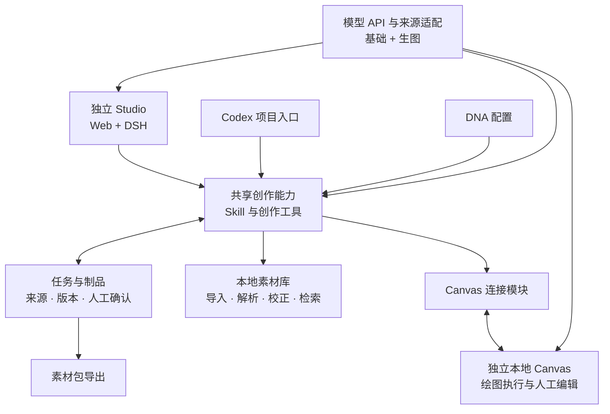

# Creative Agent Studio 开发与施工计划

## 公司版 P5 成品微调（2026-10-17 已获授权）

公司版以已独立复验的 P5 源码 `8cd572e`／交付文档 `125fac2` 及原生双平台候选包为基础，继承桌面对话、自然确认、文件工具与预构建启动方式。公司服务地址由管理员预置到运行包根目录 `company-services.json`，不写公开源码；员工只填写个人 Teedy 账号密码以及基础／生图两类 API。两类 API 均保存本机，远端 Canvas 通过任务专用、准确 Origin 认证的本机工具桥接访问图片代理；模型钥匙不得发送到远端静态站点或写进浏览器持久化。Teedy 账号按现有 ACL 访问，不放共享凭据。保持 Company 数据目录、4311、Codex 不启动 DSH、Canvas 纯工具边界。复用 P5 包内 Node 与生产依赖；Python／OCR／Office 仍按已授权 P5 方式在首次启动单独检查准备，不宣称完全离线。旧远端服务、挂靠、标签与 ACL 不变；本轮不部署服务器、不重放付费模型。公司版新增范围需单独自检，不沿用 P5 结果冒充公司现网或独立验收。


## P5 调试后的微迭代（2026-10-16 已授权）

本批以通用版为交付目标；公司版 Teedy／远端 Canvas 改动另行施工，保留其远端模型配置差异，不能混入本阶段通用包。施工基线为 `391b955`，复用已有启动准备分层修复；P4 既有独立验收结论不扩写为 P5 已验收。

- Web 左侧以自然对话和必要的简短方案卡承接讨论、需求澄清、参考选择及逐图内容／风格用途；不搬入右侧原有大表单，不要求用户逐页管理复审。右侧在检索阶段展示编号、缩略图、标题、摘要及已讨论用途的只读素材候选，点开原图；用户在对话里保留或排除。进入制作后展示成品、上一版对照与下载，整套最终交付一次明确确认。桌面本机为本批目标，不做手机兼容验收。确认嵌入对话，不要求同一意图重复点击。人工同意必须绑定实际展示的任务 revision／制作单版本，模型只能提出参考选择方案，不能替人确认。版本、SHA、CAS、陈旧批准失效和提交幂等继续保留。
- 海报及多页图文继续使用既有制作单与绘图执行链路。文档、表格和批量文件任务按意图直接使用通用工具，不强制套 1—5 页制作单；支持 Word／PDF／Excel／图片的读取提取、过滤去重、结构化、简单 Python／JS、批量文件图片、工作簿和 ZIP 交付。优先核实和复用 DSH 工具协议与成熟依赖，普通用户看到意图、进度、结果，技术记录可展开。
- 普通用户交付目标升级为 GitHub Releases 上按平台预构建的运行包：构建时准备 Node、前端、Canvas／DSH 和 Node 依赖，双击以图形反馈启动。按 2026-10-17 用户补充决定，Python 环境单独处理：首次检查兼容的 Python 3.12 与锁定依赖，健康则复用；没有或版本不兼容时在稳定应用数据目录准备私有 Python 和依赖，不修改系统默认版本，不搬移开发虚拟环境。源码 clone 保留给开发与 Codex。只交付 Apple 芯片 Mac（arm64）与 Windows 64 位（x64）两个运行包，在对应 runner 构建；不兼容 Intel Mac；不得把 Mac 环境压缩冒充跨平台。包不含凭据、个人数据、历史任务，核对再分发许可；签名、实际构建与实机体验分别记录。
- 首次引导依次选择服务商（保留自定义 API）、地址／钥匙与申请帮助、对话／生图模型和职责、分级检查、首个示例任务。同服务商可复用地址与钥匙，可跳过或重开；已有有效配置直接进工作台。连接或模型列表通过不等于生图能力通过，不暗中付费出图。
- Codex 保持宿主对话→共享工具→检索→Canvas→审核导出，生图仍用项目图片 API；不启动 DSH、不叠加 Harness、不改用宿主内置生图。Canvas 保留原绘图界面，仅裁剪 Agent 侧栏。

实施方验证和缺项见 [P5 实施与验证](docs/P5实施与验证.md)。完成后供主审独立验收，停止在本批授权边界。

**2026-10-16 P4 最终独立复验通过：跨平台本地 Web 源码交付、macOS 隔离运行和 Windows Actions 按授权范围通过。** 两项首轮必修已关闭，229/229 测试、真实浏览器及用户数据完整性核对通过；普通设备双击体验与既有上游限制单独记录。最新结论见 [P4最终独立复验](docs/P4最终独立复验.md)。

P3 于 2026-10-16 按已授权源码及本机集成范围独立复验通过。主审重跑 206 项测试、恢复与归档审核案例、隔离点验关键 Web 操作，并核对在线 HTTP 构建与验证产物一致。最终结论及限制见 [P3最终独立复验](docs/P3最终独立复验.md)，原审查和返工历史保留。用户已于 2026-10-16 授权启动 P4，施工及跨平台本地 Web 交付范围独立复验已完成；交付目标是 GitHub 仓库内的跨平台本地 Web 产品，不要求 macOS 原生 App、DMG 或 PKG。P3 的远端 AI 改图效果与 WorkBuddy 实际能力限制保持不变，不冒充已通过。

版本：v0.5 · 2026-10-16

状态：P0 已独立验收通过；P1 返工后已独立复验通过，按阶段范围验收通过；P2 按批准范围独立复验通过，原发现及最新结论见 [P2独立验收](docs/P2独立验收.md)。P3 于 2026-10-16 按已授权源码及本机集成范围独立复验通过，最终报告见 [P3最终独立复验](docs/P3最终独立复验.md)。早期真实一／三／五页读图、ZIP 核验及模型配置来源记录保留在 [P3实施与验证](docs/P3实施与验证.md) 和对应证据中，不将历史失败或未验证能力说成已通过。WorkBuddy 真实账号与实际能力仍待本人验证。P4 已按跨平台本地 Web 交付范围独立复验通过，最终结论见 `docs/P4最终独立复验.md`。Git 基线、标签及本地回滚边界见 [Git 版本与回滚](docs/Git版本与回滚.md)。本文记录实施与验收边界；源码交付阶段通过不代表所有远端模型效果和任意设备体验均已验证。

## 1. 目标与已确认决策

2026-10-15 用户批准 P3 对话局部改图：首轮完整创作继续人工确认，后续指定页修改由明确聊天指令授权；复用共享执行器，继承未改页、保留版本、支持失败恢复，详见 [实现与验证合同](docs/P3对话局部改图.md)。这不是对未确认完整制作单的通用执行放行。

把现有高级用户通过 Agent、素材库和 Canvas 完成内容生产的方式，封装成普通运营人员可以使用的独立创作产品。降低工具使用门槛，业务判断仍由用户完成。

**本次目标是相对完整的首版产品，不是再做一套轻量 MVP。** RAG-Yuki 及现有工作台已经提供原型基础；本次要补齐产品界面、双入口、素材管理、本地 Canvas、安装启动、配置、成品回收、故障恢复和交付体验。阶段切片只用于降低开发风险，不是降低最终交付标准。

| 决策 | 当前要求 |
| --- | --- |
| 开发目录 | `/Users/akechi/Desktop/creative-Agent-studio` |
| 旧项目边界 | `/Users/akechi/Desktop/RAG-Yuki` 仅作只读参考；旧代码、配置、数据和正在使用的服务不改动 |
| 独立应用入口 | 使用 DeepSeek Harness（DSH）承接 Agent 运行，提供创作 Web 工作台 |
| Codex 入口 | 用户在 Codex 打开同一个仓库，使用项目 Skill 和共享工具；该路径不启动 DSH |
| 模型 API | 仅基础 API 与生图 API 两类；基础供 DSH 对话、工具调用、读图及 Web／CLI 素材清洗，生图供 Canvas 图片生成；Codex 推理继续由宿主会话承担 |
| 基础 API 来源 | OpenCode、Kilo、WorkBuddy 国内版、WorkBuddy 国际版或自定义 API；免费来源不要求用户手贴 API Key，WorkBuddy 需用户本人登录；平台额度不作保证 |
| 首版创作范围 | 同时支持单张海报与多页图文；制作单支持 1—5 张（含两张海报），单张、三页与五页仍保留真实历史验证范围 |
| Canvas 交付 | 产品启动时带起独立本地 Canvas，不使用原来的运行实例 |
| Canvas 职责 | 接收绘图指令，执行操作并返回状态和成品；不启动或召唤 Codex、DSH 或其他 Agent |
| 本地 Web 交付 | GitHub 仓库内本地运行；macOS `.command` 与 Windows `.cmd` 是薄入口，共享启动逻辑；不要求原生 App、DMG 或 PKG |
| Windows 证据 | GitHub Actions 真 Windows runner 覆盖依赖安装、构建、启动、浏览器和图片样例回归；CI 不等于普通用户双击体验或实机试用，缺少实机时如实记录且不停止其他 P4 工作 |
| 区域检测 | 只替换 macOS Swift／Vision 检测依赖；保留现有跨平台裁切、分割、拼贴等浏览器像素工具。先验证代表性样例定位精度再选型，不预选依赖 |
| 交付等级 | 相对完整的首版产品；不把技术演示、CLI 可用、半成品界面或手工拼接流程当成最终交付 |
| 素材库 | 默认本地轻量库；Teedy／外部 MCP 为后续可选连接 |
| DNA | 用户主动维护品牌、偏好、常用要求和禁用元素，不自动学习或写记忆 |
| 人工确认 | 需求、参考选择、制作单、最终成品；确认必须关联具体版本 |
| 暂缓范围 | 自动发布、投放、ROI、企业权限、插件市场、自动记忆、通用 Agent 平台 |

第一版的工程选型以简单模块和完整产品体验为原则。下文标为“建议”的技术细节由对应阶段验证后记录，不把尚未验证的接口或安装方式当作既成事实。

## 2. 调研依据与证据边界

### 2.1 当前代码基础

| 来源 | 已读实现 | 可用基础与限制 |
| --- | --- | --- |
| RAG-Yuki | `src/rag_yuki/cleaning/`、`mcp_server/`、架构文档 | 已有解析、OCR、摘要打标和 Teedy 只读检索；不是独立本地素材产品，清洗依赖清单也不完整 |
| 图文工作台 | `xhs-ad-workbench/src/task-state.mjs`、`src/output-archive.mjs` | 已有任务状态、人工筛选来源、原子写入和版本归档；制作单硬编码为 3—5 页 |
| 制作与 Canvas | `content/validate-production-sheet.mjs`、`export-canvas-sheet.mjs`、`canvas-agent-runner.mjs` | 已有制作单校验、节点生成、连线、生图与等待结果；制作单确认主要依赖 Skill，执行器直接读取 MD |
| 创作 Skill | `skills/xhs-ad-workbench/SKILL.md` | 已有澄清、参考选择、回图审核方法；实际推理与读图由宿主 Agent 承担 |

旧项目历史验收证明了部分真实检索、建图、生图和读图能力。不同任务的阶段性成功不合并成一条完整交付证据；新产品必须独立验收。当前本地留存任务、原服务运行状态和全部成品并未在本轮完整核验。

### 2.2 上游调研快照

- [DeepSeek Harness](https://github.com/deepseek-ai/deepseek-harness)：调研提交 `d743267388641bc76f17c45ce8b4c231aed1d32c`。已有 Agent Loop、会话日志、Web、模型配置、Skill、MCP、用户提问与插件扩展；上游处于开发者预览。
- [Harness 架构](https://github.com/deepseek-ai/deepseek-harness/blob/d743267388641bc76f17c45ce8b4c231aed1d32c/docs/architecture.md)、[扩展方式](https://github.com/deepseek-ai/deepseek-harness/blob/d743267388641bc76f17c45ce8b4c231aed1d32c/docs/cookbook/extension-cookbook.md)。
- [Infinite Canvas](https://github.com/basketikun/infinite-canvas)：调研提交 `3a6b64b602ad062b29fac66902ed18a7ef5fd9dc`。既有画布工具，也有启动 Codex 的侧边栏路径；本项目只采用前者。
- [Canvas Agent 文档](https://github.com/basketikun/infinite-canvas/blob/3a6b64b602ad062b29fac66902ed18a7ef5fd9dc/canvas-agent/README.md)：启动本机服务不等于注册 Codex MCP；两者需要分别处理。
- [Codex 项目指令](https://learn.chatgpt.com/docs/agent-configuration/agents-md)、[Skill 发现](https://learn.chatgpt.com/docs/build-skills)：支持仓库 `AGENTS.md` 与 `.agents/skills/`；文件存在不等于依赖、服务和工具已配置。

调研阶段只读文档与部分源码；P0 现已安装固定依赖、构建并实际运行独立副本。固定版本、许可证、裁剪与本地改造见 [上游来源](docs/上游来源.md)，验证记录见 [技术验证](docs/技术验证.md)。若采用新版本，先核对变化，不直接跟随 `latest`。

## 3. 产品模块与运行边界



### 3.1 Harness 与共享能力

- DSH 负责独立应用的模型会话、推理循环和工具调度；Codex 模式由 Codex 承担这些职责。
- 模型 API 只设基础和生图两类。基础 API 同时供 DSH 对话／工具／读图，以及素材 Web 和 CLI 清洗使用；图片生成使用生图 API。Codex 推理使用宿主会话，不通过基础模型来源插件。
- 基础 API 来源插件仅提供 OpenCode、Kilo、WorkBuddy 国内版／国际版及自定义 API；OpenCode/Kilo 不需要用户粘贴来源密钥，WorkBuddy 要求用户本人登录。平台可用额度与限额由平台决定。
- 共享任务、素材、制作单、Canvas 和导出实现不导入 DSH 的 Agent Loop，不调用 `dsh`／`codex exec` 重新启动创作会话。
- DSH 插件是共享工具的适配层；Codex 首版优先使用相同工具的 CLI，确需 MCP 时再增加薄协议入口，不同时维护两套业务实现。
- 同一份创作 Skill 放在 `.agents/skills/creative-studio/`，DSH 显式读取产品技能；不复制两份长期分叉的创作规则。
- 项目级指令区分“使用产品创作”和“修改产品源码”，避免用户提出做海报时被当成代码施工。
- 任务与制品可以跨入口接续，聊天日志各自保留，不承诺自动互通。

### 3.2 Canvas 的单向指挥

保留双向传输，限制单向指挥：外部 Agent 发出操作，Canvas 返回进度、错误和文件；Canvas 不再启动 Agent。

- 保留画布节点、连线、生成、参考图编辑、人工选图和导出能力。
- 移除面向用户的 Agent 聊天入口以及配套的会话启动、模型决策和 Agent 运行路径；不是只隐藏按钮。
- 工具操作确认若依赖原侧栏 UI，迁入独立操作确认区域或 Studio，避免删除整块侧栏后工具失效。
- 只要原子绘图工具仍需要特定服务，保留工具执行桥接；去掉其调用 `codex app-server` 等 Agent 的职责。
- Canvas 可调用图片生成服务完成明确的绘图请求；这不等于运行一个处理整项创作需求的 Harness。
- 操作目标必须绑定本产品的 Canvas 实例、项目与任务，不能误连原有网页。
- 用户停止或关闭产品时，只停止本产品启动的进程。已提交到上游的生图若不能撤销，应如实返回状态。

### 3.3 模块职责

| 模块 | 负责 | 不负责 |
| --- | --- | --- |
| 创作能力 | 澄清、参考分析、制作方案、实际读图审核 | 隐式改 DNA、代替业务判断 |
| 任务与制品 | 任务事实、来源、确认版本、执行记录、归档 | 保存或合并全部 Harness 聊天历史 |
| 素材库 | 导入、原件、正文、标签候选、人工校正、检索预览 | 默认采用旧业务标签或复制内部素材 |
| Canvas 连接 | 明确指令、目标检查、进度、错误与成品回收 | 再启动 Agent 作规划 |
| Canvas | 绘图执行、人工编辑与选图 | 自主推进整个创作任务 |
| DNA 与配置 | 用户显式要求、工具连接与模型配置 | 自动记忆和偷偷推断偏好 |
| 导出 | 图片、配套文案、制作单、来源和版本清单 | 自动发布或投放 |

## 4. 仓库与迁移方式

建议结构如下，按阶段创建实际需要的目录，不预先搭建空模块：

```text
creative-agent-studio/
├── Creative_Agent_Studio_PRD.md
├── 开发与施工计划.md
├── AGENTS.md
├── .agents/skills/creative-studio/SKILL.md
├── apps/studio/              # DSH 配置、创作界面与启动入口
├── src/
│   ├── core/                 # 任务、制作单、确认、归档
│   ├── assets/               # 本地素材处理与检索
│   └── canvas/               # 连接与结果获取
├── adapters/dsh/             # 共享工具的 DSH 适配
├── scripts/                  # 准备、检查与 Codex CLI 工具
├── third_party/canvas/       # 固定上游版本的独立裁剪副本
├── tests/                    # 关键合同与整条链路验证
└── docs/                     # 使用、开发、上游来源和决策
```

迁移原则：

1. RAG-Yuki 选择性迁移必要源码，保留许可与来源，不整体复制 `.venv`、`runs/`、`inputs/`、员工配置或凭据。
2. Canvas 建立独立源码副本，保留作者、许可和上游要求的标识；开发与构建均不在旧部署目录执行。
3. DSH 优先采用固定依赖、配置组合和插件扩展，不直接将整个 Harness 仓库作为产品主目录。P0 若证明必须改上游源码，先记录具体限制及最小变更范围。
4. 建议 TypeScript／Node 承接共享业务层，沿用已有 Node 模块。Python 只在已确认的解析／图片处理依赖确有必要时保留，禁止把开发机既有环境当作安装依赖清单。
5. Codex 工具入口不导入 Studio 启动代码。安装依赖也不自动启动 DSH 或改用户全局客户端设置。
6. 上游升级作为明确维护任务，不做旧格式兼容层；本项目新格式和来源约束以当前版本为准，替换过时指导。

## 5. 共享任务、制作单与人工确认

先使用原子写入的任务 JSON、清晰的文件目录和单任务执行锁，避免同时引入复杂数据库与编排系统。索引是可重建的数据，不能成为原件和人工校正信息的唯一保存位置。

任务至少保存：

| 对象 | 最低内容 |
| --- | --- |
| 需求 | 任务 ID、创作类型、选题、受众、目标、要求、版本与确认 |
| 参考 | 素材 ID、来源、摘要、预览、保留／排除、借鉴用途和事实边界 |
| 制作单 | 版本、页 ID、精确文案、风格、布局、参考和 Logo；页数由类型决定 |
| 人工确认 | 确认对象、版本、时间与确认来源；默认按钮操作或用户明确反馈，模型不能自行批准 |
| 执行 | 当前入口、目标 Canvas、制作单版本、页面、节点、状态与错误 |
| 成品 | 文件、所属页面、用户选择、可见文字、审核结果和最终确认 |
| 归档 | 制作单、图片、文案、来源、审核记录和交付版本清单 |

具体要求：

- 制作单是结构化数据源，MD 是导出产物；修改后产生新版本并使旧确认失效。
- 单张海报允许一页；多页图文首版至少验证三页与五页。移除旧代码固定 3—5 页硬门，不引入泛化模板引擎。
- 未获保留的历史参考不能用于制作单。没有合适参考时，允许人工确认空清单，用用户提供的依据继续。
- 生成调用核对已确认的制作单版本，不能只接受任意 MD 绕过确认。
- 用户换图或改文案后重新审核；归档不将待审版本标成已批准。
- 同一任务同时只有一个入口写入和执行；切换时释放执行权，再读取任务和文件续做。
- 执行恢复记录每页已有节点和生成结果；重复请求不直接重复生图。超时无法判断成功时，先查询状态，不自动重放收费操作。
- 实际读图审核记录文字错漏、手机可读性、品牌一致性、主题对应和具体修改位置。无法读图或文字不清时标明待核，不填空值宣称通过。
- 可迁移原风险词库检查，但必须展示词库来源和辅助性质，不把零命中当成合规或视觉审核通过。

## 6. 素材、模型、DNA 与本地服务

### 6.1 本地素材库

2026-10-14 用户明确确认：素材放同一总库，以自由标签区分；标签管理与检索参考 Teedy 的基础功能，供后续 Agent 查询历史素材。上传先暂存，用户显式点击 AI 清洗；参考旧 RAG-Yuki 小红书脚本的正文＋多图 OCR→模型摘要及自由标签处理，去除旧业务标签映射。用户可微调标签／正文／摘要，人工确认后入库。模型配置按基础 API 与生图 API 两类划分；基础 API 共用于 DSH 对话、工具调用、读图以及 Web／CLI 素材清洗，生图 API 供 Canvas 图片生成。Codex 推理仍使用宿主会话。用户已指定本机历史图文目录，全量 13 篇/85 附件用后续明确授权的 Grok 4.7 完成真实清洗与批量授权入库，证据见 docs/P2验收.md；不宣称千份规模性能或完整 Web 界面通过。

- 建议首版支持 PNG／JPEG、TXT／MD 与 PDF；Office／视频解析不作为首版交付前提。
- 保留原件、正文与提取状态、摘要和标签候选、人工校正元数据、缩略图与索引。
- 解析、模型打标、人工确认和入库状态分别展示；单条失败可重试，不静默丢失。
- 检索首版先验证关键词、标签和摘要检索；没有证据证明必要前不引入向量库或复杂 RAG。
- 来源分为历史视觉参考、用户当前业务资料、明确授权后查证的公开资料；不能将历史营销内容直接当作现行政策和数字。
- 本地库可整体备份；索引可从元数据重建。Teedy 接入后仍保留来源与选择合同，首版不施工该连接。

### 6.2 模型与 DNA

- Studio 只配置基础 API 与生图 API。基础 API 负责 DSH 对话、工具调用、读图及 Web／CLI 素材清洗；生图 API 由 Canvas 用于图片生成。
- 基础 API 来源为 OpenCode、Kilo、WorkBuddy 国内版（buddy）、WorkBuddy 国际版（workbuddy）或自定义 API。OpenCode/Kilo 使用匿名免费来源，不要求用户粘贴来源密钥；WorkBuddy 必须使用用户本人账号登录。平台额度、速率和可用性不是 Studio 保证项。
- 模型来源插件以内嵌本机服务提供，绑定 `127.0.0.1` 的动态端口并使用本机随机 token；不向公网监听。保留用户已有自用 API 设置和调用路径。
- Codex 模式的推理仍使用当前宿主 Codex 会话；产品模型 API 只供显式的素材清洗、生图等 Studio 服务，不改变宿主推理模型。
- CLI 素材清洗读取产品共享基础 API 配置；不再读取 `STUDIO_TEXT_*` 环境变量，也不从清洗 payload 取服务凭据。
- 用真实端点验证工具调用、图像输入、错误和取消；勾选“支持图片”不是能力验证。
- DNA 为默认关闭的全局提示词，用户主动填写、显式保存并启用，提供可选模板，不做品牌层级或自动记忆。每项任务记录采用的 DNA 内容和版本。执行中修改 DNA 不静默改已确认制作单。
- 凭据放用户本机配置，不进 Git、任务包或日志。初次配置由用户选择服务并提供凭据，不为新产品复制旧员工配置。

### 6.3 本地进程与数据

- 独立应用启动 DSH、独立 Canvas 和必要工具服务；Codex 首次使用只启动必要 Canvas／工具服务。
- macOS `.command` 和 Windows `.cmd` 只负责调用共享启动逻辑。共享逻辑完成首次依赖准备、构建与检查，按入口需要启动 DSH、独立 Canvas 和模型插件服务；提供停止、健康检查和重复启动处理。
- 首次使用引导配置用户自己的基础／生图 API；更新前备份用户数据和配置，更新后保留任务与素材，并给出更新失败时的恢复信息。
- 记录用户数据根目录、实例标识、端口选择、服务健康检查和停止方式。源码目录与用户任务数据分开。
- 模型来源插件服务只监听本机 `127.0.0.1`，使用动态端口和本机随机 token；停止工作台时收尾本地插件。插件来源不扩大为公开网络服务。
- Windows 路径与进程逻辑使用平台 API，避免硬编码 macOS 绝对路径。只替换 macOS Swift／Vision 区域检测依赖，不重写现有跨平台浏览器裁切、分割和拼贴工具。
- 服务启动失败时提示失败服务与可操作原因；避免通过随意连接其他端口上的现有 Canvas 来掩盖失败。
- Web DSH 与 Codex CLI／Skill 入口继续分开；Codex 路径不启动 DSH，Canvas 只执行绘图，不启动或召唤 Agent。移除重复提示时保留必要人工确认，不增加同义弹窗或过量护栏。
- WorkBuddy 可辅助部署诊断；普通用户不需要手工修改源码完成安装、启动或提交诊断信息。
- 本轮用户已补充授权创建公开源码仓库 `creative-Agent-studio`，检查后上传并运行 Windows Actions；不部署公网服务。先用隔离夹具和已有证据验证，不重放历史付费任务；若确需新增真实付费验证，先说明测试内容和成本，不以此阻断无关施工。

## 7. 完整首版的交付面

以下均属于本次正式交付，不以“先能跑”为理由延期：

| 交付面 | 必须达到的产品体验 |
| --- | --- |
| 本地启动与首次使用 | macOS `.command` 与 Windows `.cmd` 两个薄入口共享启动逻辑；首次准备依赖并构建，启动／停止 Canvas 与模型插件服务，完成基础配置和连接检查；不要求原生 App、DMG 或 PKG |
| 创作工作台 | 完整聊天、任务列表与恢复、参考预览和选择、制作单编辑和确认、成品预览和审核、导出入口；无占位或死按钮 |
| 素材管理 | 在支持的格式内完成导入、处理状态、人工校正、检索、详情预览、更新和删除；原件与引用关系明确 |
| DNA 与配置 | 用户可编辑、保存、查看当前生效版本；模型、Canvas 和本地服务配置可检查并给出明确反馈 |
| 两种创作类型 | 单张海报与多页图文都有完整创建、修改、审核和交付体验，不能只覆盖一类 |
| 本地 Canvas | 启动、连接和实例管理由产品承担；成品可回收、选取和重新审核；纯绘图执行，不召唤 Agent |
| Codex 入口 | 同一仓库完成首次准备后可直接创作；不依赖 DSH 运行，使用相同任务和制品合同 |
| 执行与恢复 | 用户能停止、重试和继续任务；出错位置清晰，不丢已完成页面，不重复未知状态的收费请求 |
| 成品与交付 | 可查看实际图片和审核意见、修改后复审；导出完整可用素材包，有来源、版本和确认记录 |
| 使用与维护 | 双入口说明、安装与故障指引、数据备份位置、版本信息和更新方式清楚；旧实例不受影响 |

完整产品不等于无限功能范围。Windows 用户试用仍单独记录；GitHub Actions 的 CI 不证明普通用户双击体验。视频、企业权限、自动发布等仍按已确认的暂缓边界处理。素材格式明确声明并实测；支持范围内的管理体验必须完整。

## 8. 分阶段施工

阶段按依赖顺序推进。每阶段留下可复查的结果与验收记录，不以文档或模拟成功替代真实链路。

### P0：验证框架与工具边界

**工作**

1. 在新目录记录上游版本与来源，准备独立 DSH、Canvas 调研副本／固定依赖。
2. 验证 DSH 最小配置、工具注册、Skill 加载、会话恢复和业务界面扩展。
3. 查清 Canvas 画布工具、操作确认和 Agent 启动路径；做最小纯工具运行切片。
4. 验证 Codex 用共享工具创建文本节点、触发一张图片并获取结果，不启动 DSH。
5. 验证本地 Canvas 自动连接方式和图片结果回收，记录需要的接口改造。
6. 在固定版本的文档和类型基础上确定 Node、前端、解析依赖、凭据与打包方式。

**产物**：`docs/技术验证.md`、`docs/上游来源.md`、最小运行代码、固定依赖清单。

**通过条件**：两个入口分别完成最小工具调用；Canvas 不启动 Agent；服务使用独立实例；生成结果能回收并实际查看。

**未通过处理**：记录具体限制和可行改造，不继续搭完整 UI。需要改变已确认产品边界时再与用户讨论。

### P1：共享创作核心与 Codex 入口

**工作**：迁移任务、来源选择、制作单、归档；同时支持一页与多页；加入确认版本、执行状态和单任务写入约束；提供共享 CLI 与仓库 Skill。共享请求接收并传递取消信号；以可控错误／延迟模拟验证新增连接层的失败传递、取消和任务状态一致性，不重复测试上游全量错误处理。

**产物**：可在 Codex 中使用的创作核心；结构化制作单与版本素材包；`docs/Codex使用.md`。

**通过条件**：Codex 能完成需求、参考确认、制作单、Canvas 生成、实际读图和导出；不加载 DSH 运行入口；未确认／过时制作单无法执行。对已有任务 JSON 的公开状态变更命令必须携带 `show` 返回的正整数 `expectedRevision`；`confirm-inputs` 以正整数 `revision` 承担同一 CAS 约束。锁维护命令 `unlock` 不改任务 JSON，不参加 task revision CAS，只携带 `deadPid` 并核对锁所有者及 PID 已退出。`set-sheet` 还必须携带准备时的 `inputRevision`（等于 `task.inputConfirmation.revision`），`approve-final` 必须持久记录用户当时实际查看的全部页面及其 SHA-256。过期快照必须拒绝，不能只替换 revision 后重发旧 payload。

### P2：本地素材库与 DNA

**工作**：导入、解析、摘要标签候选、人工校正、检索预览、详情、更新和删除；DNA 编辑与显式保存；记录原件、来源和失败状态。删除已被任务引用的素材时明确影响，任务保留已确认来源的快照。

**产物**：小规模本地素材库、管理与查询工具、DNA 配置。

**通过条件**：真实素材能导入、校正、检索和引用；失败可见；索引重建不丢人工校正；没有素材仍可按已提供依据创作。

### P3：独立 Studio 与业务界面

**当前状态（2026-10-16）**：P3 按已授权源码及本机集成范围独立复验通过，结论与证据见 [最终独立复验](docs/P3最终独立复验.md)。该范围涵盖 Web UI、业务操作、两入口共享核心、Canvas 任务衔接和本机模型配置集成；远端 AI 改图效果、WorkBuddy 实际账号与能力仍未验证或未通过，不冒充阶段成果。历史来源自验见 [模型来源与裁剪证据](docs/evidence/model-plugin/verification.json)。

**工作**：将共享工具注册到 DSH；完成任务列表与恢复、聊天、素材管理、参考保留／排除、可编辑制作单、确认、成品选取、审核与导出；将真实执行事件转成业务进度；接入模型配置和 DNA。基础模型来源只保留 OpenCode、Kilo、WorkBuddy 国内版／国际版和自定义 API；移除原管理台、EAC 与其他账号源、自动签到、更新器及反馈入口。为首次使用、空内容、处理等待、错误、取消、重试和成功完成设计完整界面，进行真实渲染与可用性检查。

**产物**：可独立运行的 Web 创作工作台；`docs/独立应用使用.md`。

**通过条件**：不依赖打开 Codex 完成创作；展示真实进度和结果；默认不展示内部推理；关闭重开可恢复任务；Canvas 不召唤 Agent；模型请求失败或取消时界面与任务状态一致，不误报完成。基础 API 覆盖对话／工具／读图与 Web／CLI 素材清洗，生图 API 覆盖 Canvas 生图；本机来源插件仅绑定 loopback 并用随机 token，保留自定义 API 路径，不承诺服务平台免费额度。错误与取消优先通过可控模拟验证新增集成，不要求真实服务反复失败。

### P4：GitHub 本地 Web 交付、跨平台启动与完整验收

**当前状态（2026-10-16）**：两项首轮必修已关闭，跨平台本地 Web 交付范围独立复验通过；证据见 [P4最终独立复验](docs/P4最终独立复验.md)。P3 原授权范围和独立复验结论不变；远端 AI 改图效果与 WorkBuddy 实际账号能力仍受既有验证限制。

**工作**：

1. 提供 macOS `.command` 和 Windows `.cmd` 两个薄入口，调用共享启动逻辑。完成首次依赖准备、构建、Canvas／插件服务启动与停止、健康检查、重复启动、首次配置、用户数据备份和更新恢复。产品作为 GitHub 仓库中的本地 Web 应用交付，不要求 macOS 原生 App、DMG 或 PKG。
2. 只替换依赖 macOS Swift／Vision 的区域检测模块，不重做已有浏览器裁切、分割、拼贴等跨平台像素工具。保留自动二维码定位替换以及文字、矩形定位目标。先用代表性图片样例和负例验证候选库定位精度，再决定是否选用，不预先锁定依赖。二维码回归分别核对定位框、替换后目标区域以外原像素保留、新码可读；平色覆盖不代表复杂背景无痕还原。
3. 增加 GitHub Actions 真 Windows runner 工作流，覆盖依赖安装、构建、启动、浏览器和图片样例回归。CI、普通用户双击体验和 Windows 实机试用分别记录；无实机时不宣称实机验证，也不因此停止其他 P4 施工。本轮用户已明确授权创建公开源码仓库 `creative-Agent-studio`，检查源码与历史后上传并运行 CI；仍须以真实 run 结果记录 Windows 云端状态，不部署公网服务。
4. Web DSH 入口与 Codex CLI／Skill 入口保持分开；Codex 路径不启动 DSH，Canvas 仅绘图、不召唤 Agent。精简重复提示时保留必要人工确认，不增加同义弹窗或过量护栏。WorkBuddy 可辅助部署诊断，普通用户无须自行修改源码。

**产物**：`.command`／`.cmd` 薄入口与共享启动逻辑、首次准备／配置／备份更新路径、经样例验证后的区域检测方案、Windows Actions workflow、GitHub 本地 Web 使用和故障说明。

**通过条件**：macOS 入口在干净用户环境完成首次准备、构建、配置、Canvas／插件启停、重复启动、备份和更新验证。Windows workflow 在真实 Windows runner 覆盖安装、构建、启动、浏览器和图片样例回归；若当前没有远端而未执行，明确标注未运行，不得声称通过，但这不阻止其他 P4 施工。Windows 普通用户双击体验和实机试用作为独立证据边界记录，不虚报。代表性区域样例满足预先记录的定位精度要求；二维码定位框、局部替换后目标外像素和新码可读性分别核验。测试优先使用隔离夹具和已有证据，不重放历史付费任务；如需新增真实付费验证，先说明内容和成本，不让其阻断无关施工。完整首版不依赖 macOS 特定 Swift／Vision 运行时。

完整首版完成以 P4 和第 7 节全部交付面通过为准。P0 是内部技术验证，P1 是内部核心切片，P3 是内部集成版本，均不作为本次最终产品交付。P1 可用不等于独立应用完成；P3 可运行不等于普通用户安装体验通过。

## 9. 验收矩阵与必要测试

| 验收项 | 验证方式 |
| --- | --- |
| DSH 单张海报 | 新需求到单页成品、实际读图、人工确认和导出完整任务 |
| DSH 多页图文 | 三页完整任务，并补充五页制作／生成覆盖 |
| Codex 单张海报 | 同一仓库内完成整条链路；进程与调用记录证明不启动 DSH |
| Codex 多页图文 | 三页完整任务，并补充五页覆盖；使用共享核心与相同确认合同 |
| 纯工具 Canvas | 移除或禁用全部 Agent 会话启动路径；操作与生成过程中不启动 Codex／DSH |
| 确认约束 | 制作单未确认、改后版本、排除来源、非人工批准均不能绕过合同 |
| 成品审核 | 实际打开图片；刻意含错字／不可读文字的样本不会被当作通过 |
| 跨入口续做 | 从持久任务恢复；旧入口退出执行后另一入口接管，无并发重复生成 |
| 超时与恢复 | 单页失败、服务重启、状态不明时能查明已有结果，不盲目重复收费调用 |
| 素材与 DNA | 人工校正可保留，DNA 未显式保存不变化，参考来源可追溯 |
| 完整界面 | 首次使用、任务管理、素材增改删、预览、确认、错误恢复、审核和导出均有真实可用界面，无占位和无效操作 |
| 交付包 | 图片、文案、制作单、来源、版本与审核状态一致；文件可打开，ZIP 可解压 |
| 本地启动与隔离 | macOS `.command` 干净环境首次准备和启动通过；停止不影响旧项目或其他服务 |
| Windows CI | GitHub Actions 真 Windows runner 安装、构建、启动、浏览器和图片样例回归；分别记录未运行、通过或失败 |
| 区域检测 | 代表性图片和负例定位精度；二维码定位框、替换区域外像素保留、新码可读性分别验证 |

测试投入聚焦会造成错误执行、重复生成、错误确认或丢数据的合同：版本确认、来源约束、写入互斥、归档一致性、执行恢复和工具错误。视觉界面做真实渲染检查；模型和 Canvas 整条链路用实机任务验收，不用夹具替代。

## 10. GitHub 呈现与完成标准

README 先介绍产品，再分别给出“独立应用”和“Codex 使用”入口；两者说明首次准备、所需服务、任务数据位置和输出位置。

- 克隆后，Codex 能发现项目指令与创作 Skill；首次准备完成后直接创作，无须启动 DSH。
- 独立应用的用户不必理解 MCP、Skill、命令行或手工启动多个服务。
- 使用说明与开发说明分开；不把开发环境安装步骤包装成普通用户开箱即用。
- 提供同一真实任务的需求、参考、制作单、画布和成品证据；公开演示使用可公开资料。
- 不宣称 Windows 实机或普通用户双击体验已验证，除非分别有对应证据；Windows Actions CI 结果单独陈述。WorkBuddy 完整创作运行时、完整聊天迁移、成品质量或商业效果也不作未经验证的承诺。
- 本轮用户已明确授权创建公开源码仓库 `creative-Agent-studio`，检查后上传并运行 Windows Actions；不部署公网服务。Windows 实机和 Actions CI 证据分别记录。真实付费验证不重放历史任务，如确有需要先说明测试内容与成本。

## 11. 文档状态与下一步

信息已足够开展分阶段施工；尚未确定的具体端口、解析库、数据目录和打包实现由 P0 验证，不需要用户提前决定工程细节。

P0、P1、P2、P3 均已按各自授权范围独立验收或复验通过，分别见 [P0验收](docs/P0验收.md)、[P1独立验收](docs/P1独立验收.md)、[P2独立验收](docs/P2独立验收.md) 和 [P3最终独立复验](docs/P3最终独立复验.md)。P3 结论仅覆盖已授权源码及本机集成范围；WorkBuddy 真实账号与实际能力仍待本人验证，远端 AI 改图效果仍有历史限制。P4 已按跨平台本地 Web 源码交付范围独立复验通过；P5 通用版微迭代已获本批授权，实施方验证与缺项单独记录；Git 基线及回滚边界见 [Git 版本与回滚](docs/Git版本与回滚.md)。工程选择与非显然取舍以本文、PRD、`docs/技术验证.md` 的 P0 工程决定及阶段验收记录为当前事实源；范围变化时同步更新这些事实源，避免会话结论与项目文档分叉。

每个新阶段先读取项目资料和上一阶段验收，用自然语言说明本阶段目标及其对整个产品的贡献，然后按授权施工。开工和交付均更新 [整体模块进度图](docs/工程进度.md)：绿色为有证据的已完成工作，橙色为本阶段工作，蓝色为下一阶段计划，灰色为后续工作，节点同时注明文字状态。部分完成的模块必须说明范围，不把技术验证或计划阶段标成完整交付。阶段末说明全项目已有能力、尚缺能力和下一阶段涉及模块。


### P3 人工复测补充：Canvas 机械工具调用

用户要求对话复用 Canvas 现有功能，不按二维码等举例场景制作专用工具。第一批补齐裁切、行列分割、像素重采样、节点移动及显示缩放：Web DSH 调用受限宿主接口，宿主钉住当前任务／实例／客户端、核验源图和结果，像素产物回到聊天附件；不调用图片模型、不覆盖原成品或自动批准。完整能力核对见 [Canvas 工具接入清单](docs/P3Canvas工具接入清单.md)。后续按用户授权新增任务附件导入、原像素拼接、多层贴图与区域清除，并将文字／条码／矩形的原始像素区域检测提供给对话 Agent，避免仅凭预览估算替换位置。模板批次管理器仍未实施，通用操作可重复生成多个版本。UI 同步移除重复任务浮窗和逐页复审二次提交，最终整套人工批准保留。此补充属于 P3。历史状态文字（2026-10-16 P4 授权前）记为“P4 未授权”；该状态已由本轮授权更新取代。

### P3 独立验收历史：恢复审核顺序

历史记录：当时审核恢复返工自验201/201、隔离构建和361文件对照通过，曾等待独立复验。后续输入归档顺序、关闭版 DNA 和交互修正已按本轮主审范围完成独立复验，当前结论见 [P3最终独立复验](docs/P3最终独立复验.md)，原审查与返工记录见 [返工记录](docs/P3审核恢复返工.md)。历史状态文字（2026-10-16 P4 授权前）为“P4 仍未授权”；该状态已由本轮授权更新取代。
